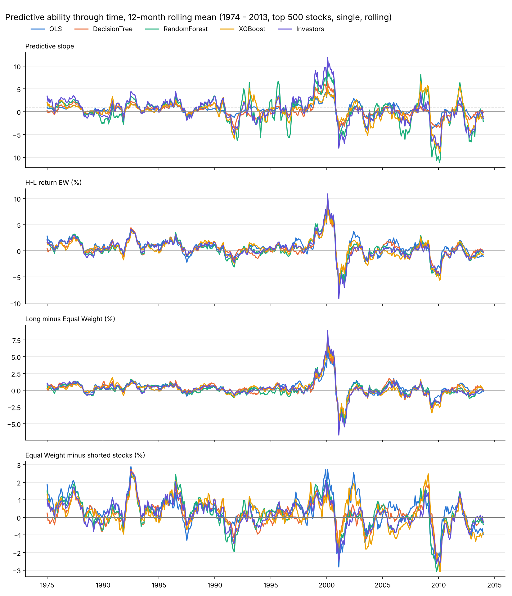
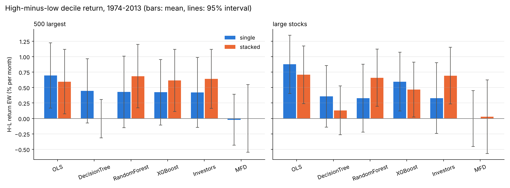

# Masterprojekt: Aktienrenditen mit Entscheidungsbäumen prognostizieren

Replikation von **Lewellen (2015), "The Cross-Section of Expected Stock Returns"**
(`ssrn-2511246.pdf` in diesem Ordner) – mit einer Änderung: Wo Lewellen eine
**lineare Regression** schätzt, verwenden wir **Machine Learning**:

| Modell | Idee in einem Satz |
| --- | --- |
| **OLS** (Benchmark) | Die lineare Regression aus dem Paper. Läuft mit, damit wir einen direkten Vergleich haben. |
| **Decision Tree** | Teilt die Aktien mit einer Folge von Ja/Nein-Fragen zu ihren Kennzahlen in Gruppen; die Prognose ist die Durchschnittsrendite der Gruppe. |
| **Random Forest** | Viele leicht unterschiedliche Bäume, deren Prognosen gemittelt werden. |
| **XGBoost** | Viele kleine Bäume nacheinander; jeder neue Baum korrigiert die Fehler der bisherigen. |
| **Investors** | 100 simulierte Investoren, jeder ein eigener Baum mit eigener Sicht auf die Daten. Ihre mittlere Prognose ist eine weitere Prognose; wie stark sie sich uneinig sind, ist die **Machine Forecast Disagreement** (Schritt 8). |

Aus Rechenzeitgründen verwenden wir pro Monat nur die **500 größten US-Aktien**.

Diese README erklärt das Verfahren Schritt für Schritt und zeigt bei jedem
Schritt die Code-Zeilen, die ihn umsetzen. Sie ist für Leser mit
Finance-Hintergrund geschrieben; Programmierkenntnisse sind nicht nötig.

---

## Inhalt

- [Schnellstart](#schnellstart)
- [Aufbau des Projekts](#aufbau-des-projekts)
- [Die Idee des Papers in fünf Sätzen](#die-idee-des-papers-in-fünf-sätzen)
- [Schritt 1: Daten und Stichprobe](#schritt-1-daten-und-stichprobe)
- [Schritt 2: Erwartete Renditen schätzen](#schritt-2-erwartete-renditen-schätzen) ← der Kern
- [Schritt 3: Fama-MacBeth-Regressionen (Tabelle 2)](#schritt-3-fama-macbeth-regressionen-tabelle-2)
- [Schritt 4: Wie gut sind die Prognosen? (Tabelle 3)](#schritt-4-wie-gut-sind-die-prognosen-tabelle-3)
- [Schritt 5: Dezilportfolios (Tabelle 6)](#schritt-5-dezilportfolios-tabelle-6)
- [Schritt 6: Handelsstrategien](#schritt-6-handelsstrategien)
- [Schritt 7: Entwicklung über die Zeit (Fig. 2)](#schritt-7-entwicklung-über-die-zeit-fig-2)
- [Schritt 8: Machine Forecast Disagreement](#schritt-8-machine-forecast-disagreement)
- [Ergebnisse](#ergebnisse)
- [Vergleich mit den Papern](#vergleich-mit-den-papern)
- [Abgleich mit dem Paper](#abgleich-mit-dem-paper)
- [Einstellungen ändern](#einstellungen-ändern)
- [Glossar](#glossar)

---

## Schnellstart

```bash
pip install -r requirements.txt
```

```bash
python main.py
```

Das Skript lädt die vorbereiteten Daten aus `data/`, rechnet alle acht
Schritte nacheinander und schreibt die Tabellen in die Konsole. Ergebnisse
(CSV-Dateien und Grafiken) landen im Ordner `output/` (Aufbau siehe unten). Die Ergebnisse des
Standardlaufs liegen dort bereits im Repository – man muss das Skript also
nicht laufen lassen, um sie anzusehen. Ein kompletter Lauf
mit allen fünf Modellen dauert auf einem Rechner mit 4 Kernen mit der
festen Standardwerten (derzeit eingestellt) jeweils etwa eine Stunde. Mit der jährlichen Wahl der Hyperparameter
(`TUNE_HYPERPARAMETERS = True`) sind es etwa 2½ Stunden, mit den large
stocks 3 (`single`) bzw. 4–5 Stunden (`stacked`). Zum schnellen Ausprobieren `MODELS_TO_RUN` in
`main.py` auf weniger Modelle kürzen.

Wenn mehrere Läufe in `output/return/` bzw. `output/rank/` liegen, fasst
`summary.py` sie zusammen (dauert nur Sekunden, es wird nichts neu geschätzt):

```bash
python summary.py
```

```bash
python summary.py rank
```

## Aufbau des Projekts

| Datei | Inhalt |
| --- | --- |
| `main.py` | **Hier anfangen.** Ein Skript, das von oben nach unten läuft: oben die Einstellungen, darunter die sieben Schritte, jeder unter einer eigenen Überschrift. |
| `models.py` | Die Modelle mit ihren Hyperparametern, die simulierten Investoren und die beiden Schätzverfahren (Schritt 2) |
| `util.py` | Werkzeugkasten: Datenaufbereitung, Fama-MacBeth-Regression, Newey-West-Test, Portfolios, Kennzahlen, Grafiken |
| `summary.py` | Liest die Ergebnisse aller Läufe einer Zielgröße und fasst sie in einer CSV und Vergleichsgrafiken zusammen (`output/return/summary/`, `output/rank/summary/`) |
| `output/` | Ergebnisse, getrennt nach Zielgröße der Bäume: `return/` (Rendite, Standard) mit `single/`, `stacked/`, `single_until_2024/`, `single_large/`, `stacked_large/`; `rank/` (Rang der Rendite) mit `single/` und `stacked/`; jeweils mit `predicted_return/` und `investor_disagreement/` – siehe [Ausgabedateien](#ausgabedateien-in-output) |
| `data/jkp_top1000_25y_5y_rank.csv.gz` | Vorbereitete Daten (aus den 6-GB-Rohdaten des Tutors erzeugt) |
| `Thema 3 - Stock Return Prediction/` | MATLAB-Skripte des Tutors, an denen sich die Datenaufbereitung orientiert |
| `ssrn-2511246.pdf` | Das Paper |

`main.py` ist durch Überschriften in die acht Schritte gegliedert, z. B.:

```python
# =============================================================================
# 4. Güte der Prognosen (Tabelle 3)
# =============================================================================
```

Was in mehreren Schritten oder für jedes Modell gebraucht wird (z. B. die
Fama-MacBeth-Regression), steht als Funktion in `util.py`; `main.py` ruft sie
mit `util.…` auf.

> **Lesehilfe Python.** `df` ist eine Tabelle (wie ein Excel-Blatt), `df["me"]`
> ist eine Spalte daraus. `for x in liste:` wiederholt den eingerückten Block
> für jedes Element. Text nach `#` ist ein Kommentar und wird nicht ausgeführt.
> `model.fit(X, y)` heißt "Modell auf X und y schätzen", `model.predict(X)`
> heißt "Prognose für X berechnen" – diese beiden Befehle gelten für alle vier
> Modelle gleich.

---

## Die Idee des Papers in fünf Sätzen

1. In jedem Monat wird eine **Querschnittsregression** geschätzt: die Renditen
   aller Aktien im nächsten Monat auf ihre heutigen Kennzahlen (Größe, B/M,
   Momentum, …). Das ist die Fama-MacBeth-Methode.
2. Die Steigungen dieser Regressionen schwanken stark von Monat zu Monat.
   Lewellen **mittelt sie daher über die letzten 10 Jahre** (120 Monate).
3. Mit diesen gemittelten Steigungen und den heutigen Kennzahlen einer Aktie
   berechnet er ihre **erwartete Rendite für den nächsten Monat** – nur mit
   Informationen, die zu diesem Zeitpunkt bekannt waren (out-of-sample).
4. Dann prüft er, ob die Prognosen etwas taugen: Haben Aktien mit hoher
   Prognose tatsächlich höhere Renditen? (Tabelle 3: Regression der
   realisierten auf die prognostizierten Renditen; Tabelle 6: Dezilportfolios.)
5. Ergebnis im Paper: Ja – die Prognosen streuen stark und sagen die
   tatsächlichen Renditen gut voraus.

**Unsere Frage:** Werden die Prognosen besser, wenn wir statt der linearen
Regression Entscheidungsbäume verwenden, die auch nichtlineare Zusammenhänge
und Wechselwirkungen zwischen den Kennzahlen erkennen können?

---

## Schritt 1: Daten und Stichprobe

**Code:** Abschnitt 1 in `main.py`, Liste der Charakteristika in `util.py`

### Die Daten

Die Daten kommen aus der **JKP-Datenbank** (Jensen, Kelly & Pedersen, "Global
Factor Data"). Sie bilden ein **Panel**: eine Zeile pro Monat und Aktie.

| eom | id | ret_exc_lead1m | me | market_equity | be_me | ret_12_1 | … |
| --- | --- | --- | --- | --- | --- | --- | --- |
| 1990-01-31 | 10107 | 0.0412 | 3 912 | 0.48 | -0.21 | 0.33 | … |
| 1990-01-31 | 10145 | -0.0170 | 1 507 | 0.39 | 0.12 | -0.05 | … |
| … | | | | | | | |

- `eom` – Monatsende, zu dem die Kennzahlen gemessen werden (Monat *t*)
- `ret_exc_lead1m` – **Überrendite der Aktie im Folgemonat** *t + 1* (das wollen wir prognostizieren)
- `me` – Marktkapitalisierung in Mio. USD (nur für die Auswahl der 500 größten und für Wertgewichte)
- 14 **Charakteristika** zum Zeitpunkt *t*

Die Zeilen eines Monats bilden einen **Querschnitt**: rund 500 Aktien × 14 Kennzahlen.
Wichtig für das Timing: Kennzahlen am Ende von Monat *t*, Rendite über Monat
*t + 1*. Dadurch wird nie eine Rendite mit Informationen "erklärt", die es zu
Beginn der Renditeperiode noch nicht gab.

### Die 14 Charakteristika (Lewellens Modell 3)

Festgelegt im Tutor-Skript `b00PrepareDataset.m`, in Python in `util.py`:

```python
JKP_CHARACTERISTICS = [
    "market_equity",   # Größe (log. Marktkapitalisierung)
    "be_me",           # Buchwert / Marktwert (B/M)
    "ret_12_1",        # Momentum: Rendite von Monat t-12 bis t-2
    "chcsho_12m",      # Aktienemissionen: Veränderung der Aktienanzahl über 12 Monate
    "oaccruals_at",    # Accruals: operative Accruals / Bilanzsumme
    "ni_at",           # Profitabilität: Return on Assets
    "at_gr1",          # Asset Growth: Wachstum der Bilanzsumme
    "beta_60m",        # Beta aus 60 Monatsrenditen
    "div12m_me",       # Dividendenrendite der letzten 12 Monate
    "ret_60_12",       # Langfristige Rendite: Monat t-60 bis t-12
    "rvol_252d",       # Volatilität der Tagesrenditen (1 Jahr)
    "turnover_126d",   # Turnover (Handelsvolumen / Aktienanzahl, 6 Monate)
    "debt_me",         # Verschuldung: Schulden / Marktwert
    "sale_me",         # Umsatz / Marktwert
]
```

Lewellens drei Modelle sind Teilmengen davon (Einstellung `FEATURE_SET` in `main.py`):

```python
LEWELLEN_MODELS = {
    "Model 1": JKP_CHARACTERISTICS[:3],   # Größe, B/M, Momentum
    "Model 2": JKP_CHARACTERISTICS[:7],   # + Emissionen, Accruals, Profitabilität, Asset Growth
    "Model 3": JKP_CHARACTERISTICS,       # alle 14
}
```

(`[:3]` heißt "die ersten drei Einträge der Liste".)

### Rangtransformation

Wie im Tutor-Skript `fCrossSectTransChars.m` wird jede Kennzahl **in jedem
Monat in Ränge umgerechnet** und auf das Intervall **[−0,5; +0,5]** skaliert.
Beispiel mit fünf Aktien und ihrem B/M in einem Monat:

| Aktie | B/M | Rang | skaliert: (Rang − 1) / (5 − 1) − 0,5 |
| --- | --- | --- | --- |
| A | 0,20 | 1 | −0,50 |
| B | 0,45 | 2 | −0,25 |
| C | 0,60 | 3 | 0,00 |
| D | 1,10 | 4 | +0,25 |
| E | 3,50 | 5 | +0,50 |

Warum? Ausreißer (Aktie E) verlieren ihren übergroßen Einfluss, und alle
Kennzahlen haben in jedem Monat dieselbe Skala. Die Steigung einer Regression
auf eine Rangvariable lässt sich direkt lesen: **Renditeunterschied zwischen der
Aktie mit dem niedrigsten und der mit dem höchsten Wert**.

```python
ranks = df.groupby("eom")[JKP_CHARACTERISTICS].rank(method="average")  # gleiche Werte: mittlerer Rang
df[JKP_CHARACTERISTICS] = (ranks - 1) / (ranks.groupby(df["eom"]).transform("max") - 1) - 0.5
```

Diese Aufbereitung (`util.build_prepared_data`) läuft nur einmal auf den 6-GB-Rohdaten
des Tutors. Das Ergebnis ist die Datei in `data/`, die `main.py` danach direkt lädt.

Die Ränge in der Datei beziehen sich auf alle Aktien der Rohdaten. Die Spalte
`is_included` (1/0) markiert die Monate, in denen eine Stammaktie (CRSP-Share-Code
10/11, ohne nano/micro, mit Rendite) zu den 1.000 größten gehört. Von diesen Aktien
enthält die Datei alle Zeilen der 25 Jahre davor und der 5 Jahre danach.

### Stichprobe: 500 größte Aktien mit vollständigen Daten

```python
df = df.sort_values([DATE, ID])
df = df[(df[DATE] >= "1964-01-01") & (df["is_included"] == 1)].dropna(subset=[RET, *features])
size_rank = df.groupby(DATE)[SIZE].rank(ascending=False, method="first")  # 1 = größte Aktie
df = df[size_rank <= UNIVERSE_SIZE].reset_index(drop=True)
df[util.JKP_CHARACTERISTICS] = util.rank_characteristics(df)
```

`DATE`, `ID`, `RET` und `SIZE` sind Kurznamen für die Spalten `eom`, `id`,
`ret_exc_lead1m` und `me`. Die Filter, Zeile für Zeile:

1. Nur Monate **ab 1964** (wie im Paper: ab dann gibt es Compustat-Daten) und
   mit `is_included = 1`; die übrigen Zeilen der Datei sind nur die Historie der Aktien.
2. `dropna`: nur Aktien, für die die Rendite und **alle 14 Kennzahlen**
   vorliegen (wie im Paper).
3. In jedem Monat (`groupby(DATE)`) die Aktien nach Marktkapitalisierung
   absteigend ranken und nur die **Ränge 1 bis 500** behalten.
4. Die Kennzahlen **innerhalb dieser Stichprobe neu ranken**.

Ergebnis: 731 Monate (Januar 1964 bis November 2024) mit je 500 Aktien; nur
in den ersten 41 Monaten (bis Mai 1967) sind es 407–499, weil noch nicht
genug Firmen alle 14 Kennzahlen haben.

Das Universum wird jeden Monat neu bestimmt; eine Aktie kann also hinein- und
herausfallen. Da die Marktkapitalisierung am Monatsende *t* bekannt ist,
entsteht dadurch kein Look-ahead-Bias.

---

## Schritt 2: Erwartete Renditen schätzen

**Code:** Abschnitt 2 in `main.py`, `fama_macbeth_forecast()` in `models.py`

Das ist der Kern der Arbeit. Wir gehen in drei Teilen vor: erst Lewellens
Verfahren, dann die Übertragung auf Machine Learning, dann der Code.

### 2a) Lewellens Verfahren

In **jedem Monat j** schätzt Lewellen eine Querschnittsregression:

```
r(i, j+1) = a(j) + b1(j) · Größe(i, j) + b2(j) · B/M(i, j) + … + Fehler
```

Das ergibt pro Monat einen Satz Koeffizienten a(j), b(j). Für die Prognose am
Ende von Monat *t* mittelt er die Koeffizienten der **letzten 120 Monate**:

```
ā = Mittelwert von a(t−120) … a(t−1)
b̄ = Mittelwert von b(t−120) … b(t−1)

Prognose(i, t) = ā + b̄1 · Größe(i, t) + b̄2 · B/M(i, t) + …
```

### 2b) Übertragung auf Machine Learning

Ein Entscheidungsbaum hat keine Steigungen, die man mitteln könnte. Wir nutzen
deshalb eine Umformung, die für die Regression **exakt dasselbe** ergibt:
Statt erst die Koeffizienten zu mitteln und dann zu prognostizieren, lassen wir
**jedes der 120 Monatsmodelle eine eigene Prognose** abgeben und **mitteln die
Prognosen**:

```
Mittel der Prognosen = 1/120 · Σ [ a(j) + b(j) · x ]
                     = 1/120 · Σ a(j)  +  (1/120 · Σ b(j)) · x
                     = ā + b̄ · x          ← genau Lewellens Prognose
```

Weil das Mitteln bei einem linearen Modell egal ist, ist unsere OLS-Prognose
**identisch mit dem Paper**. Für Bäume funktioniert dieselbe Rechnung genauso –
man ersetzt nur die Regression durch einen Baum. Damit bleibt alles andere
(Daten, Timing, Fenster, Auswertung) wie im Paper, und der einzige Unterschied
zwischen den Modellen ist das Modell selbst. Das macht den Vergleich sauber.

Zeitlich sieht das für den ersten Prognosemonat so aus (Fenster von 120 Monaten):

```
Monatsmodelle j:  1964-01   1964-02   …   1973-11   1973-12      (120 Modelle,
                  Kennzahlen Ende j  →  Rendite im Monat j + 1     je ~500 Aktien)
                     │         │             │         │
                     └─────────┴──── Mittel ─┴─────────┘
                                       │
                                       ▼
Prognose:   Kennzahlen Ende Januar 1974  →  erwartete Rendite im Februar 1974
```

Einen Monat später fällt das Modell von 1964-01 heraus und das von 1974-01
kommt hinzu – das Fenster rollt.

Präziser, mit den Zeilen des Datensatzes: Eine Zeile mit Datum *t* enthält die
Kennzahlen am Ende von *t* und die Rendite über *t + 1*.

- Monatsmodell *j* lernt aus den Zeilen von Monat *j*:
  **Kennzahlen Ende j → Rendite im Monat j + 1**.
- Die Prognose für die Zeilen von Monat *t* (also für die Rendite über *t + 1*)
  ist das Mittel der Modelle *j = t − 120, …, t − 1*.
- Das jüngste dieser Modelle (*j = t − 1*) braucht die Rendite über Monat *t* –
  die ist am Ende von *t* bekannt. **Es wird also nie in die Zukunft geschaut.**

### 2c) Die vier Modelle

Jedes Monatsmodell bekommt die rund 500 Aktien eines Monats mit ihren 14
(rangtransformierten) Kennzahlen und deren Folgemonatsrenditen.

**OLS** – die lineare Regression von oben. Eine Steigung pro Kennzahl.

**Decision Tree.** Der Baum sucht die Ja/Nein-Frage zu einer Kennzahl, die die
Aktien in zwei Gruppen mit möglichst unterschiedlichen Durchschnittsrenditen
teilt (genauer: die den quadrierten Prognosefehler am stärksten senkt). Dann
macht er in jeder Gruppe dasselbe, bis eine Abbruchregel greift. Die Prognose für
eine Aktie ist die Durchschnittsrendite der Endgruppe ("Blatt"), in der sie landet.
Ein **erfundenes** Beispiel zur Anschauung:

```
                     Momentum-Rang > 0,2 ?
                    /                     \
                 nein                      ja
       Größe-Rang < −0,3 ?           Volatilitäts-Rang > 0,4 ?
          /         \                   /            \
      +1,1 %      +0,7 %            +1,3 %         +0,6 %
```

Anders als die Regression kann der Baum so **Schwellen** ("nur extreme
Momentum-Aktien") und **Wechselwirkungen** ("Momentum wirkt nur bei kleinen
Aktien") abbilden, ohne dass wir sie vorher festlegen.

Das Risiko: Ein unbegrenzter Baum teilt so lange, bis jede Gruppe nur noch eine
Aktie enthält – dann hat er das Rauschen eines Monats auswendig gelernt
(**Overfitting**). Monatsrenditen bestehen zum größten Teil aus Rauschen; das
Begrenzen ist daher entscheidend. Das tun die **Hyperparameter**. Die
Modelle und ihre Einstellungen folgen Gu, Kelly & Xiu (2020). Es gibt zwei
Wege, die Hyperparameter festzulegen:

- **feste Standardwerte aus den Papern** (`TUNE_HYPERPARAMETERS = False`,
  derzeit eingestellt): die Werte in `MODELS`, angepasst an unsere Daten
  (siehe unten);
- **jährliche Wahl auf einer Validierung** wie bei Gu, Kelly & Xiu
  (`TUNE_HYPERPARAMETERS = True`, siehe 2i): aus `GRIDS`.

```python
MODELS = {
    # Benchmark: die lineare Regression aus dem Paper (ohne Hyperparameter)
    "OLS": LinearRegression(),
    # ein einzelner Entscheidungsbaum
    "DecisionTree": DecisionTreeRegressor(max_depth=3, min_samples_leaf=50, random_state=42),
    # Mittel vieler unabhängiger Bäume (Bagging); 300 Bäume wie bei Gu, Kelly & Xiu
    "RandomForest": RandomForestRegressor(n_estimators=300, max_depth=3, min_samples_leaf=50,
                                          max_features=3, n_jobs=-1, random_state=42),
    # Bäume nacheinander, jeder korrigiert die Fehler der vorigen (Boosting), mit Huber-Verlust
    "XGBoost": HuberBoosting(n_estimators=500, max_depth=2, learning_rate=0.01, random_state=42),
    # 100 simulierte Investoren, je ein Baum auf der Hälfte der Charakteristika (siehe 2e)
    "Investors": Investors(n_investors=100, feature_share=0.5, max_depth=3, min_samples_leaf=50, random_state=42),
}

# Mögliche Werte, aus denen jedes Jahr auf der Validierung gewählt wird (Gu, Kelly & Xiu,
# Internet Appendix Tabelle A.5)
GRIDS = {
    "DecisionTree": {"max_depth": [1, 2, 3, 4, 5, 6]},
    "RandomForest": {"max_depth": [1, 2, 3, 4, 5, 6], "max_features": [3, 5, 10]},
    "XGBoost": {"max_depth": [1, 2], "learning_rate": [0.01, 0.1], "n_estimators": [100, 300]},
    "Investors": {"max_depth": [1, 2, 3, 4, 5, 6]},
}
```

| Hyperparameter | Bedeutung | fester Standardwert | mit Validierung gewählt aus |
| --- | --- | --- | --- |
| `max_depth` | höchstens so viele Fragen hintereinander | Baum, Forest, Investors 3; XGBoost 2 | Baum, Forest, Investors 1–6; XGBoost 1–2 |
| `min_samples_leaf` | mindestens so viele Aktien pro Endgruppe – die Prognose ist also immer ein Durchschnitt über ≥ 50 Aktien | 50 | (immer 50) |
| `n_estimators` | Anzahl der Bäume | Forest 300; XGBoost 500 | Forest 300; XGBoost 100 oder 300 |
| `max_features` | Random Forest: bei jeder Frage nur aus einer zufälligen Auswahl von so vielen Kennzahlen wählen | 3 | 3, 5 oder 10 |
| `learning_rate` | XGBoost: Gewicht, mit dem jeder neue Baum in die Prognose eingeht | 0,01 | 0,01 oder 0,1 |
| Verlust | XGBoost: Huber-Verlust (siehe unten); alle anderen: quadrierter Fehler | | |

**Woher die festen Werte kommen und wie sie angepasst sind:**

- **Tiefe 3** für Random Forest, Investors und den einzelnen Baum: Das
  MFD-Paper (Tabelle B1) nutzt Tiefe 3. Bei Gu, Kelly & Xiu wählt der
  Random Forest "im Mittel ein bis fünf Ebenen" – 3 liegt in der Mitte. Für
  einen einzelnen Baum nennen die Paper keinen Wert; er bekommt dieselbe
  Tiefe.
- **`max_features = 3`:** Die Paper lassen bei jeder Frage nur einen
  kleinen Teil der Kennzahlen zu (MFD-Paper 5 %, Gu, Kelly & Xiu 3 bis 50
  von 920). Bei 14 Kennzahlen wären 5 % weniger als eine; 3 ist etwa die
  Wurzel aus 14, der übliche Standard.
- **XGBoost:** Tiefe 2, 500 Bäume und Lernrate 0,01 wie die Boosting-Variante
  im MFD-Paper (Tabelle C1, Konfiguration 18); alle drei Werte liegen im
  Raster von Gu, Kelly & Xiu. Huber-Verlust wie dort.
- **Investors:** Im MFD-Paper ist jeder Investor ein Random Forest aus 2 000
  Bäumen, jeder auf 5 % der Beobachtungen. Bei rund 500 Aktien pro Monat
  wären das 25 Aktien pro Baum – zu wenig für Tiefe 3. Daher ein Baum auf
  allen Aktien (siehe 2e).
- **`min_samples_leaf = 50`** steht in keinem der Paper: Ein Monatsmodell
  sieht nur rund 500 Aktien; mit wenigen Aktien pro Blatt würde es vor
  allem Rauschen lernen.
| `n_jobs = -1` | alle Prozessorkerne nutzen (ändert nichts am Ergebnis) | | |
| `random_state` | Startwert des Zufallsgenerators: jeder Lauf liefert dieselben Zahlen | 42 | |

Abweichungen von Gu, Kelly & Xiu: Sie haben 920 Eingaben, wir 14 – deshalb
geht `max_features` nur bis 10 statt bis in die Hunderte. XGBoost darf dort
bis zu 1 000 Bäume haben, hier höchstens 300 (Rechenzeit). `min_samples_leaf
= 50` gibt es im Paper nicht; es bleibt als Untergrenze, damit kein Blatt aus
einer Handvoll Aktien besteht.

**Random Forest** (Bagging). Ein einzelner Baum ist instabil: Ein paar andere
Aktien in der Stichprobe, und er stellt ganz andere Fragen. Der Random Forest
trainiert daher 300 Bäume, jeden auf einer zufälligen Ziehung der Aktien (mit
Zurücklegen) und mit zufälliger Auswahl der Kennzahlen pro Frage, und **mittelt
ihre Prognosen**. Das ist Diversifikation: Die Fehler der einzelnen Bäume heben
sich teilweise auf, wie das unsystematische Risiko in einem Portfolio.

**XGBoost** (Boosting). Die Bäume werden **nacheinander** gebaut. Der erste
macht eine grobe Prognose; jeder weitere Baum wird auf die **verbleibenden
Fehler** (Residuen) der bisherigen Prognose trainiert und mit dem Gewicht
`learning_rate` addiert. Die vielen kleinen Korrekturen (Tiefe nur 1 oder 2)
bauen langsam ein feineres Bild auf.

Wie bei Gu, Kelly & Xiu ("GBRT+H") lernt XGBoost mit dem **Huber-Verlust**
(Klasse `HuberBoosting` in `models.py`): Kleine Fehler zählen quadratisch wie
sonst, große Fehler nur linear. Eine einzelne Aktie, die sich in einem Monat
verdreifacht, verbiegt das Modell so weniger. Die Grenze zwischen "klein" und
"groß" liegt wie im Paper beim 99,9-%-Quantil der absoluten Abweichungen vom
Median im Training; gestartet wird beim Median der Renditen.

### 2d) Der Code der Schätzung

Die ganze Logik von 2a und 2b steckt in einer Funktion,
`fama_macbeth_forecast()` in `models.py`. Gekürzt auf das Wesentliche:

```python
forecast_sum = empty_forecast(model, len(y))  # Summe der Prognosen je Aktie und Monat
n_models = np.zeros(len(y))                   # Anzahl der Monatsmodelle, die diese Prognose enthält

first_model = 0 if expanding else max(first - window, 0)
for j in range(first_model, last):
    # 1. Modell auf dem Querschnitt von Monat j trainieren (ca. 500 Aktien x 14 Charakteristika)
    in_month_j = month_nr == j
    fitted = clone(model).fit(X[in_month_j], y[in_month_j])

    # 2. Damit alle Aktien der Monate j + 1 ... j + window prognostizieren (expanding: alle späteren)
    last_month = last if expanding else min(j + window, last)
    in_forecast_months = (month_nr > j) & (month_nr >= first) & (month_nr <= last_month)
    forecast_sum[..., in_forecast_months] += predict(fitted, X[in_forecast_months])
    n_models[in_forecast_months] += 1

# 3. Mittelwert: Summe der Prognosen / Anzahl der Modelle
return forecast_sum / n_models, importances
```

Was hier passiert:

- `month_nr` nummeriert die Monate durch (0 = Januar 1964, 1 = Februar 1964, …);
  `first` und `last` sind die Nummern des ersten und letzten Prognosemonats
  (Januar 1974 und Dezember 2013).
- `X` sind die Kennzahlen aller Zeilen, `y` die Folgemonatsrenditen.
  `X[in_month_j]` wählt die Zeilen von Monat *j* aus.
- Die Schleife `for j in …` geht Monat für Monat durch. In jedem Monat wird
  **ein frisches Modell** (`clone(model)`) auf genau diesem einen Querschnitt
  geschätzt (`.fit`).
- Statt "für Monat *t* die Modelle *t − 120 … t − 1* einsammeln" dreht der Code
  die Blickrichtung um: **Jedes Modell *j* prognostiziert sofort alle Monate,
  in deren Fenster es liegt** (*j + 1 … j + 120*), und legt seine Prognose in
  `forecast_sum` ab. `n_models` zählt mit, wie viele Modelle zu jeder Prognose
  beigetragen haben. Das ergibt dasselbe, ist aber viel schneller, weil jedes
  Modell nur einmal aufgerufen wird.
- Am Ende ist `forecast_sum / n_models` der **Mittelwert der Prognosen der
  letzten 120 Monatsmodelle** – für jede Aktie in jedem Monat.

(`[..., …]` bedeutet: funktioniert auch, wenn die Prognose bei den Investors
eine Tabelle mit einer Zeile pro Investor ist.)

In `main.py` wird diese Funktion – oder `stacked_forecast`, siehe 2h – für jedes
Modell aufgerufen:

```python
for name in MODELS_TO_RUN:
    forecast, model_importances = estimate(models.MODELS[name], X, y, month_nr, first, last, TRAIN_WINDOW,
                                           expanding=WINDOW_TYPE == "expanding", label=name, **options)
```

Das Ergebnis ist die Tabelle `preds` mit einer Zeile pro (Monat, Aktie):
realisierte Rendite plus je eine Prognosespalte `OLS`, `DecisionTree`,
`RandomForest`, `XGBoost`. Alle folgenden Schritte arbeiten nur noch mit
dieser Tabelle.

**Minimale Historie:** Vor der ersten Prognose müssen 120 Monate liegen
(`first = max(TRAIN_WINDOW, …)`). Mit Daten ab Januar 1964 ist Januar 1974 der
erste Prognosemonat – jede Prognose beruht also auf vollen 120 Monatsmodellen;
eine Anlaufphase mit kürzeren Fenstern gibt es nicht.

### 2g) Rollendes oder wachsendes Fenster (`WINDOW_TYPE`)

| `WINDOW_TYPE` | Prognose für Monat *t* nutzt | im Paper |
| --- | --- | --- |
| `"rolling"` (Standard) | die Monate *t − 120 … t − 1* | Hauptergebnis ("rolling slopes") |
| `"expanding"` | alle Monate seit Januar 1964 bis *t − 1* (mindestens 120) | "cumulative slopes" in Tabelle 3 |

Im Code ist der Unterschied eine Zeile: Beim wachsenden Fenster beginnt die
Schleife beim ersten Monat und jedes Modell prognostiziert alle späteren
Monate.

```python
first_model = 0 if expanding else max(first - window, 0)
...
last_month = last if expanding else min(j + window, last)
```

Im ersten Prognosemonat (Januar 1974) sind beide gleich, weil es noch genau
120 Monate Historie gibt; danach wächst das Fenster bis auf 600 Monate (2013).

### 2h) Einzelne Monatsmodelle oder gestapelte Daten (`ESTIMATION`)

| `ESTIMATION` | Training | Prognose | Vorbild |
| --- | --- | --- | --- |
| `"single"` (Standard) | **120 Modelle**, jedes auf **einem** Monat (~500 Zeilen) | Mittel der 120 Prognosen | Lewellen (2015) |
| `"stacked"` | **ein Modell** auf allen 120 Monaten **untereinandergestapelt** (~60 000 Zeilen) | direkt die Prognose dieses Modells; neu trainiert alle `REFIT_EVERY` Monate (Standard: jeden Monat) | Gu, Kelly & Xiu (2020); auch das MFD-Paper |

Beide Verfahren nutzen dieselben Informationen (die 10 Jahre vor *t*). Der
Unterschied: Beim Stapeln sieht **ein** Baum 60 000 Beobachtungen und kann
feinere Muster lernen, die über die Jahre stabil sind; beim Fama-MacBeth-Weg
lernt jeder Baum nur aus einem Monat, und erst das Mitteln glättet das
Rauschen. Für OLS liefern beide fast dasselbe; für die Bäume können sie sich
deutlich unterscheiden.

Neu trainiert wird standardmäßig **jeden Monat** (`REFIT_EVERY = 1`). So
nutzt `stacked` in jedem Monat genau dieselben Daten wie `single`, und der
Vergleich misst nur den Unterschied zwischen Stapeln und Mitteln. Gu, Kelly &
Xiu trainieren aus Rechenzeitgründen nur einmal im Jahr neu (`REFIT_EVERY = 12`);
dann ist das Modell bis zu 11 Monate alt. In einem früheren Stand mit
festen Hyperparametern lag die H−L-Rendite bei den 500 größten Aktien so bei
OLS bei 0,54 statt 0,59 %, bei XGBoost bei 0,58 statt 0,81 % pro Monat; nur
der Random Forest kam mit 0,80 statt 0,76 % etwa gleich heraus.

```python
for i, t in enumerate(refit_months, start=1):
    # 1. Trainingsdaten: alle Zeilen der Monate im Fenster vor t
    in_window = (month_nr >= (0 if expanding else t - window)) & (month_nr < t)
    fitted = clone(model).fit(X[in_window], y[in_window])

    # 2. Prognose für die Monate t ... t + refit_every - 1
    in_forecast_months = (month_nr >= t) & (month_nr <= min(t + refit_every - 1, last))
    forecast[..., in_forecast_months] = predict(fitted, X[in_forecast_months])
```

Das Modell, das ab Januar 1974 prognostiziert, ist auf Januar 1964 bis
Dezember 1973 trainiert und prognostiziert nur Januar 1974; für Februar rückt
das Fenster um einen Monat weiter (mit `REFIT_EVERY = 12`: Modell für 12
Monate, dann 12 Monate weiter). Auch hier gibt es keine Zukunftsdaten: Die
jüngste Trainingszeile (Dezember 1973) enthält die Rendite im Januar 1974, die
am Ende von Januar 1974 bekannt ist.

### 2i) Hyperparameter auf einer Validierung wählen (`TUNE_HYPERPARAMETERS`)

Welche Baumtiefe die richtige ist, weiß man vorher nicht. Gu, Kelly & Xiu
wählen sie deshalb auf einer **Validierung**: Das Modell lernt auf einem
älteren Teil der Daten und wird auf einem jüngeren Teil geprüft, den es
nicht gesehen hat. Gewonnen hat die Einstellung mit dem kleinsten
Prognosefehler (mittlerer quadrierter Fehler, MSE). Wir machen das genauso,
mit einem Unterschied: Bei uns rollt das Fenster von 120 Monaten, im Paper
wächst der Trainingsteil.

```
Fenster vor dem Auswahltermin s (120 Monate):

   s − 120 ................ s − 37 | s − 36 .......... s − 1 | s ...... s + 11
   Training (84 Monate)            | Validierung (36 Mon.) | Prognose (12 Monate)
   jede Einstellung aus GRIDS lernt | und wird hier geprüft  | mit der besten Einstellung,
                                                             | trainiert auf allen 120 Monaten
```

- **Einmal im Jahr** (`RETUNE_EVERY = 12`, erstmals Januar 1974) wird jede
  Einstellung aus `GRIDS` auf den ersten 84 Monaten des Fensters trainiert
  und auf den letzten 36 (`VALIDATION_MONTHS`) geprüft.
- Die beste Einstellung gilt für die nächsten 12 Prognosemonate. Prognostiziert
  wird damit wie ohne Validierung: Das Modell lernt auf dem **ganzen** Fenster
  von 120 Monaten. Die Validierung entscheidet also nur über die Einstellung,
  sie kostet keine Daten.
- **`single` und `stacked` werden gleich behandelt:** dieselben Daten, dieselbe
  Aufteilung, derselbe Verlust und dieselben `GRIDS`. Bei `single` ist die
  Validierungsprognose das Mittel der 84 Monatsmodelle des Trainingsteils,
  bei `stacked` die Prognose eines Modells auf den 84 gestapelten Monaten.
  Der einzige Unterschied bleibt das Mitteln gegenüber dem Stapeln – und
  `stacked` *kann* tiefere Bäume wählen, wenn die vielen Daten das hergeben.
- **OLS** hat keine Hyperparameter und bleibt Lewellens Regression.
- Es gibt keine Zukunftsdaten: Die jüngste Validierungszeile (Monat *s* − 1)
  enthält die Rendite im Monat *s*, die vor der ersten Prognose am Ende von
  *s* bekannt ist – genau wie beim Training.

Welche Einstellung in welchem Jahr gewonnen hat, steht in
`predicted_return/hyperparameters.csv` (eine Zeile pro Modell und Jahr, mit
dem MSE der besten und der schlechtesten Einstellung); `main.py` druckt
außerdem, wie oft jede Einstellung gewählt wurde.

Rechenaufwand: Bei `single` wird jedes Monatsmodell für jede Einstellung nur
einmal geschätzt und sowohl für die Validierung als auch für die Prognose
genutzt. Bei `stacked` kommen pro Jahr die Modelle auf den 84 Monaten hinzu.

### 2j) Zielgröße der Bäume: Rendite oder Rang (`TARGET`)

Standardmäßig lernen die Bäume wie bei Gu, Kelly & Xiu die **Rendite** im
Folgemonat (`TARGET = "return"`). Mit `TARGET = "rank"` lernen sie
stattdessen den **Rang der Rendite innerhalb des Monats**, skaliert auf
−0,5 (schlechteste Aktie des Monats) bis +0,5 (beste) – genauso wie die
Kennzahlen:

```python
# Zielgröße der Bäume: die Rendite selbst oder ihr Rang im Monat. Ausgewertet wird immer mit der Rendite.
y_trees = util.rank_returns(df) if TARGET == "rank" else y
...
target = y if name == "OLS" else y_trees
```

Warum das helfen kann:

- **Das Marktniveau fällt weg.** Ob der Markt in einem Monat +8 % oder −8 %
  macht, ist für die Sortierung der Aktien egal, macht aber einen großen
  Teil des quadrierten Fehlers aus. Mit Rängen hat jeder Monat dasselbe
  Niveau.
- **Ausreißer fallen weg.** Eine Aktie, die sich verdreifacht, ist einfach
  die beste des Monats (+0,5). Ein Blatt des Baums wird nicht mehr von
  einzelnen extremen Renditen bestimmt.
- **Das Ziel passt zur Auswertung.** Dezile, Strategien und IC hängen nur
  von der Reihenfolge der Prognosen ab, nicht von ihrer Höhe.

Alles andere bleibt gleich: dieselben Daten, Fenster, `GRIDS` und dieselbe
Validierung; der Validierungsfehler wird dann auf den Rängen gemessen.
**OLS lernt immer die Rendite**, damit Lewellen exakt repliziert bleibt.

Wichtig beim Lesen der Ergebnisse: Die Prognosen der Bäume sind dann
**erwartete Ränge, keine Renditen**. Vergleichbar mit dem Lauf auf
Renditen sind alles, was nur von der Reihenfolge abhängt (H−L-Rendite,
Long, Short, Long-Short, IC) sowie die t-Statistik der Steigung. Die Höhe
der Prognosen (Avg, Std, Pred in den Dezilen), die Steigung selbst sowie
RMSE, R² OOS und Hit rate sind in anderen Einheiten und nicht vergleichbar.
Dasselbe gilt für die Höhe der MFD.

### 2e) Investors: 100 simulierte Investoren

Das fünfte Modell stammt aus Bali, Kelly, Mörke & Rahman (2026), "Machine
Forecast Disagreement". Die Idee: Echte Investoren nutzen dieselben Daten,
schauen aber auf unterschiedliche Kennzahlen und verarbeiten sie
unterschiedlich – deshalb sind sie sich uneinig. Das Paper simuliert das mit
vielen Machine-Learning-Modellen, die sich auf zwei Arten unterscheiden:

1. **Information:** Jeder Investor sieht nur eine feste, zufällig gewählte
   Hälfte der Kennzahlen (bei uns 7 von 14). Investor A schaut vielleicht auf
   Momentum und Volatilität, Investor B auf B/M und Dividendenrendite.
2. **Modell:** Jeder schätzt sein Modell auf einer eigenen Zufallsstichprobe
   der Aktien (Bootstrap) – wie die Bäume eines Random Forest.

In `models.py` ist jeder Investor **ein einzelner, gespeicherter
Entscheidungsbaum**. Seine Tiefe wird wie bei den anderen Bäumen jedes Jahr
auf der Validierung gewählt (1–6; ohne Validierung 3 wie im Paper):

```python
# 1. Informationsmenge jedes Investors (bei gleichem random_state in jeder Schätzung dieselbe)
feature_rng = np.random.default_rng(self.random_state)
self.features_ = [np.sort(feature_rng.choice(n_features, n_seen, replace=False))
                  for _ in range(self.n_investors)]
# 2. Bootstrap genau wie sklearns RandomForestRegressor: je Baum ein eigener Startwert, daraus
#    n Zeilen mit Zurücklegen; gezogene Zeilen gehen mit ihrer Häufigkeit als Gewicht ein
#    (min_samples_leaf zählt also verschiedene Aktien, nicht Kopien derselben Aktie)
seed_rng = np.random.RandomState(self.random_state)
self.trees_ = []
for cols in self.features_:
    seed = seed_rng.randint(np.iinfo(np.int32).max)
    rows = np.random.RandomState(seed).randint(0, n_rows, n_rows)
    tree = DecisionTreeRegressor(max_depth=self.max_depth, min_samples_leaf=self.min_samples_leaf,
                                 random_state=seed)
    self.trees_.append(tree.fit(X[:, cols], y, sample_weight=np.bincount(rows, minlength=n_rows)))
```

**Dieselben Regeln wie sklearns Random Forest.** Bootstrap, Startwerte und
Baumparameter folgen genau `RandomForestRegressor` (`bootstrap=True`):

| Regel | sklearn `RandomForestRegressor` | `Investors` |
| --- | --- | --- |
| Größe der Bootstrap-Stichprobe | *n* Zeilen mit Zurücklegen (`max_samples=None`) | gleich |
| Wie die Stichprobe eingeht | jede Zeile mit ihrer Häufigkeit als Gewicht (`sample_weight`), nicht gezogene mit Gewicht 0 | gleich |
| `min_samples_leaf = 50` | zählt verschiedene gezogene Aktien, nicht doppelt gezogene Kopien | gleich |
| Startwerte | je Baum `randint` aus `RandomState(random_state)`; derselbe Wert für Stichprobe und Baum | gleich |
| Anzahl Kennzahlen bei einem Anteil | `max(1, int(Anteil × 14))` | gleich (7 von 14) |
| Welche Kennzahlen | bei **jeder Verzweigung** neu gezogen (`max_features`) | **eine feste Teilmenge pro Investor** – gewollt, das ist die Informationsmenge aus dem Paper |

Geprüft: Mit `feature_share = 1.0` (alle Kennzahlen) liefert `Investors` exakt
dieselben 100 Bäume – gleiche Verzweigungen, gleiche Prognosen bis auf die
letzte Nachkommastelle – wie
`RandomForestRegressor(n_estimators=100, max_depth=3, min_samples_leaf=50, max_features=1.0, random_state=42)`.
Der einzige Unterschied ist damit die feste Informationsmenge.

Weil jeder Baum einzeln gespeichert ist, kann jeder Investor seine eigene
Prognose abgeben (`predict_each`: eine Zeile pro Investor). Ihr Mittelwert ist
die Prognose des Modells "Investors", die wie die anderen Modelle in den
Schritten 3–7 ausgewertet wird; ihre Standardabweichung ist die
Disagreement (Schritt 8). Die Informationsmenge jedes Investors bleibt über
alle Schätzungen gleich – Investor 7 ist also in jedem Monat derselbe
"Typ".

Vereinfachung gegenüber dem Paper: Dort ist jeder Investor ein ganzer Random
Forest mit 2 000 Bäumen auf 76 von 153 Kennzahlen. Wir haben nur 14 Kennzahlen
und nutzen pro Investor einen Baum – das hält die Rechenzeit klein und jeder
Baum ist direkt ein Investor.

### 2f) Feature Importance

Bäume berichten, wie stark jede Kennzahl den Prognosefehler beim Aufteilen
gesenkt hat (`feature_importances_`). Wir mitteln das über alle Monatsmodelle;
`main.py` druckt die zehn wichtigsten Kennzahlen. Das ist das Gegenstück zu den
t-Statistiken der Regression – es zeigt, worauf die Bäume ihre Prognosen
stützen, aber nicht in welche Richtung.

---

## Schritt 3: Fama-MacBeth-Regressionen (Tabelle 2)

**Code:** Abschnitt 3 in `main.py`, `fama_macbeth()` in `util.py`

Zur Einordnung reproduzieren wir Lewellens Tabelle 2: die über alle Monate
gemittelten Steigungen der Querschnittsregressionen, für unsere Stichprobe.
(Code-Auszüge in dieser README sind teils leicht gekürzt.)

```python
# 1. Querschnittsregression pro Monat
monthly = []
for date, g in df.groupby(DATE):
    fit = sm.OLS(g[y_col], sm.add_constant(g[x_cols])).fit()
    monthly.append({DATE: date, **fit.params.rename({"const": "Intercept"}),
                    "R2": fit.rsquared, "N": int(fit.nobs)})

# 2. Mittelwert und Newey-West-t-Statistik der monatlichen Koeffizienten
coefs = monthly.drop(columns=["R2", "N"])
table = pd.DataFrame([newey_west_test(coefs[c]) for c in coefs],
                     index=coefs.columns, columns=["Coef", "S.E.", "t-stat"])
```

1. `df.groupby(DATE)` teilt die Daten in Monate; für jeden Monat `g` wird
   mit `statsmodels` eine OLS-Regression der Renditen auf die Kennzahlen plus
   Konstante geschätzt und die Koeffizienten werden gespeichert.
2. Für jede Kennzahl ergibt das eine Zeitreihe von ~600 Steigungen. Deren
   **Mittelwert** ist der Fama-MacBeth-Koeffizient; die **t-Statistik**
   kommt aus der Streuung dieser Zeitreihe.

Wie im Paper werden die Standardfehler nach **Newey-West mit 4 Lags** korrigiert,
weil die monatlichen Steigungen autokorreliert sein können. Technisch ist das
eine Regression der Zeitreihe auf eine Konstante (= ihr Mittelwert) mit
HAC-Standardfehlern:

```python
def newey_west_test(series, lags=4):
    y = pd.Series(series).dropna().to_numpy()
    fit = sm.OLS(y, np.ones(len(y))).fit(cov_type="HAC", cov_kwds={"maxlags": lags})
    return fit.params[0], fit.bse[0], fit.tvalues[0]
```

**Lesart:** Da die Kennzahlen Ränge in [−0,5; 0,5] sind, ist eine Steigung von
0,50 (in % pro Monat) beim Momentum so zu lesen: Die Aktie mit dem höchsten
Momentum hat – bei sonst gleichen Kennzahlen – eine um 0,5 Prozentpunkte pro
Monat höhere erwartete Rendite als die mit dem niedrigsten.

---

## Schritt 4: Wie gut sind die Prognosen? (Tabelle 3)

**Code:** Abschnitt 4 in `main.py`, `forecast_evaluation()` und
`prediction_metrics()` in `util.py`

### Tabelle 3 wie im Paper

```python
dist = preds.groupby(DATE)[model].describe(percentiles=[0.1, 0.9]).mean() * 100
table, monthly = fama_macbeth(preds, RET, [model])
```

**Linker Teil – Verteilung der Prognosen** (`dist`): In jedem Monat Mittelwert,
Standardabweichung sowie 10 %- und 90 %-Quantil der Prognosen über alle Aktien,
dann über die Monate gemittelt. Eine große Streuung heißt: Das Modell traut sich,
Aktien deutlich zu unterscheiden.

**Rechter Teil – Prognosegüte**: Dieselbe Fama-MacBeth-Funktion aus Schritt 3,
aber jetzt mit nur einer erklärenden Variablen – der Prognose:

```
r(i, t+1) = α(t) + β(t) · Prognose(i, t) + Fehler
```

Die gemittelte Steigung β ist die zentrale Kennzahl des Papers:

| Steigung | Bedeutung |
| --- | --- |
| **β = 1** | Ideal: Ein Prozentpunkt mehr Prognose bedeutet im Schnitt einen Prozentpunkt mehr Rendite. |
| **0 < β < 1** | Die Prognose trennt gute und schlechte Aktien, übertreibt aber die Unterschiede. |
| **β = 0** | Die Prognose ist wertlos. |

Die t-Statistik (Newey-West) zeigt, ob β signifikant von null verschieden ist.
Lewellen findet für große Aktien Steigungen von 0,44–0,72.

### Weitere Kennzahlen aus der Machine-Learning-Literatur

| Kennzahl | Bedeutung |
| --- | --- |
| `RMSE`, `MAE` | durchschnittlicher Prognosefehler (Wurzel des mittleren quadratischen bzw. mittlerer absoluter Fehler) |
| `R2 OOS` | 1 − Σ(r − Prognose)² / Σ r² nach Gu, Kelly & Xiu (2020): Vergleich mit einer Prognose von null. Schon leicht positive Werte sind bei Monatsrenditen gut. |
| `IC mean` | **Information Coefficient**: Rangkorrelation zwischen Prognose und realisierter Rendite in jedem Monat, gemittelt. Misst, ob die *Reihenfolge* der Aktien stimmt – das ist für eine Long-Short-Strategie entscheidend. |
| `IC IR`, `IC t-stat` | Mittelwert / Standardabweichung des IC bzw. t-Test, ob der IC über die Zeit verlässlich positiv ist |
| `Hit rate` | Anteil der Prognosen mit dem richtigen Vorzeichen |

Außerdem zeigt `main.py` die mittlere Korrelation der Prognosen verschiedener
Modelle (vgl. Lewellens Tabelle 4): Sagen die Bäume etwas anderes als OLS?

---

## Schritt 5: Dezilportfolios (Tabelle 6)

**Code:** Abschnitt 5 in `main.py`, `sorted_portfolios()` und `portfolio_returns()` in `util.py`

Jeden Monat werden die Aktien nach ihrer Prognose in **10 gleich große
Portfolios** sortiert (Dezil 1 = niedrigste Prognose, Dezil 10 = höchste):

```python
df["portfolio"] = df.groupby(DATE)[model].transform(
    lambda s: pd.qcut((sign * s).rank(method="first"), n_groups, labels=False) + 1)
```

(`sign` ist 1 für die Prognosen und −1 für die Disagreement, siehe Schritt 8.)

Für jedes Portfolio wird die Rendite im Folgemonat berechnet –
**gleichgewichtet (EW)** und **wertgewichtet (VW)** nach Marktkapitalisierung –
und zusätzlich das **High-minus-Low-Portfolio H−L** (Dezil 10 long, Dezil 1 short):

```python
pred, ret = means[model].unstack(), means[RET].unstack()  # Monate x Portfolios
pred["H-L"] = pred[n_groups] - pred[1]
ret["H-L"] = ret[n_groups] - ret[1]
```

Die Tabelle zeigt pro Portfolio die mittlere **Prognose** (`Pred`), die
mittlere **realisierte Rendite** (`Avg`), deren Standardabweichung, die
annualisierte Sharpe Ratio und die Newey-West-t-Statistik.

**Lesart:** Ein gutes Modell zeigt eine **monoton steigende** Rendite von Low
nach High und eine signifikant positive H−L-Rendite. `Pred` und `Avg`
nebeneinander zeigen, ob die Prognosen die tatsächlichen Unterschiede über-
oder unterschätzen (vgl. die Steigung aus Schritt 4).

---

## Schritt 6: Handelsstrategien

**Code:** Abschnitt 6 in `main.py`, `strategy_returns()`, `backtest()` und
`performance_metrics()` in `util.py`

Zum Schluss drei einfache Strategien, jeden Monat neu zusammengestellt und
gleichgewichtet. Benchmark ist das gleichgewichtete Portfolio aller 500 Aktien
("Equal Weight").

| Strategie | Was passiert | Einstellung |
| --- | --- | --- |
| **Long** | die 10 % Aktien mit der höchsten Prognose kaufen | `LONG_PCT = 0.10` |
| **Short** | die 10 % Aktien mit der niedrigsten Prognose leerverkaufen | `SHORT_PCT = 0.10` |
| **Long-Short** | beides zugleich; der Erlös aus dem Leerverkauf bezahlt den Kauf (selbstfinanzierend) | beide |

Alle drei rechnet eine Funktion, die einen Long- und einen Short-Anteil
bekommt:

```python
for date, g in preds.groupby(DATE):
    # realisierte Renditen, sortiert von der besten zur schlechtesten Aktie nach `model`
    realised = g.sort_values(model, ascending=not high_is_good, kind="stable")[RET]
    ret = 0.0
    if long_pct > 0:
        n_long = max(1, int(round(len(realised) * long_pct)))  # mindestens 1 Aktie
        ret += realised.iloc[:n_long].mean()
    if short_pct > 0:
        n_short = max(1, int(round(len(realised) * short_pct)))
        ret -= realised.iloc[-n_short:].mean()
    returns[date] = ret
```

Für jeden Monat: Aktien nach Prognose sortieren; die ersten 10 %
(`iloc[:n_long]`) werden gekauft, die letzten 10 % (`iloc[-n_short:]`)
leerverkauft. Die Rendite eines Leerverkaufs ist minus die Rendite der Aktie.
In `main.py` legt ein Dictionary die drei Strategien fest:

```python
STRATEGIES = {"Long": (LONG_PCT, 0.0), "Short": (0.0, SHORT_PCT), "Long-Short": (LONG_PCT, SHORT_PCT)}
strategy = util.backtest(preds, MODELS_TO_RUN, STRATEGIES)  # Spalten: (Strategie, Modell) plus Equal Weight
```

Zum Lesen der Ergebnisse:

- **Long** vergleicht man direkt mit Equal Weight.
- **Short** allein verliert fast immer Geld, weil Aktien im Schnitt steigen.
  Entscheidend ist, ob die leerverkauften Aktien **schlechter als der Markt**
  waren. Das zeigt die Kennzahl "Equal Weight minus leerverkaufte Aktien" in
  Schritt 7.
- **Long-Short** mit 10 % / 10 % ist gleichgewichtet genau das H−L-Portfolio
  aus Tabelle 6 (High-Dezil minus Low-Dezil); nur bei exakt gleichen
  Prognosen können einzelne Aktien anders zugeordnet werden.

Daraus die Kennzahlen:

```python
wealth = (1 + returns).cumprod()
...
"Ann. Return": wealth.iloc[-1] ** (12 / len(returns)) - 1,   # geometrisch (CAGR)
"Ann. Volatility": returns.std() * np.sqrt(12),
"Sharpe Ratio": returns.mean() / returns.std() * np.sqrt(12),
"Max Drawdown": (wealth / peak - 1).min(),
```

| Kennzahl | Berechnung |
| --- | --- |
| Ann. Return | geometrische Rendite p. a. (CAGR) aus dem Endvermögen |
| Ann. Volatility | Standardabweichung der Monatsrenditen × √12 |
| Sharpe Ratio | mittlere Überrendite / Standardabweichung × √12 (die JKP-Renditen sind bereits Überrenditen über den risikofreien Zins) |
| Max Drawdown | größter prozentualer Verlust vom bisherigen Höchststand |

Die Grafiken `performance_long.png`, `performance_short.png` und
`performance_long-short.png` in `output/return/single/predicted_return/` zeigen die
Wertentwicklung von 1 investierten Dollar je Modell gegen Equal Weight
(logarithmische Skala: gleiche prozentuale Rendite ergibt gleiche Steigung).
Statt der Investors-Prognose (sie steht in den Tabellen) zeigen sie die
Strategie nach der Disagreement (MFD, Schritt 8): Long = geringste,
Short = höchste Disagreement.
Für Long-Short ist das eine Näherung: Man stellt sich vor, das Kapital liegt
als Sicherheit und erhält zusätzlich die Long-Short-Rendite.

Hinweis: Transaktionskosten und Leihgebühren für Leerverkäufe sind nicht
berücksichtigt; da jeden Monat neu sortiert wird, kann der Umschlag hoch sein.

---

## Schritt 7: Entwicklung über die Zeit (Fig. 2)

**Code:** Abschnitt 7 in `main.py`, `trend_test()` und `plot_time_variation()` in `util.py`

Die Tabellen 3 und 6 zeigen Durchschnitte über 40 Jahre. Sie sagen nicht, ob
die Prognosen **immer** gleich gut waren oder ob ihre Güte mit der Zeit
**nachlässt**. Lewellen untersucht das in Abschnitt 3.6 und Fig. 2. Die Frage
ist wichtig: Werden Anomalien bekannt und gehandelt, könnten sie
verschwinden (McLean & Pontiff, 2016).

### Vier Kennzahlen pro Monat

```python
series = {
    "Predictive slope": pd.DataFrame(
        {name: util.fama_macbeth(preds, RET, [name])[1][name] for name in MODELS_TO_RUN}),
    "H-L return EW (%)": pd.DataFrame(
        {name: util.portfolio_returns(preds, name)[1]["H-L"] for name in MODELS_TO_RUN}) * 100,
    "Long minus Equal Weight (%)": strategy["Long"].sub(equal_weight, axis=0) * 100,
    "Equal Weight minus shorted stocks (%)": strategy["Short"].add(equal_weight, axis=0) * 100,
}
```

| Kennzahl | Was sie misst | Mittelwert über alle Monate = |
| --- | --- | --- |
| **Prognose-Steigung** | Steigung der Querschnittsregression realisierte Rendite auf Prognose, **in diesem einen Monat** | Steigung aus Tabelle 3 |
| **H−L-Rendite** | Rendite Dezil 10 minus Dezil 1 in diesem Monat (gleichgewichtet) | H−L aus Tabelle 6 |
| **Long-Seite** | Rendite der gekauften 10 % minus Equal Weight | wie viel besser die Long-Strategie war |
| **Short-Seite** | Equal Weight minus Rendite der leerverkauften 10 % | wie viel schlechter die leerverkauften Aktien waren |

Die ersten beiden sind genau Lewellens zwei Panels in Fig. 2. Die letzten
beiden teilen die H−L-Rendite in ihre zwei Hälften: Long-Seite + Short-Seite
≈ H−L. So sieht man, ob der Gewinn eher aus guten Käufen oder aus guten
Leerverkäufen kommt.

### Gleitender Mittelwert

Einzelne Monatswerte sind sehr verrauscht (eine Steigung kann in einem Monat
+8 und im nächsten −6 sein). Deshalb zeigen die Grafiken den **gleitenden
Mittelwert**: Jeder Punkt ist der Durchschnitt der letzten *n* Monate.

```python
rolling = monthly.rolling(window).mean()
```

Es gibt zwei Grafiken:

- `time_variation_12m.png` – **12 Monate**: zeigt einzelne Jahre und
  Krisen deutlich, schwankt aber stark (Einstellung `ROLLING_MONTHS`).
- `time_variation_120m.png` – **120 Monate**, wie Lewellens Fig. 2:
  zeigt den langfristigen Verlauf. Der erste Punkt liegt Ende 1983, weil
  dafür 10 Jahre Prognosen nötig sind.

### Test auf einen Rückgang

Die Grafik zeigt einen Eindruck, ein Test macht daraus eine Aussage.
`trend_test()` prüft jede Monatsreihe auf zwei Arten:

```python
halves = sm.OLS(y.to_numpy(), sm.add_constant(second_half)).fit(**hac)
trend = sm.OLS(y.to_numpy(), sm.add_constant(np.asarray(decades))).fit(**hac)
```

1. **Hälftenvergleich**: Regression der Monatswerte auf eine Dummy-Variable,
   die in der zweiten Hälfte (1994–2013) 1 ist. Der Koeffizient ist genau die
   Differenz der Mittelwerte "zweite minus erste Hälfte".
2. **Linearer Trend**: Regression auf die Zeit, gemessen in Jahrzehnten. Der
   Koeffizient ist die durchschnittliche Veränderung pro 10 Jahre.

Beide mit Newey-West-Standardfehlern (4 Lags), wie überall im Paper.
**Ein negativer Wert mit |t| > 2 spricht für einen signifikanten Rückgang.**

## Schritt 8: Machine Forecast Disagreement

**Code:** Abschnitt 8 in `main.py`, Klasse `Investors` in `models.py`

Bali, Kelly, Mörke & Rahman (2026) zeigen: Aktien, bei denen sich viele
Prognosemodelle **uneinig** sind, haben im Folgemonat **niedrigere**
Renditen. Ihre Erklärung folgt Miller (1977): Wenn Investoren uneinig sind
und Leerverkäufe teuer, bestimmen die Optimisten den Preis – die Aktie ist
überbewertet und fällt später.

### Berechnung

Für jede Aktie und jeden Monat geben die 100 Investoren aus 2e je eine
Prognose ab. Die Disagreement ist deren Standardabweichung (Gleichung 4 im
Paper):

```
MFD(i, t) = Standardabweichung über k = 1 … 100 von Prognose_k(i, t)
```

```python
investor_forecasts = forecast[:, is_test_row]
preds[name] = investor_forecasts.mean(axis=0)
preds["MFD"] = investor_forecasts.std(axis=0)  # Standardabweichung über die 100 Investoren
```

Im Modus `"single"` ist die Prognose von Investor *k* das Mittel seiner
120 Monatsbäume; im Modus `"stacked"` die Prognose seines einen Baums.

### Auswertung: dasselbe wie für die Prognosen, nur nach Disagreement

Die Disagreement wird genauso ausgewertet wie die Renditeprognosen in den
Schritten 4–7; die Ergebnisse liegen im Ordner `investor_disagreement/`
neben `predicted_return/`.

**Richtung der Sortierung.** Bei den Prognosen ist High das Dezil mit der
höchsten Prognose – die Aktien, die man kaufen möchte. Bei der Disagreement
ist es umgekehrt: Laut Paper haben Aktien mit **geringer** Disagreement die
höheren Renditen. Die Strategie des Papers kauft deshalb die Aktien mit der
geringsten und verkauft die mit der höchsten Disagreement. Damit die Tabellen
gleich zu lesen sind, wird hier umgekehrt sortiert:

| Dezil | Prognose (`predicted_return/`) | Disagreement (`investor_disagreement/`) |
| --- | --- | --- |
| **High (H)** | höchste Prognose | **geringste** Disagreement |
| **Low (L)** | niedrigste Prognose | **höchste** Disagreement |
| **H−L** | Long-Short-Strategie aus Tabelle 6 | Long-Short-Strategie des MFD-Papers |

In beiden Ordnern heißt also: **positives H−L = das Signal funktioniert.**

**Warum die Short-Seite hier besonders wichtig ist.** Laut Paper sitzt der
Effekt vor allem bei den Aktien mit **hoher** Disagreement: Sie sind
überbewertet, weil Pessimisten sie wegen teurer Leerverkäufe nicht verkaufen
können (Miller, 1977). Die Aktien mit geringer Disagreement haben dagegen
wertgewichtet kaum Alpha. Deshalb wird die Strategie in drei Teilen
ausgewertet – Long (geringste MFD), Short (höchste MFD) und beides – und im
Zeitverlauf die Short-Seite als "Equal Weight minus leerverkaufte Aktien":
Ist sie positiv, haben die Aktien mit der höchsten Disagreement schlechter
abgeschnitten als der Markt.

```python
mfd_portfolios = util.sorted_portfolios(preds, "MFD", high_is_good=False, value_label="MFD (%)")
```

`high_is_good=False` dreht die Sortierung um; die erste Spalte der Tabelle
zeigt statt der mittleren Prognose die mittlere Disagreement (`MFD (%)`).

| | Prognose (Schritte 4–7) | Disagreement (Schritt 8) |
| --- | --- | --- |
| Verteilung | Avg, Std, p10, p90 der Prognosen | Mittel, p10, Median, p90 der MFD |
| Fama-MacBeth-Regression | Renditen auf Prognose (Steigung ideal 1) | Renditen auf MFD, allein und zusammen mit der Prognose (Paper: Steigung negativ) |
| Dezilportfolios | nach Prognose | nach MFD (High = geringste MFD) |
| Strategien | Long die 10 % mit der höchsten, Short die 10 % mit der niedrigsten Prognose, beides | Long die 10 % mit der **geringsten**, Short die 10 % mit der **höchsten** MFD, beides |
| Zeitverlauf | Steigung, H−L, Long-Seite, Short-Seite | H−L, Long-Seite, Short-Seite |

Unterschiede zum Paper: 14 statt 153 Kennzahlen, ein Baum statt ein Random
Forest pro Investor, die 500 größten statt aller Aktien über 5 $. Das Paper
kontrolliert außerdem für viele weitere Kennzahlen und berechnet
Faktor-Alphas; hier ist nur die Grundfunktion umgesetzt.

---

## Ergebnisse

Ein Lauf mit Modell 3, 500 größten Aktien, 10-Jahres-Fenster,
Hyperparameter jedes Jahr auf einer Validierung gewählt
(`TUNE_HYPERPARAMETERS = True`, Ordner `output/return/`), Prognosen
1974–2013, 480 Monate. Die Läufe mit den festen Standardwerten der Paper
(derzeit in `main.py` eingestellt) und mit Rängen als Zielgröße stehen in
eigenen Abschnitten weiter unten. Alle Zahlen stammen aus `python main.py`;
sie sind als Ausgangspunkt für die eigene Interpretation gedacht.

### Gewählte Hyperparameter

Welche Einstellung die Validierung in den 40 Jahren gewählt hat
(`predicted_return/hyperparameters.csv`; alle vier Läufe 1974–2013):

| Modell | mittlere Tiefe `single` / `stacked` | Tiefe ≤ 2 in … der Jahre, `single` / `stacked` | mittlere Tiefe large stocks, `single` / `stacked` |
| --- | --- | --- | --- |
| Decision Tree | 2,4 / 1,7 | 62 % / 80 % | 2,1 / 2,0 |
| Random Forest | 2,5 / 3,1 | 57 % / 52 % | 2,9 / 3,0 |
| XGBoost | 1,6 / 1,3 | 100 % (Raster 1–2) | 1,6 / 1,2 |
| Investors | 2,2 / 3,0 | 68 % / 48 % | 3,0 / 2,9 |

- **Die Validierung wählt fast immer flache Bäume.** Am häufigsten gewinnt
  Tiefe 1 – ein einziger Schnitt. Bei XGBoost gewinnt meist die kleine
  Lernrate 0,01 mit 100 Bäumen, also die vorsichtigste Einstellung im Raster.
  Beim Random Forest gewinnt im Modus `single` meist `max_features = 10`,
  gestapelt meist 3.
- **Gestapelt wählen Random Forest und Investors etwas tiefere Bäume** (bei
  den 500 größten Aktien im Mittel 3,1 statt 2,5 und 3,0 statt 2,2), der
  einzelne Decision Tree und XGBoost dagegen noch flachere. Die vielen Daten
  führen also nicht automatisch zu tiefen Bäumen.
- **Die Unterschiede auf der Validierung sind winzig.** Der mittlere
  quadrierte Fehler der besten und der schlechtesten Einstellung liegt im
  Median nur 0,02–0,3 % auseinander (`single`, Random Forest gestapelt), beim
  gestapelten Decision Tree und XGBoost etwa 1 %. Monatsrenditen bestehen
  fast nur aus Rauschen; ein Modell, das kaum von der Durchschnittsrendite
  abweicht, hat deshalb fast denselben Fehler wie eines, das die Aktien gut
  sortiert. Die Wahl schwankt entsprechend von Jahr zu Jahr.
- **Folge beim gestapelten Decision Tree:** Ein Baum der Tiefe 1 teilt die
  Aktien in nur zwei Gruppen. In 404 von 480 Monaten hat er höchstens drei
  verschiedene Prognosen, in 67 Monaten gibt er allen Aktien dieselbe. Eine
  Sortierung in Dezile ist dann weitgehend willkürlich (gleiche Prognosen
  werden in der Reihenfolge des Datensatzes verteilt). Monate ohne
  Unterschiede in der Prognose gehen nicht in Steigung und IC ein – dort
  sind sie nicht definiert.

### Prognosen der 500 größten Aktien (`single`)

**Tabelle 3 – Prognosegüte**

| Modell | Std der Prognosen (%) | Steigung | t-Stat | IC mean | IC t-Stat |
| --- | --- | --- | --- | --- | --- |
| OLS | 0,41 | 0,40 | 2,26 | 0,025 | 3,66 |
| Decision Tree | 0,32 | 0,29 | 1,26 | 0,015 | 2,44 |
| Random Forest | 0,18 | 0,16 | 0,29 | 0,016 | 2,21 |
| XGBoost | 0,29 | 0,22 | 0,59 | 0,017 | 2,65 |
| Investors | 0,16 | 0,48 | 1,08 | 0,013 | 1,89 |

**Tabelle 6 – Dezilportfolios, gleichgewichtet (realisierte Rendite in % pro Monat)**

| Modell | Low | High | H−L | t-Stat H−L |
| --- | --- | --- | --- | --- |
| OLS | 0,33 | 1,02 | 0,70 | 2,58 |
| Decision Tree | 0,50 | 0,95 | 0,45 | 1,69 |
| Random Forest | 0,45 | 0,88 | 0,43 | 1,45 |
| XGBoost | 0,50 | 0,92 | 0,42 | 1,56 |
| Investors | 0,50 | 0,92 | 0,42 | 1,45 |

**Handelsstrategien – Long Top 10 %, Short Bottom 10 %, Long-Short**

| Modell | Long: Rendite p. a. / Sharpe | Short: Rendite p. a. | Long-Short: Rendite p. a. / Sharpe | Long-Seite (t) | Short-Seite (t) |
| --- | --- | --- | --- | --- | --- |
| OLS | 10,79 % / 0,62 | −5,96 % | 6,79 % / 0,44 | 0,32 % (2,02) | 0,37 % (2,81) |
| Decision Tree | 9,55 % / 0,54 | −8,01 % | 3,66 % / 0,28 | 0,25 % (1,37) | 0,20 % (1,61) |
| Random Forest | 8,76 % / 0,52 | −7,50 % | 3,11 % / 0,25 | 0,18 % (0,92) | 0,25 % (1,84) |
| XGBoost | 9,22 % / 0,53 | −8,23 % | 3,22 % / 0,26 | 0,22 % (1,21) | 0,20 % (1,47) |
| Investors | 9,25 % / 0,53 | −8,05 % | 3,05 % / 0,25 | 0,22 % (1,15) | 0,20 % (1,51) |
| Equal Weight | 7,23 % / 0,51 | | | | |

Long-Seite = Rendite der gekauften 10 % minus Equal Weight, Short-Seite =
Equal Weight minus Rendite der leerverkauften 10 %, beide in % pro Monat mit
Newey-West-t-Statistik. Zusammen ergeben sie etwa die H−L-Rendite aus
Tabelle 6 (z. B. OLS: 0,32 + 0,37 ≈ 0,70).

Beobachtungen, die sich direkt aus den Zahlen ablesen lassen:

- Alle Modelle haben einen positiven IC: Sie sortieren die Aktien besser als
  der Zufall. Signifikant (t > 2) ist er für alle außer den Investors
  (t = 1,89).
- **OLS liefert die höchste H−L-Rendite und die besten Strategien.** Die vier
  Baummodelle liegen mit 0,42–0,45 % pro Monat nahe beieinander und deutlich
  unter OLS (0,70 %); keines ist für sich signifikant.
- **Long- und Short-Seite tragen etwa gleich viel bei.** Die Short-Strategie
  allein verliert trotzdem deutlich Geld (−6 bis −8 % p. a., Max Drawdown
  über −95 %). Das ist kein Fehler, sondern zu erwarten: Bei OLS bringen die
  leerverkauften Aktien im Schnitt +0,33 % pro Monat – weniger als der Markt
  (+0,70 %), aber eben positiv. Wer sie leerverkauft, verliert diese
  0,33 % pro Monat (−3,9 % p. a.). Dazu kommt der Volatilitätsabschlag
  (Volatilität 21 %, geometrisch etwa −σ²/2 ≈ −2,2 Prozentpunkte p. a.), und
  der Markt hat sich 1974–2013 versechzehnfacht. Eine reine Short-Position
  auf Aktien verliert also langfristig fast immer; ihr Wert liegt im
  Long-Short-Portfolio, wo sie den Markt absichert. Gemessen am Markt
  funktioniert die Short-Seite: Die leerverkauften Aktien sind im Schnitt
  0,37 % pro Monat schlechter als Equal Weight (t = 2,81).
- **Random Forest und Investors prognostizieren sehr vorsichtig** (Streuung
  0,16–0,18 % statt 0,41 %): Flache Bäume, das Mitteln über viele Bäume
  *und* über 120 Monatsmodelle glätten die Prognosen stark. Kleine
  Unterschiede in der Prognose machen die Steigung dann unpräzise
  (Random Forest: 0,16 mit t = 0,29), obwohl der IC signifikant ist.
- Die wichtigsten Kennzahlen für die Bäume sind Volatilität, Beta und
  Momentum (`feature_importance.csv`).
- Die OLS-Steigung von 0,40 liegt knapp unter Lewellens Werten für große
  Aktien (0,44–0,72, Tabelle 3, Panel C). Mit Lewellens Abgrenzung der
  großen Aktien ist sie 0,48 (siehe unten, "large stocks").
- OLS hat keine Hyperparameter; seine Zahlen sind mit und ohne Validierung
  dieselben.

**Wertentwicklung** (`output/return/single/predicted_return/`)


**Schritt 7 – Entwicklung über die Zeit**

| Reihe | Modell | Mittel 1974–93 | Mittel 1994–2013 | Differenz (t) | Trend pro 10 J. (t) |
| --- | --- | --- | --- | --- | --- |
| Prognose-Steigung | OLS | 0,49 | 0,32 | −0,16 (−0,46) | −0,24 (−1,74) |
| | Decision Tree | 0,39 | 0,19 | −0,21 (−0,45) | −0,25 (−1,60) |
| | Random Forest | 0,37 | −0,06 | −0,42 (−0,39) | −0,61 (−1,44) |
| | XGBoost | 0,57 | −0,14 | −0,71 (−0,97) | −0,53 (−1,68) |
| | Investors | 0,86 | 0,09 | −0,77 (−0,87) | −0,77 (−2,25) |
| H−L-Rendite EW (%) | OLS | 0,96 | 0,43 | −0,52 (−0,98) | −0,47 (−2,44) |
| | Decision Tree | 0,69 | 0,21 | −0,48 (−0,91) | −0,35 (−1,82) |
| | Random Forest | 0,65 | 0,21 | −0,44 (−0,74) | −0,44 (−2,07) |
| | XGBoost | 0,76 | 0,09 | −0,67 (−1,24) | −0,48 (−2,42) |
| | Investors | 0,74 | 0,11 | −0,63 (−1,10) | −0,51 (−2,55) |
| Long-Seite (%) | OLS | 0,37 | 0,27 | −0,11 (−0,33) | −0,16 (−1,60) |
| | Decision Tree | 0,34 | 0,15 | −0,20 (−0,55) | −0,18 (−1,61) |
| | Random Forest | 0,20 | 0,15 | −0,05 (−0,14) | −0,16 (−1,36) |
| | XGBoost | 0,30 | 0,13 | −0,17 (−0,47) | −0,19 (−1,64) |
| | Investors | 0,32 | 0,12 | −0,20 (−0,51) | −0,23 (−1,94) |
| Short-Seite (%) | OLS | 0,58 | 0,17 | −0,42 (−1,59) | −0,31 (−2,75) |
| | Decision Tree | 0,34 | 0,06 | −0,28 (−1,14) | −0,17 (−1,51) |
| | Random Forest | 0,44 | 0,06 | −0,38 (−1,41) | −0,28 (−2,36) |
| | XGBoost | 0,45 | −0,04 | −0,50 (−1,82) | −0,29 (−2,40) |
| | Investors | 0,41 | −0,02 | −0,43 (−1,68) | −0,28 (−2,52) |




Was die Zahlen zeigen:

- **Alle Vorzeichen sind negativ:** Bei allen Modellen und allen vier
  Kennzahlen ist die Prognosegüte 1994–2013 kleiner als 1974–1993.
- **Der Trend der H−L-Rendite ist bei allen Modellen außer dem Decision
  Tree signifikant negativ** (t zwischen −2,07 und −2,55; Decision Tree
  −1,82), ebenso der der Short-Seite außer beim Decision Tree (t zwischen
  −2,36 und −2,75). 1994–2013 sind die leerverkauften Aktien der Bäume
  nicht mehr schlechter als der Markt. Die Long-Seite geht bei allen
  Modellen zurück, signifikant aber bei keinem.
- **Der Rückgang ist kein gleichmäßiger Abwärtstrend.** In der
  10-Jahres-Grafik sind die Kennzahlen bis etwa 2008 recht stabil (mit
  einem Tief Mitte der 1990er und einem Hoch um 2000) und brechen dann ein.
  In den letzten 10 Jahren (2004–2013) liegt die mittlere Steigung bei
  −0,15 (OLS) bis −1,31 (Random Forest), die H−L-Rendite bei −0,06 % (OLS)
  bis −0,64 % (XGBoost) pro Monat.
- Das deckt sich mit Lewellen (Abschnitt 3.6): stabile Prognosekraft bis
  2008, dann ein Einbruch, besonders bei großen Aktien (dort mittlere
  Steigung −0,37 in den letzten 10 Jahren). Er nennt als einen Grund die
  sehr schlechte Momentum-Rendite 2009 und hält offen, ob der Rückgang
  dauerhaft ist.
- Die **Bäume trifft der Einbruch stärker als OLS**. In der
  12-Monats-Grafik fallen um 2001 und 2009 die starken Ausschläge auf.
  Bei Random Forest und Investors ist die Steigung besonders extrem, weil
  ihre Prognosen kaum streuen (siehe oben): Kleine Prognoseunterschiede
  ergeben in der Regression große Steigungen in beide Richtungen.

### Erweiterung: Prognosen bis 2024

Das Paper endet 2013. Um zu prüfen, ob die Strategien **nach** dem Paper noch
funktionieren, haben wir denselben Lauf mit Prognosen bis November 2024
wiederholt (`TEST_END = None`). Alles andere ist unverändert; die Prognosen
und die gewählten Hyperparameter für 1974–2013 sind identisch mit dem
Hauptlauf. Alle Tabellen und Grafiken dieses Laufs liegen in
**`output/return/single_until_2024/`**.

Die entscheidende Frage ist der Zeitraum **2014–2024 (131 Monate)**, den
das Paper nicht kennt. Mittelwerte pro Monat in % mit Newey-West-t-Statistik:

| Modell | Prognose-Steigung (t) | H−L EW (t) | Long-Seite (t) | Short-Seite (t) |
| --- | --- | --- | --- | --- |
| OLS | 0,03 (0,05) | −0,28 (−0,50) | −0,05 (−0,18) | −0,22 (−0,77) |
| Decision Tree | 0,04 (0,11) | 0,01 (0,04) | 0,02 (0,09) | −0,01 (−0,04) |
| Random Forest | −0,48 (−0,27) | −0,34 (−0,72) | −0,13 (−0,48) | −0,20 (−0,83) |
| XGBoost | 0,35 (0,36) | −0,14 (−0,41) | −0,13 (−0,71) | −0,01 (−0,04) |
| Investors | −0,11 (−0,09) | −0,27 (−0,58) | −0,11 (−0,40) | −0,17 (−0,63) |

Zum Vergleich 1974–2013: H−L-Rendite 0,42–0,70 %, Long-Seite 0,18–0,32 %,
Short-Seite 0,20–0,37 % pro Monat.

Strategien nur 2014–2024:

| Modell | Long: Rendite p. a. / Sharpe | Long-Short: Rendite p. a. / Sharpe |
| --- | --- | --- |
| OLS | 9,03 % / 0,58 | −5,16 % / −0,17 |
| Decision Tree | 9,68 % / 0,57 | −0,95 % / 0,01 |
| Random Forest | 7,36 % / 0,45 | −5,61 % / −0,22 |
| XGBoost | 7,60 % / 0,47 | −2,83 % / −0,11 |
| Investors | 7,83 % / 0,47 | −4,91 % / −0,17 |
| Equal Weight | 10,05 % / 0,68 | |


Was die Zahlen zeigen:

- **2014–2024 ist bei keinem Modell ein Vorteil erkennbar**, weder auf der
  Long- noch auf der Short-Seite. Fast alle Mittelwerte sind leicht negativ
  oder null, alle t-Statistiken betragsmäßig unter 1. Alle
  Long-Short-Strategien verlieren Geld, und jede Long-Strategie liegt bei
  Rendite und Sharpe Ratio unter Equal Weight (10,05 % / 0,68); am nächsten
  kommen Decision Tree und OLS.
- Der Einbruch von 2008/09 hat sich also **nicht erholt**: Die gleitenden
  10-Jahres-Mittelwerte der H−L-Rendite bleiben bis 2024 überwiegend
  negativ, nur um 2020/21 kurz um null (Decision Tree leicht darüber).
- Über den ganzen Zeitraum 1974–2024 ist der Rückgang deutlicher als bis
  2013: Der Trend der H−L-Rendite ist für alle Modelle signifikant negativ
  (t zwischen −2,23 und −3,00), der der Short-Seite für alle außer dem
  Decision Tree (t zwischen −2,43 und −3,37); jetzt ist auch die Long-Seite
  bei allen Modellen außer dem Random Forest (t = −1,82) signifikant
  rückläufig (`output/return/single_until_2024/predicted_return/time_variation_trends.csv`).

Einordnung: Gemessen wird die Überrendite gegenüber dem gleichgewichteten
Portfolio der 500 größten Aktien, kein risikoadjustiertes Alpha (z. B.
gegenüber den Fama-French-Faktoren). Die Aussage lautet daher genau: *Mit
diesem Verfahren und diesen 14 Kennzahlen lässt sich unter den 500 größten
US-Aktien seit 2009 keine Überrendite gegenüber Equal Weight erzielen.*
Ein Ergebnis nahe null mit kleinen t-Statistiken heißt auch: Ein kleiner
Vorteil lässt sich mit 11 Jahren Daten weder nachweisen noch ausschließen.

### Vergleich: gestapelte Schätzung (`ESTIMATION = "stacked"`)

Derselbe Zeitraum (1974–2013), aber jedes Modell lernt auf allen 120 Monaten
zugleich (60 000 Zeilen). Es wird wie `single` jeden Monat neu trainiert,
sieht also in jedem Monat genau dieselben Daten, und die Hyperparameter
werden auf derselben Validierung gewählt. Alle Ergebnisse liegen in
`output/return/stacked/`.

| Modell | Steigung Tab. 3 (t) – single | Steigung Tab. 3 (t) – stacked | H−L EW in % (t) – single | H−L EW in % (t) – stacked | Long-Short p. a. / Sharpe – stacked |
| --- | --- | --- | --- | --- | --- |
| OLS | 0,40 (2,26) | 0,38 (2,43) | 0,70 (2,58) | 0,59 (2,24) | 5,55 % / 0,38 |
| Decision Tree | 0,29 (1,26) | 0,43 (1,81) | 0,45 (1,69) | 0,00 (−0,03) | −0,56 % / 0,01 |
| Random Forest | 0,16 (0,29) | 0,63 (1,63) | 0,43 (1,45) | 0,68 (2,62) | 6,45 % / 0,42 |
| XGBoost | 0,22 (0,59) | 0,30 (0,72) | 0,42 (1,56) | 0,62 (2,40) | 4,92 % / 0,34 |
| Investors | 0,48 (1,08) | 0,74 (2,40) | 0,42 (1,45) | 0,64 (2,62) | 6,19 % / 0,41 |

- **Die Ensembles profitieren vom Stapeln:** Random Forest (0,68 %),
  Investors (0,64 %) und XGBoost (0,62 %) erreichen gestapelt deutlich
  höhere und signifikante H−L-Renditen als im Modus `single` (0,42–0,43 %).
  Ein Modell auf 60 000 Beobachtungen findet stabilere Muster als 120
  Modelle auf je 500.
- **Sie schlagen die gestapelte OLS, aber nicht Lewellens OLS:** Gestapelte
  OLS kommt auf 0,59 %, OLS im Modus `single` auf 0,70 %. Bei
  Long-Short liegen gestapelter Random Forest und Investors mit 6,5 % bzw.
  6,2 % p. a. (Sharpe 0,42 bzw. 0,41) knapp unter OLS `single` (6,8 % /
  0,44).
- Beide Seiten tragen bei: Long-Seite 0,28 % (t = 1,81) und Short-Seite
  0,39 % (t = 2,38) beim Random Forest, 0,27 % (1,64) und 0,36 % (2,56) bei
  den Investors. Die Long-Short-Verluste in der Spitze sind mit −44 bis −49 %
  deutlich kleiner als bei OLS (−71 %).
- **Der einzelne Decision Tree versagt gestapelt:** Die Validierung wählt in
  26 von 40 Jahren Tiefe 1. Ein einziger Schnitt teilt die Aktien in zwei
  Gruppen; damit lassen sich keine Dezile bilden (siehe "Gewählte
  Hyperparameter"), und die H−L-Rendite ist null.
- **OLS bleibt gestapelt etwas schwächer** (0,59 % statt 0,70 %): Die
  gestapelte Regression gewichtet Monate, in denen die Kennzahlen stark
  streuen, stärker; Lewellens Mittel gibt jedem Monat dasselbe Gewicht.
- **Der Rückgang über die Zeit ist hier nur bei OLS signifikant** (Trend der
  H−L-Rendite t = −2,18, der Short-Seite t = −2,59). Bei Random Forest und
  Investors ist die H−L-Rendite 1994–2013 sogar höher als 1974–1993 (0,87
  statt 0,49 % bzw. 0,72 statt 0,56 %). In den letzten 10 Jahren (2004–2013)
  liegt sie aber auch gestapelt bei allen Modellen nahe null (−0,25 bis
  0,03 %).

### Vergleich: feste Standardwerte der Paper (`TUNE_HYPERPARAMETERS = False`)

Dieselben beiden Läufe (500 größte Aktien, 1974–2013), aber ohne jährliche
Wahl der Hyperparameter: Die Bäume nutzen die festen Standardwerte aus den
Papern (siehe 2c). OLS ist in beiden Fällen identisch. Ergebnisse in
`output/return_fixed/`.

| H−L EW in % (t) / Long-Short p. a., Sharpe | `single`, Validierung | `single`, fest | `stacked`, Validierung | `stacked`, fest |
| --- | --- | --- | --- | --- |
| OLS | 0,70 (2,58) / 6,79 %, 0,44 | 0,70 (2,58) / 6,79 %, 0,44 | 0,59 (2,24) / 5,55 %, 0,38 | 0,59 (2,24) / 5,55 %, 0,38 |
| Decision Tree | 0,45 (1,69) / 3,66 %, 0,28 | 0,44 (1,59) / 3,40 %, 0,27 | 0,00 (−0,03) / −0,56 %, 0,01 | 0,25 (1,45) / 3,38 %, 0,30 |
| Random Forest | 0,43 (1,45) / 3,11 %, 0,25 | 0,40 (1,34) / 2,77 %, 0,24 | 0,68 (2,62) / 6,45 %, 0,42 | 0,73 (2,75) / 7,21 %, 0,45 |
| XGBoost | 0,42 (1,56) / 3,22 %, 0,26 | 0,58 (2,13) / 5,17 %, 0,35 | 0,62 (2,40) / 4,92 %, 0,34 | **0,77 (3,07) / 7,77 %, 0,49** |
| Investors | 0,42 (1,45) / 3,05 %, 0,25 | 0,45 (1,54) / 3,38 %, 0,26 | 0,64 (2,62) / 6,19 %, 0,41 | 0,58 (2,29) / 5,17 %, 0,35 |

- **Gestapelt mit festen Werten schlagen XGBoost und Random Forest beide
  OLS-Varianten:** XGBoost 0,77 % pro Monat (t = 3,07), Long-Short 7,8 % p. a.
  mit Sharpe 0,49; Random Forest 0,73 % (t = 2,75). Lewellens OLS (`single`)
  kommt auf 0,70 % und 6,8 % / 0,44. Beide Seiten tragen bei: Long-Seite
  0,41 % (t = 2,55) und Short-Seite 0,36 % (t = 2,45) bei XGBoost.
- Die feste Tiefe 3 ist tiefer als die meist gewählte Tiefe 1–2. Damit
  bestätigt sich, was die Analyse der Validierung zeigt ("Gewählte
  Hyperparameter"): Die Auswahl nach dem quadrierten Fehler macht die
  gestapelten Bäume zu flach; besonders sichtbar beim einzelnen Decision
  Tree (0,25 % statt 0,00 %).
- Im Modus `single` ändert sich wenig; nur XGBoost wird mit festen Werten
  deutlich besser (0,58 % statt 0,42 %).
- Die festen Werte stammen aus den Papern, nicht aus unseren Testdaten –
  sie sind also nicht nachträglich auf die Ergebnisse abgestimmt. Es ist
  aber nur eine Einstellung; wie stark die Ergebnisse davon abhängen, zeigt
  der Vergleich mit den gewählten Werten.

### Vergleich: Zielgröße Rang (`TARGET = "rank"`)

Dieselben beiden Läufe mit Validierung, aber die Bäume lernen den Rang der
Rendite im Monat statt der Rendite (siehe 2j). OLS lernt weiter die Rendite
und ist unverändert. Ergebnisse in `output/rank/`. Vergleichbar sind nur
Kennzahlen, die von der Reihenfolge der Prognosen abhängen.

| H−L EW in % (t) / IC | `single`, Rendite | `single`, Rang | `stacked`, Rendite | `stacked`, Rang |
| --- | --- | --- | --- | --- |
| Decision Tree | 0,45 (1,69) / 0,015 | 0,33 (1,23) / 0,018 | 0,00 (−0,03) / −0,002 | 0,33 (1,66) / 0,014 |
| Random Forest | 0,43 (1,45) / 0,016 | 0,29 (0,99) / 0,016 | 0,68 (2,62) / 0,017 | 0,56 (2,07) / 0,023 |
| XGBoost | 0,42 (1,56) / 0,017 | 0,38 (1,28) / 0,020 | 0,62 (2,40) / 0,017 | 0,37 (1,36) / 0,019 |
| Investors | 0,42 (1,45) / 0,013 | 0,35 (1,18) / 0,015 | 0,64 (2,62) / 0,021 | 0,53 (1,97) / 0,021 |

- **Nur der gestapelte Decision Tree profitiert** (0,33 statt 0,00 %): Mit
  Rängen gibt er nicht mehr allen Aktien dieselbe Prognose. Alle anderen
  Modelle haben mit Rängen eine **niedrigere H−L-Rendite**.
- Der IC ist mit Rängen meist etwas höher: Die Modelle sortieren die
  Aktien im Mittel etwas besser, aber nicht an den Rändern, auf die es für
  Dezile und Strategien ankommt. Eine mögliche Erklärung: Ränge behandeln
  den Unterschied zwischen der besten und der zehntbesten Aktie wie jeden
  anderen, und extreme Renditen, die gerade in den äußeren Dezilen liegen,
  verlieren ihr Gewicht.
- Auch mit Rängen wählt die Validierung flache Bäume (gestapelter Decision
  Tree im Mittel Tiefe 1,6).
- Fazit: Die Rendite bleibt die bessere Zielgröße; der Rang behebt nur den
  Sonderfall des gestapelten Decision Tree.

### Vergleich: Lewellens "large stocks" (`UNIVERSE = "large"`)

Dieselben Läufe mit allen Stammaktien über dem NYSE-Median statt den 500
größten – Lewellens Gruppe in Panel C (Einstellung und Daten siehe
"Einstellungen ändern"). Im Prognosezeitraum sind es im Mittel **719 Aktien
pro Monat** (Lewellen: 728 im Mittel seines ganzen Zeitraums). Ergebnisse in `output/return/single_large/` und
`output/return/stacked_large/`, 1974–2013.

| Modell | Steigung (t) – single | Steigung (t) – stacked | H−L EW in % (t) – single | H−L EW in % (t) – stacked | Long-Short p. a. / Sharpe – single | Long-Short p. a. / Sharpe – stacked |
| --- | --- | --- | --- | --- | --- | --- |
| OLS | 0,48 (3,27) | 0,42 (3,21) | 0,87 (3,64) | 0,71 (2,96) | 9,37 % / 0,59 | 7,22 % / 0,48 |
| Decision Tree | 0,30 (1,37) | 0,06 (0,29) | 0,36 (1,41) | 0,13 (0,65) | 2,80 % / 0,24 | 2,14 % / 0,22 |
| Random Forest | 0,00 (0,01) | 0,50 (1,26) | 0,33 (1,17) | 0,66 (2,78) | 2,12 % / 0,20 | 6,15 % / 0,40 |
| XGBoost | 0,31 (0,88) | 0,46 (1,31) | 0,60 (2,45) | 0,47 (2,06) | 5,71 % / 0,40 | 4,06 % / 0,31 |
| Investors | 0,29 (0,66) | 0,57 (1,88) | 0,33 (1,12) | 0,69 (2,96) | 1,90 % / 0,19 | 6,89 % / 0,44 |

Equal Weight: 7,87 % p. a., Sharpe 0,53; Long Top 10 % mit OLS: 12,79 % /
0,72.

- **Mit dieser Abgrenzung liegt OLS sehr nahe an Lewellen:** Steigung 0,48
  (t = 3,27) gegenüber 0,44 (3,64), H−L-Rendite 0,87 % (t = 3,64) gegenüber
  1,00 % (3,70). Details im nächsten Abschnitt.
- **OLS `single` ist hier klar das beste Verfahren** – bei H−L-Rendite,
  Long-Short (9,4 % p. a., Sharpe 0,59) und Long allein. Unter den Bäumen
  ist im Modus `single` XGBoost am stärksten (0,60 %, t = 2,45), gestapelt
  Investors (0,69 %) und Random Forest (0,66 %).
- Das Muster aus den 500 größten wiederholt sich: Random Forest und
  Investors gewinnen durch das Stapeln, der einzelne Decision Tree verliert.
  XGBoost wird gestapelt hier etwas schwächer (0,47 statt 0,60 %).
- Der Zeitverlauf ist derselbe: Im Modus `single` ist der Trend der
  H−L-Rendite bei allen Modellen signifikant negativ (t zwischen −2,40 und
  −3,39), ebenso der der Short-Seite (t zwischen −2,13 und −3,23). In den
  letzten 10 Jahren (2004–2013) ist die OLS-Steigung 0,01, die H−L-Rendite
  0,00 %; bei den Bäumen −0,49 bis −0,60 %. Gestapelt ist der Trend wie bei
  den 500 größten nur bei OLS signifikant (t = −2,32).

### Ergebnisse zu Schritt 8: Machine Forecast Disagreement

Alle Zahlen in `output/return/<Lauf>/investor_disagreement/`. Sortierung wie oben
erklärt: **High = geringste, Low = höchste Disagreement**; ein positives H−L
entspräche dem Befund des Papers.

| Lauf | MFD Mittel (% p. M.) | Low (höchste MFD), EW in % | High (geringste MFD), EW in % | H−L EW in % (t) | H−L VW in % (t) | Steigung MFD in FM-Regression (t) |
| --- | --- | --- | --- | --- | --- | --- |
| `single`, 1974–2013 | 0,22 | 0,75 | 0,73 | −0,02 (−0,10) | 0,08 (0,33) | 0,72 (0,49) |
| `single_until_2024`, 1974–2024 | 0,21 | 0,81 | 0,77 | −0,04 (−0,24) | −0,07 (−0,36) | 0,84 (0,58) |
| `stacked`, 1974–2013 | 0,52 | 0,70 | 0,70 | 0,00 (0,00) | −0,15 (−0,52) | 0,39 (1,24) |
| `single_large`, 1974–2013 | 0,23 | 0,73 | 0,72 | 0,00 (0,00) | 0,01 (0,05) | 0,87 (0,57) |
| `stacked_large`, 1974–2013 | 0,56 | 0,72 | 0,75 | 0,03 (0,09) | −0,24 (−0,73) | 0,13 (0,40) |

Strategien: Long = die 10 % mit der geringsten, Short = die 10 % mit der
höchsten Disagreement. Long-Seite und Short-Seite wie oben in % pro Monat.

| Lauf | Long: Rendite p. a. / Sharpe | Short: Rendite p. a. | Long-Short: Rendite p. a. / Sharpe | Long-Seite (t) | Short-Seite (t) | Equal Weight: Rendite / Sharpe |
| --- | --- | --- | --- | --- | --- | --- |
| `single`, 1974–2013 | 8,08 % / 0,63 | −10,64 % | −1,30 % / −0,02 | 0,03 (0,26) | −0,05 (−0,45) | 7,23 % / 0,51 |
| `single_until_2024` | 8,59 % / 0,67 | −11,23 % | −1,52 % / −0,04 | 0,02 (0,24) | −0,07 (−0,67) | 7,83 % / 0,54 |
| `stacked`, 1974–2013 | 7,49 % / 0,56 | −11,23 % | −2,26 % / 0,01 | 0,00 (0,00) | 0,01 (0,07) | 7,23 % / 0,51 |
| `single_large` | 7,99 % / 0,62 | −10,67 % | −1,28 % / 0,00 | −0,03 (−0,26) | 0,03 (0,25) | 7,87 % / 0,53 |
| `stacked_large` | 8,32 % / 0,61 | −12,04 % | −2,27 % / 0,02 | 0,01 (0,05) | 0,03 (0,12) | 7,87 % / 0,53 |

- **Die Disagreement sagt die Renditen mit unserer Umsetzung nicht voraus –
  auch nicht auf der Short-Seite.** Die Aktien mit der höchsten Disagreement
  schneiden genauso ab wie der Markt (Short-Seite −0,07 bis 0,03 % pro Monat, alle |t| unter 0,7), und auch das
  Vorzeichen ist mal positiv, mal negativ. Gerade auf der Short-Seite sitzt
  im Paper der Effekt.
- **Die Long-Strategie mit der geringsten Disagreement schlägt Equal Weight
  vor allem beim Risiko**, kaum bei der Rendite: Die Volatilität ist
  1,5–3,0 Prozentpunkte niedriger, die Sharpe Ratio dadurch höher. Das
  liegt daran, dass die MFD stark mit der Volatilität zusammenhängt: Die
  Dezilportfolios schwanken bei geringster Disagreement um 4,0 % pro Monat,
  bei höchster um 6,1 % (`stacked`: 4,3 % und 7,7 %). Investoren sind sich
  bei riskanten Aktien uneiniger – das passt zum Paper, in dem MFD mit der
  idiosynkratischen Volatilität korreliert.
- **Gestapelt ist die Disagreement mehr als doppelt so groß** (im Mittel
  0,52 statt 0,22 % pro Monat) und sehr ungleich verteilt (im
  höchsten Dezil 1,5 %): Im Modus `single` ist die Prognose jedes Investors
  ein Mittel aus 120 Monatsbäumen, das seine Ausreißer glättet; gestapelt
  ist es ein einziger Baum. Die Investoren liegen deshalb weiter
  auseinander. An der Prognosekraft ändert das nichts.
- **Die Short-Strategie verliert besonders viel** (−10,6 bis −12,0 % p. a.):
  Leerverkauft werden die volatilsten Aktien, ohne dass sie schlechter
  abschneiden als der Markt. Long-Short liegt deshalb leicht unter null.
- **Kein Trend über die Zeit**: alle |t| unter 1,1.
- **Warum schwächer als im Paper?** Laut Paper entsteht der Effekt durch
  Überbewertung bei teuren Leerverkäufen (Miller, 1977) und sitzt vor allem
  auf der Short-Seite (Aktien mit hoher Disagreement). Bei Aktien mit den
  niedrigsten Leihgebühren findet das Paper selbst nur einen Alpha-Spread von
  −0,12 % pro Monat (gegenüber −2,36 % bei den höchsten). Die großen
  US-Aktien sind billig leerzuverkaufen und überwiegend institutionell
  gehalten – genau die Gruppe, in der der Effekt kaum auftritt. Dazu kommen
  14 statt 153 Kennzahlen und ein Baum statt eines Random Forest pro Investor.

Mögliche Ansatzpunkte für die Arbeit: ein anderes Raster in `GRIDS` oder
feste Hyperparameter (`TUNE_HYPERPARAMETERS = False`) sowie Lewellens
Modell 1 und 2 im Vergleich (`FEATURE_SET`).

---

## Vergleich mit den Papern

### Lewellen (2015): Replikation gelungen

Vergleichsgruppe bei Lewellen ist Panel C, **"Large stocks"** (größer als der
NYSE-Median, im Mittel 728 Aktien), Modell 3, 10-Jahres-Fenster. Bei uns:
OLS im Modus `single`, 1974–2013, einmal mit derselben Abgrenzung
(`single_large`, im Mittel 719 Aktien) und einmal mit den 500 größten Aktien
(`single`).

**Tabelle 2 – Fama-MacBeth-Regressionen.** Die Höhe der Koeffizienten ist
nicht vergleichbar (wir nutzen Ränge statt Rohwerten), Vorzeichen und
Signifikanz aber schon:

| Kennzahl | Lewellen, große Aktien (t) | Hier, large stocks (t) | Hier, 500 größte (t) |
| --- | --- | --- | --- |
| Größe | −3,84 | −3,52 | −3,28 |
| B/M | +2,31 | +3,46 | +3,10 |
| Momentum | +5,05 | +4,73 | +4,36 |
| Emissionen | −3,23 | −4,00 | −3,76 |
| Accruals | −3,75 | −4,63 | −4,73 |
| Profitabilität (ROA) | +2,89 | +2,89 | +2,61 |
| Asset Growth | −0,82 | −0,44 | +0,48 |
| Beta | +1,73 | +0,15 | +0,34 |
| Volatilität | **−3,76** | −0,89 | −0,98 |
| Dividende, Langfristrendite, Turnover, Verschuldung, Umsatz/Preis | nicht signifikant | nicht signifikant | nicht signifikant |
| mittleres R² | 0,147 | 0,133 | 0,147 |

Einzige echte Abweichung: Die Volatilität ist bei Lewellen klar signifikant
negativ, bei uns nicht.

**Tabelle 3 – Prognosegüte**

| | Lewellen | Hier, large stocks | Hier, 500 größte |
| --- | --- | --- | --- |
| Mittel der Prognosen | 1,02 % | 0,62 % | 0,58 % |
| Streuung der Prognosen | 0,53 % | 0,42 % | 0,41 % |
| **Steigung (t)** | **0,44 (3,64)** | **0,48 (3,27)** | **0,40 (2,26)** |
| R² | 0,020 | 0,017 | 0,022 |

Die Steigung ist praktisch identisch. Das niedrigere Mittel kommt von den
Überrenditen (der risikofreie Zins lag 1974–2013 bei etwa 0,4 % pro Monat).

**Tabelle 6 – Dezilportfolios** (H−L in % pro Monat)

| | Lewellen: prognostiziert / realisiert (t) | Hier, large stocks | Hier, 500 größte |
| --- | --- | --- | --- |
| gleichgewichtet | 1,87 / 1,00 (3,70) | 1,47 / 0,87 (3,64) | 1,41 / 0,70 (2,58) |
| wertgewichtet | 1,80 / 0,93 (3,25) | 1,46 / 0,90 (3,48) | 1,40 / 0,84 (3,04) |

Verhältnis realisiert zu prognostiziert (gleichgewichtet): 0,53 bei
Lewellen, 0,59 bzw. 0,50 hier. In allen Fällen übertreiben die Prognosen die
Unterschiede um etwa den Faktor 2, und die realisierten Renditen steigen
fast monoton von Low nach High. Mit Lewellens Abgrenzung stimmen auch die
t-Statistiken nahezu überein.

**Fig. 2 / Abschnitt 3.6 – Zeitverlauf.** Dasselbe Muster: bis 2008 stabil,
dann ein Einbruch. Mittlere Steigung der letzten 10 Jahre (2004–2013): −0,37
bei Lewellen (große Aktien), 0,01 (large stocks) bzw. −0,15 (500 größte)
hier für OLS, −0,3 bis −1,3 für die Bäume (500 größte, `single`). Darüber hinaus zeigen unsere Daten
bis 2024, dass sich die Prognosekraft danach **nicht erholt** hat, und dass
der Rückgang vor allem von der Short-Seite kommt.

### Gu, Kelly & Xiu (2020): nur teilweise bestätigt

GKX finden, dass Bäume die lineare Regression schlagen, weil sie
nichtlineare Wechselwirkungen erfassen. Mit ihrem Vorgehen (gestapelte
Daten, Hyperparameter auf einer Validierung, Huber-Verlust für Boosting)
zeigt sich das hier nur gegenüber der gestapelten OLS bei den 500 größten
Aktien:

| H−L EW in % pro Monat (t) | 500 größte, `single` | 500 größte, `stacked` | large stocks, `single` | large stocks, `stacked` |
| --- | --- | --- | --- | --- |
| OLS | 0,70 (2,58) | 0,59 (2,24) | 0,87 (3,64) | 0,71 (2,96) |
| Random Forest | 0,43 (1,45) | 0,68 (2,62) | 0,33 (1,17) | 0,66 (2,78) |
| XGBoost | 0,42 (1,56) | 0,62 (2,40) | 0,60 (2,45) | 0,47 (2,06) |

- Gestapelt schlagen Random Forest und XGBoost die gestapelte OLS bei den
  500 größten Aktien (0,68 % und 0,62 % gegenüber 0,59 %), bei den large
  stocks nicht (0,66 % und 0,47 % gegenüber 0,71 %).
- **Mit Validierung gewinnt gegen Lewellens eigenes Verfahren (OLS
  `single`) kein Baummodell**, in keiner der vier Einstellungen.
- **Mit den festen Standardwerten der Paper** (nur 500 größte gerechnet)
  schlagen gestapelt XGBoost (0,77 %, t = 3,07) und Random Forest (0,73 %,
  t = 2,75) beide OLS-Varianten, auch Lewellens OLS `single` (0,70 %). Das
  ist der Befund von GKX: Bäume auf gestapelten Daten schlagen die lineare
  Regression – hier allerdings knapp und nur in dieser Einstellung.
- Im Modus `single` liegen die Bäume klar hinter OLS – ein Modell auf den
  Aktien eines einzigen Monats ist zu verrauscht, und die Validierung wählt
  entsprechend flache Bäume.

Zum Vergleich die wertgewichteten H−L-Renditen bei GKX (Tabelle 7, alle
Aktien, 1987–2016): OLS-3 0,94 %, Random Forest 1,62 %, Boosting 0,99 % pro
Monat. Hier, wertgewichtet und gestapelt bei den 500 größten: OLS 0,67 %,
Random Forest 0,70 %, XGBoost 0,50 %; mit festen Werten Random Forest
0,69 % und XGBoost 0,68 % (OLS `single`: 0,84 %). GKX nutzen
94 Kennzahlen, deren Wechselwirkungen mit acht Makrovariablen und alle
Aktien einschließlich der kleinen; die Zahlen sind daher nicht direkt
vergleichbar. Mit 14 Kennzahlen und nur großen Aktien zeigt sich hier
höchstens ein kleiner Vorsprung der Bäume, gleichgewichtet und nur bei
festen Hyperparametern.

### Bali, Kelly, Mörke & Rahman (2026): nicht repliziert

| | Paper | Hier |
| --- | --- | --- |
| Spread geringste minus höchste Disagreement, wertgewichtet | ≈ 1,09 % pro Monat (13 % p. a., t = 4,32) | zwischen −0,24 % und 0,08 % pro Monat, alle \|t\| < 0,8 (vier Läufe 1974–2013) |
| Effekt auf der Short-Seite | hohe Disagreement klar überbewertet | Short-Seite −0,07 bis 0,03 %, nicht signifikant |
| Disagreement hängt mit der Volatilität zusammen | ja | ja, deutlich |

Repliziert ist nur der Zusammenhang mit der Volatilität. Die naheliegende
Erklärung liefert das Paper selbst: Der Effekt entsteht durch teure
Leerverkäufe; bei Aktien mit den niedrigsten Leihgebühren findet es nur
−0,12 % pro Monat. Große US-Aktien sind genau diese Gruppe. Dazu
kommen 14 statt 153 Kennzahlen und ein Baum statt eines Random Forest pro
Investor.

### Fazit

Die Replikation von Lewellen mit OLS gelingt in den Kernaussagen (Steigung,
Verhältnis von realisiertem zu prognostiziertem Spread, Zeitverlauf); mit
seiner Abgrenzung der large stocks stimmen sogar die t-Statistiken nahezu
überein. Ob Entscheidungsbäume OLS schlagen, hängt an den
Hyperparametern: Werden sie wie bei Gu, Kelly & Xiu jedes Jahr auf einer
Validierung gewählt, gewinnen fast immer flache Bäume, und kein Baummodell
erreicht Lewellens OLS. Mit den festen Standardwerten der Paper (Tiefe 3)
schlagen XGBoost und Random Forest auf gestapelten Daten OLS knapp
(500 größte Aktien). Ränge statt Renditen als Zielgröße helfen nicht.
Seit 2009 bringt keines der Verfahren mehr eine Überrendite gegenüber
Equal Weight (Prognosen bis 2024). Der Disagreement-Effekt ist unter großen, leicht
leerverkaufbaren Aktien nicht vorhanden – was zu dem Mechanismus passt, den
das Paper selbst vorschlägt.


---

## Abgleich mit dem Paper

**Wie im Paper umgesetzt:**

| Paper | Hier | Code |
| --- | --- | --- |
| Monatliche Querschnittsregressionen der Renditen auf die Kennzahlen des Vormonats (Fama-MacBeth) | gleich | `util.fama_macbeth` |
| Prognose = Kennzahlen zu Monatsbeginn × Mittel der Achsenabschnitte und Steigungen der **vorherigen 120 Monate** | gleich; für die Bäume: Mittel der Prognosen der 120 vorherigen Monatsmodelle (für OLS rechnerisch identisch, siehe 2b) | `models.fama_macbeth_forecast` |
| Alternative: kumulierter Mittelwert seit 1964 ("cumulative") | `WINDOW_TYPE = "expanding"` | `models.fama_macbeth_forecast` |
| Erste Regressionen 1964, erste Prognose 1974 | gleich (Daten ab Januar 1964, erster Prognosemonat Januar 1974 mit vollen 120 Monaten Historie) | `TEST_START` |
| Tabelle 2: mittlere Steigungen, t-Statistik mit Newey-West (4 Lags) | gleich | Abschnitt 3 in `main.py` |
| Tabelle 3: Verteilung der Prognosen (Avg, Std, p10, p90 im Querschnitt, über die Monate gemittelt) und Out-of-Sample-FM-Regression der Renditen auf die Prognose (Slope, S.E., t, R²) | gleich | `util.forecast_evaluation` |
| Tabelle 6: Dezile nach Prognose, gleich- und wertgewichtet (Marktwert zu Monatsbeginn), Pred/Avg/Std/Sharpe/t, H−L | gleich | `util.sorted_portfolios` |
| Fig. 2: Prognose-Steigung und H−L-Rendite als gleitender 10-Jahres-Mittelwert | gleich, zusätzlich 12 Monate und ein Trendtest | Schritt 7 |

**Bewusste Abweichungen** (Vorgaben der Aufgabe bzw. der Daten):

| | Lewellen (2015) | Hier |
| --- | --- | --- |
| Modell | lineare Regression | OLS (identisches Verfahren) **plus** Decision Tree, Random Forest, XGBoost |
| Hyperparameter | – | Bäume: jedes Jahr auf einer Validierung gewählt wie bei Gu, Kelly & Xiu (siehe 2i) |
| Daten | CRSP/Compustat | JKP Global Factor Data (Kennzahlen als Annäherung an Lewellens Definitionen, siehe Kommentare in `b00PrepareDataset.m`) |
| Aktien | alle / "all-but-tiny" / "large" (> NYSE-Median) | die 500 größten pro Monat – am ehesten mit Lewellens "large stocks" vergleichbar |
| Kennzahlen | Rohwerte (teils logarithmiert) | Ränge in [−0,5; 0,5] pro Monat (wie im Tutor-Skript) |
| Rendite | Rendite | Überrendite über den risikofreien Zins (verschiebt nur das Niveau, nicht die Querschnittsunterschiede) |
| Modell 3 | 15 Variablen | 14 Variablen (eine Emissionsvariable statt zwei) |
| Zeitraum | Schätzung ab 1964, Prognosen 1974–2013 | gleich (einstellbar bis 2024) |
| Weitere Varianten im Paper | Fenster von 1, 3, 5 Jahren | über `TRAIN_WINDOW` (12, 36, 60) |

---

## Einstellungen ändern

Alle wichtigen Einstellungen stehen oben in `main.py`:

| Einstellung | Standard | Bedeutung |
| --- | --- | --- |
| `FEATURE_SET` | `"Model 3"` | Lewellens Modell 1, 2 oder 3 |
| `UNIVERSE` | `"top500"` | `"top500"`: die 500 größten Aktien pro Monat; `"large"`: alle Aktien über dem NYSE-Median wie Lewellens "large stocks" (siehe unten) |
| `UNIVERSE_SIZE` | `500` | nur `"top500"`: Anzahl der größten Aktien pro Monat (max. 1000) |
| `ESTIMATION` | `"single"` | `"single"` (Mittel der Monatsmodelle, wie Lewellen) oder `"stacked"` (ein Modell auf gestapelten Daten, wie Gu, Kelly & Xiu), siehe 2h |
| `WINDOW_TYPE` | `"rolling"` | `"rolling"` (letzte 10 Jahre) oder `"expanding"` (alle Jahre seit 1964), siehe 2g |
| `TRAIN_WINDOW` | `120` | Fensterlänge in Monaten (zugleich die Mindesthistorie vor der ersten Prognose) |
| `REFIT_EVERY` | `1` | nur `"stacked"`: alle wie viele Monate neu trainiert wird (1 = jeden Monat wie bei `"single"`; Gu, Kelly & Xiu: 12) |
| `TARGET` | `"return"` | Zielgröße der Bäume: `"return"` (Rendite, wie Gu, Kelly & Xiu) oder `"rank"` (Rang der Rendite im Monat), siehe 2j; OLS lernt immer die Rendite. Bestimmt den Ordner `output/<TARGET>/` |
| `TUNE_HYPERPARAMETERS` | `False` | `False`: feste Standardwerte der Paper aus `MODELS` (siehe 2c), Ergebnisse in `output/<TARGET>_fixed/`; `True`: Hyperparameter der Bäume jedes Jahr auf einer Validierung wählen (siehe 2i), Ergebnisse in `output/<TARGET>/` |
| `VALIDATION_MONTHS` | `36` | so viele jüngste Monate des Fensters dienen der Validierung, die übrigen 84 dem Training |
| `RETUNE_EVERY` | `12` | alle wie viele Monate die Hyperparameter neu gewählt werden |
| `TEST_START`, `TEST_END` | 1974–2013 | Prognosezeitraum (`TEST_END = None`: bis 2024) |
| `MODELS_TO_RUN` | alle fünf | Liste der Modelle; ohne `"Investors"` entfällt Schritt 8 |
| `LONG_PCT`, `SHORT_PCT` | `0.10`, `0.10` | Anteil der gekauften bzw. leerverkauften Aktien in Schritt 6 und 8 |
| `ROLLING_MONTHS` | `12` | gleitender Mittelwert in Schritt 7 (die 120-Monats-Grafik entsteht immer) |

Die Hyperparameter der Modelle stehen in `MODELS` in `models.py`, die
Auswahl für die Validierung in `GRIDS`. Die
Ergebnisse landen in `output/<TARGET>/<ESTIMATION>`; für einen weiteren Lauf, der
diese nicht überschreiben soll, `OUTPUT_DIR` in `main.py` auf einen anderen
Ordner setzen (so ist `output/return/single_until_2024/` entstanden).

### Lewellens "large stocks" (`UNIVERSE = "large"`)

Mit `UNIVERSE = "large"` nutzt das Skript statt der 500 größten Aktien **alle
Stammaktien, die größer als der NYSE-Median sind** – Lewellens Gruppe
"large stocks" (Tabelle 3 und 6, Panel C, im Mittel 728 Aktien mit
vollständigen Daten). JKP liefert dafür die Größengruppe `size_grp`, die
jeden Monat nach NYSE-Breakpoints der Marktkapitalisierung gebildet wird:

| `size_grp` | NYSE-Perzentil | Lewellen |
| --- | --- | --- |
| nano | < 1 % | |
| micro | 1–20 % | "tiny" (im Tutor-Skript entfernt) |
| small | 20–50 % | all-but-tiny |
| large | 50–80 % | all-but-tiny, **large** |
| mega | > 80 % | all-but-tiny, **large** |

```python
if universe == "large":
    is_selected = (df["size_grp"].isin(["large", "mega"]) & df["crsp_shrcd"].isin([10, 11])).to_numpy()
```

"All common stocks on CRSP" im Paper entspricht den Share Codes 10 und 11. Die
Datei reicht bis 2024; den Zeitraum des Papers legt `TEST_END` fest. Aktien pro
Monat mit `is_included = 1` im Vergleich (Mai 1964 bis Dezember 2013):

| Daten vorhanden für | Lewellen | `jkp_large_rank.csv.gz` |
| --- | --- | --- |
| Rendite | 876 | 888 |
| Model 1 | 876 | 835 |
| Model 2 | 745 | 747 |
| Model 3 | 728 | 659 |

Die vorbereitete CSV dafür (`data/jkp_large_rank.csv.gz`) wird beim ersten
Lauf aus den JKP-Rohdaten erzeugt; diese sind nicht im Repository. Einmalig:

1. `USA.parquet` vom Tutor nach `Thema 3 - Stock Return Prediction/DATA/USA.parquet` legen.
2. In `main.py` `UNIVERSE = "large"` setzen und `python main.py` starten
   (das Erzeugen der CSV dauert einige Minuten, der Lauf etwa doppelt so lange
   wie mit 500 Aktien).
3. `data/jkp_large_rank.csv.gz` committen – danach braucht niemand mehr die
   Rohdaten.

Die Ergebnisse landen in `output/return/single_large/` (bzw. `output/return/stacked_large/`).
Die Datei enthält zusätzlich die Historie dieser Aktien: 25 Jahre vor und
5 Jahre nach jedem Monat über dem NYSE-Median, soweit die Rohdaten sie enthalten,
auch mit kleineren Größengruppen und ohne Rendite. Die Spalte `is_included` (1/0)
markiert die Monate, in denen die Aktie zu den "large stocks" gehört. Die Ränge
in der Datei beziehen sich auf alle Aktien der Rohdaten; `main.py` behält ab 1964
nur die Zeilen mit `is_included = 1`, Rendite und allen Kennzahlen und bildet die
Ränge innerhalb dieser Stichprobe neu.

### Ausgabedateien in `output/`

```
output/
├── return/                         TARGET = "return", Hyperparameter mit Validierung gewählt
│   ├── single/                     ESTIMATION = "single" (Standard), 1974–2013
│   │   ├── predictions.csv.gz      alle Prognosen und die MFD: eine Zeile pro Monat und Aktie
│   │   ├── predicted_return/       Auswertung der Renditeprognosen (Schritte 3–7)
│   │   └── investor_disagreement/  dieselbe Auswertung für die Disagreement (Schritt 8)
│   ├── stacked/                    ESTIMATION = "stacked", 1974–2013, gleicher Aufbau
│   ├── single_until_2024/          ESTIMATION = "single", Prognosen bis 2024, gleicher Aufbau
│   ├── single_large/               UNIVERSE = "large", ESTIMATION = "single", 1974–2013
│   ├── stacked_large/              UNIVERSE = "large", ESTIMATION = "stacked", 1974–2013
│   └── summary/                    Vergleich der Läufe, erzeugt von summary.py
├── return_fixed/                   TUNE_HYPERPARAMETERS = False: feste Standardwerte der Paper (siehe 2c)
│   ├── single/                     500 größte, 1974–2013, gleicher Aufbau
│   ├── stacked/                    500 größte, 1974–2013, gleicher Aufbau
│   └── summary/                    python summary.py return_fixed
└── rank/                           TARGET = "rank": Bäume lernen den Rang der Rendite (siehe 2j)
    ├── single/                     500 größte, 1974–2013, gleicher Aufbau
    ├── stacked/                    500 größte, 1974–2013, gleicher Aufbau
    └── summary/                    python summary.py rank
```

**`summary/`** (`python summary.py` bzw. `python summary.py rank`, liest nur die Ordner oben)

| Datei | Inhalt |
| --- | --- |
| `summary.csv` | eine Zeile pro Lauf und Signal (fünf Modelle und MFD): Steigung und IC mit t-Statistik, H−L gleich- und wertgewichtet (Rendite, t, Sharpe), Long, Short und Long-Short (Rendite p. a., Volatilität, Sharpe, Max Drawdown) und Equal Weight |
| `hl_single_vs_stacked.png` | H−L-Rendite je Modell, `single` gegen `stacked`, 500 größte und large stocks, mit 95-%-Intervall (± 1,96 Standardfehler) |
| `strategy_return_sharpe.png` | Rendite p. a. und Sharpe Ratio von Long, Short und Long-Short für alle vier Läufe 1974–2013; Linien: Equal Weight |
| `wealth_long-short_top500.png`, `wealth_long-short_large.png` | Wertentwicklung Long-Short je Modell, `single` gegen `stacked`, mit Equal Weight |
| `rolling_hl_top500.png`, `rolling_hl_large.png` | gleitender 10-Jahres-Mittelwert der H−L-Rendite je Modell, `single` gegen `stacked` |



**`predicted_return/`**

| Datei | Inhalt |
| --- | --- |
| `fama_macbeth_regressions.csv` | Tabelle 2 |
| `fama_macbeth_monthly_coefficients.csv` | die monatlichen Regressionskoeffizienten |
| `forecast_evaluation.csv` | Tabelle 3 |
| `prediction_metrics.csv`, `forecast_correlations.csv` | weitere Kennzahlen |
| `sorted_portfolios.csv` | Tabelle 6 |
| `feature_importance.csv` | Feature Importances der Bäume |
| `hyperparameters.csv` | gewählte Hyperparameter je Modell und Jahr mit dem Validierungsfehler (siehe 2i) |
| `strategy_returns.csv`, `performance.csv` | Long, Short und Long-Short je Modell plus Equal Weight (Schritt 6) |
| `performance_long.png`, `performance_short.png`, `performance_long-short.png` | Wertentwicklung je Strategie: die Modelle ohne Investors, dazu die MFD-Strategie und Equal Weight |
| `time_variation_monthly.csv`, `time_variation_trends.csv` | Schritt 7: Kennzahlen pro Monat, Hälftenvergleich und Trendtest |
| `time_variation_12m.png`, `time_variation_120m.png` | Schritt 7: gleitende Mittelwerte |

**`investor_disagreement/`**

| Datei | Inhalt |
| --- | --- |
| `disagreement_distribution.csv` | Verteilung der MFD im Querschnitt |
| `fama_macbeth_regressions.csv` | Renditen auf MFD, allein und zusammen mit der Prognose |
| `sorted_portfolios.csv` | Dezile nach MFD (High = geringste Disagreement) |
| `strategy_returns.csv`, `performance.csv`, `performance.png` | Long die 10 % mit der geringsten, Short die 10 % mit der höchsten MFD, beides; gegen Equal Weight |
| `time_variation_monthly.csv`, `time_variation_trends.csv` | H−L, Long-Seite und Short-Seite pro Monat, Trendtests |
| `time_variation_12m.png`, `time_variation_120m.png` | gleitende Mittelwerte |

---

## Glossar

| Begriff | Erklärung |
| --- | --- |
| **Querschnitt** | alle Aktien zu einem Zeitpunkt (ein Monat) |
| **Fama-MacBeth** | jeden Monat eine Querschnittsregression, dann die Koeffizienten über die Zeit mitteln |
| **Out-of-sample** | die Prognose nutzt nur Daten, die zum Prognosezeitpunkt bekannt waren |
| **Look-ahead-Bias** | Fehler, bei dem versehentlich zukünftige Informationen in die Prognose einfließen |
| **Overfitting** | das Modell lernt zufällige Muster der Trainingsdaten statt echter Zusammenhänge und prognostiziert neue Daten schlecht |
| **Hyperparameter** | Einstellungen eines Modells, die nicht geschätzt, sondern vorgegeben werden (z. B. Tiefe eines Baums) |
| **Bagging** | viele Modelle auf zufälligen Teilstichproben trainieren und mitteln (Random Forest) |
| **Boosting** | Modelle nacheinander trainieren, jedes auf den Fehlern der vorigen (XGBoost) |
| **Newey-West** | Standardfehler, die Autokorrelation in einer Zeitreihe berücksichtigen |
| **Information Coefficient (IC)** | Rangkorrelation zwischen Prognose und realisierter Rendite im Querschnitt |

### Literatur

- Lewellen, J. (2015): The Cross-Section of Expected Stock Returns. *Critical Finance Review* 4, 1–44.
- Gu, S., Kelly, B., Xiu, D. (2020): Empirical Asset Pricing via Machine Learning. *Review of Financial Studies* 33, 2223–2273.
- Bali, T. G., Kelly, B. T., Mörke, M., Rahman, J. (2026): Machine Forecast Disagreement. *Review of Financial Studies*, Advance Access. https://doi.org/10.1093/rfs/hhag042 (nicht im Repository, da urheberrechtlich geschützt; über die Universitätsbibliothek abrufbar)
- McLean, R. D., Pontiff, J. (2016): Does Academic Research Destroy Stock Return Predictability? *Journal of Finance* 71, 5–32.
- Jensen, T. I., Kelly, B., Pedersen, L. H. (2023): Is There a Replication Crisis in Finance? *Journal of Finance* 78, 2465–2518.
