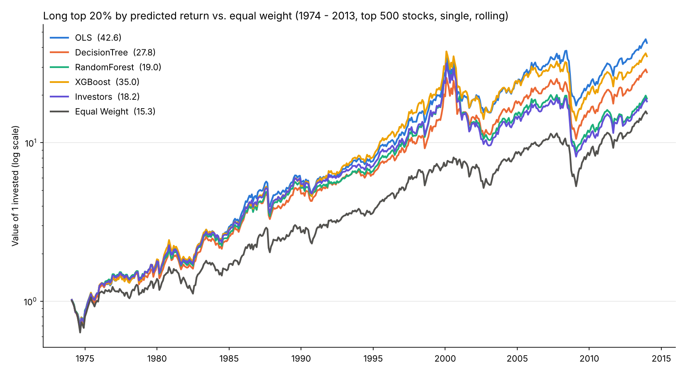
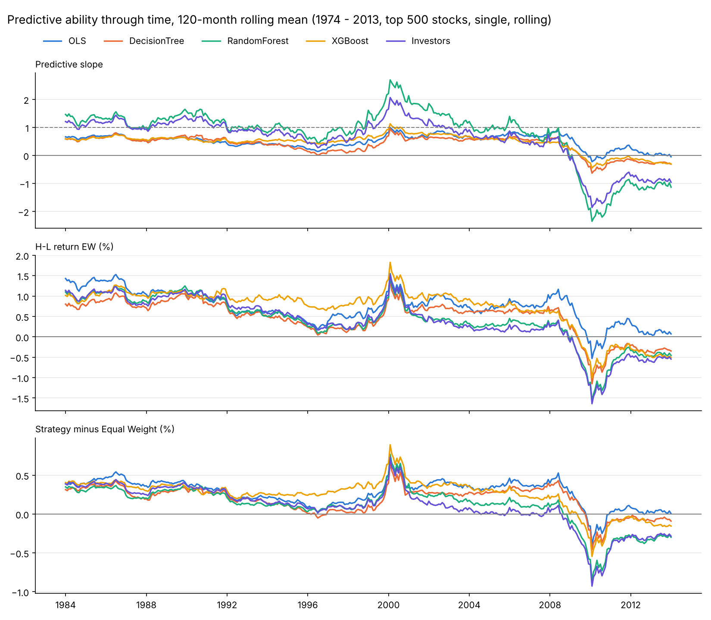
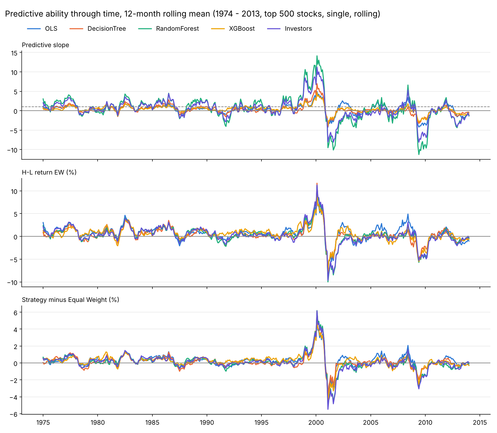
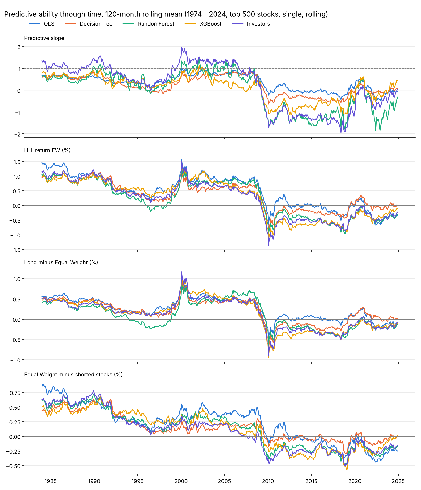

# Masterprojekt: Aktienrenditen mit Entscheidungsbäumen prognostizieren

Replikation von **Lewellen (2015), "The Cross-Section of Expected Stock Returns"**
(`ssrn-2511246.pdf` in diesem Ordner) – mit einer Änderung: Wo Lewellen eine
**lineare Regression** schätzt, verwenden wir **Machine Learning**:

| Modell | Idee in einem Satz |
| --- | --- |
| **OLS** (Benchmark) | Die lineare Regression aus dem Paper. Läuft mit, damit wir einen direkten Vergleich haben. |
| **Decision Tree** | Teilt die Aktien mit einer Folge von Ja/Nein-Fragen zu ihren Kennzahlen in Gruppen; die Prognose ist die Durchschnittsrendite der Gruppe. |
| **Random Forest** | Viele leicht unterschiedliche Bäume, deren Prognosen gemittelt werden. |
| **XGBoost** | Viele kleine Bäume nacheinander; jeder neue Baum korrigiert die Fehler der bisherigen. |
| **Investors** | 100 simulierte Investoren, jeder ein eigener Baum mit eigener Sicht auf die Daten. Ihre mittlere Prognose ist eine weitere Prognose; wie stark sie sich uneinig sind, ist die **Machine Forecast Disagreement** (Schritt 8). |

Aus Rechenzeitgründen verwenden wir pro Monat nur die **500 größten US-Aktien**.

Diese README erklärt das Verfahren Schritt für Schritt und zeigt bei jedem
Schritt die Code-Zeilen, die ihn umsetzen. Sie ist für Leser mit
Finance-Hintergrund geschrieben; Programmierkenntnisse sind nicht nötig.

---

## Inhalt

- [Schnellstart](#schnellstart)
- [Aufbau des Projekts](#aufbau-des-projekts)
- [Die Idee des Papers in fünf Sätzen](#die-idee-des-papers-in-fünf-sätzen)
- [Schritt 1: Daten und Stichprobe](#schritt-1-daten-und-stichprobe)
- [Schritt 2: Erwartete Renditen schätzen](#schritt-2-erwartete-renditen-schätzen) ← der Kern
- [Schritt 3: Fama-MacBeth-Regressionen (Tabelle 2)](#schritt-3-fama-macbeth-regressionen-tabelle-2)
- [Schritt 4: Wie gut sind die Prognosen? (Tabelle 3)](#schritt-4-wie-gut-sind-die-prognosen-tabelle-3)
- [Schritt 5: Dezilportfolios (Tabelle 6)](#schritt-5-dezilportfolios-tabelle-6)
- [Schritt 6: Handelsstrategien](#schritt-6-handelsstrategien)
- [Schritt 7: Entwicklung über die Zeit (Fig. 2)](#schritt-7-entwicklung-über-die-zeit-fig-2)
- [Schritt 8: Machine Forecast Disagreement](#schritt-8-machine-forecast-disagreement)
- [Ergebnisse](#ergebnisse)
- [Abgleich mit dem Paper](#abgleich-mit-dem-paper)
- [Einstellungen ändern](#einstellungen-ändern)
- [Glossar](#glossar)

---

## Schnellstart

```bash
pip install -r requirements.txt
```

```bash
python main.py
```

Das Skript lädt die vorbereiteten Daten aus `data/`, rechnet alle acht
Schritte nacheinander und schreibt die Tabellen in die Konsole. Ergebnisse
(CSV-Dateien und Grafiken) landen im Ordner `output/` (Aufbau siehe unten). Die Ergebnisse des
Standardlaufs liegen dort bereits im Repository – man muss das Skript also
nicht laufen lassen, um sie anzusehen. Ein kompletter Lauf
mit allen fünf Modellen dauert auf einem Rechner mit 4 Kernen etwa
13 Minuten (`"stacked"`: etwa 16 Minuten). Zum schnellen
Ausprobieren `MODELS_TO_RUN` in `main.py` auf weniger Modelle kürzen.

## Aufbau des Projekts

| Datei | Inhalt |
| --- | --- |
| `main.py` | **Hier anfangen.** Ein Skript, das von oben nach unten läuft: oben die Einstellungen, darunter die sieben Schritte, jeder unter einer eigenen Überschrift. |
| `models.py` | Die Modelle mit ihren Hyperparametern, die simulierten Investoren und die beiden Schätzverfahren (Schritt 2) |
| `util.py` | Werkzeugkasten: Datenaufbereitung, Fama-MacBeth-Regression, Newey-West-Test, Portfolios, Kennzahlen, Grafiken |
| `output/` | Ergebnisse: `single/` (Standard), `stacked/` und `single_until_2024/`, jeweils mit `predicted_return/` und `investor_disagreement/` – siehe [Ausgabedateien](#ausgabedateien-in-output) |
| `data/jkp_top1000_25y_5y_rank.csv.gz` | Vorbereitete Daten (aus den 6-GB-Rohdaten des Tutors erzeugt) |
| `Thema 3 - Stock Return Prediction/` | MATLAB-Skripte des Tutors, an denen sich die Datenaufbereitung orientiert |
| `ssrn-2511246.pdf` | Das Paper |

`main.py` ist durch Überschriften in die acht Schritte gegliedert, z. B.:

```python
# =============================================================================
# 4. Güte der Prognosen (Tabelle 3)
# =============================================================================
```

Was in mehreren Schritten oder für jedes Modell gebraucht wird (z. B. die
Fama-MacBeth-Regression), steht als Funktion in `util.py`; `main.py` ruft sie
mit `util.…` auf.

> **Lesehilfe Python.** `df` ist eine Tabelle (wie ein Excel-Blatt), `df["me"]`
> ist eine Spalte daraus. `for x in liste:` wiederholt den eingerückten Block
> für jedes Element. Text nach `#` ist ein Kommentar und wird nicht ausgeführt.
> `model.fit(X, y)` heißt "Modell auf X und y schätzen", `model.predict(X)`
> heißt "Prognose für X berechnen" – diese beiden Befehle gelten für alle vier
> Modelle gleich.

---

## Die Idee des Papers in fünf Sätzen

1. In jedem Monat wird eine **Querschnittsregression** geschätzt: die Renditen
   aller Aktien im nächsten Monat auf ihre heutigen Kennzahlen (Größe, B/M,
   Momentum, …). Das ist die Fama-MacBeth-Methode.
2. Die Steigungen dieser Regressionen schwanken stark von Monat zu Monat.
   Lewellen **mittelt sie daher über die letzten 10 Jahre** (120 Monate).
3. Mit diesen gemittelten Steigungen und den heutigen Kennzahlen einer Aktie
   berechnet er ihre **erwartete Rendite für den nächsten Monat** – nur mit
   Informationen, die zu diesem Zeitpunkt bekannt waren (out-of-sample).
4. Dann prüft er, ob die Prognosen etwas taugen: Haben Aktien mit hoher
   Prognose tatsächlich höhere Renditen? (Tabelle 3: Regression der
   realisierten auf die prognostizierten Renditen; Tabelle 6: Dezilportfolios.)
5. Ergebnis im Paper: Ja – die Prognosen streuen stark und sagen die
   tatsächlichen Renditen gut voraus.

**Unsere Frage:** Werden die Prognosen besser, wenn wir statt der linearen
Regression Entscheidungsbäume verwenden, die auch nichtlineare Zusammenhänge
und Wechselwirkungen zwischen den Kennzahlen erkennen können?

---

## Schritt 1: Daten und Stichprobe

**Code:** Abschnitt 1 in `main.py`, Liste der Charakteristika in `util.py`

### Die Daten

Die Daten kommen aus der **JKP-Datenbank** (Jensen, Kelly & Pedersen, "Global
Factor Data"). Sie bilden ein **Panel**: eine Zeile pro Monat und Aktie.

| eom | id | ret_exc_lead1m | me | market_equity | be_me | ret_12_1 | … |
| --- | --- | --- | --- | --- | --- | --- | --- |
| 1990-01-31 | 10107 | 0.0412 | 3 912 | 0.48 | -0.21 | 0.33 | … |
| 1990-01-31 | 10145 | -0.0170 | 1 507 | 0.39 | 0.12 | -0.05 | … |
| … | | | | | | | |

- `eom` – Monatsende, zu dem die Kennzahlen gemessen werden (Monat *t*)
- `ret_exc_lead1m` – **Überrendite der Aktie im Folgemonat** *t + 1* (das wollen wir prognostizieren)
- `me` – Marktkapitalisierung in Mio. USD (nur für die Auswahl der 500 größten und für Wertgewichte)
- 14 **Charakteristika** zum Zeitpunkt *t*

Die Zeilen eines Monats bilden einen **Querschnitt**: rund 500 Aktien × 14 Kennzahlen.
Wichtig für das Timing: Kennzahlen am Ende von Monat *t*, Rendite über Monat
*t + 1*. Dadurch wird nie eine Rendite mit Informationen "erklärt", die es zu
Beginn der Renditeperiode noch nicht gab.

### Die 14 Charakteristika (Lewellens Modell 3)

Festgelegt im Tutor-Skript `b00PrepareDataset.m`, in Python in `util.py`:

```python
JKP_CHARACTERISTICS = [
    "market_equity",   # Größe (log. Marktkapitalisierung)
    "be_me",           # Buchwert / Marktwert (B/M)
    "ret_12_1",        # Momentum: Rendite von Monat t-12 bis t-2
    "chcsho_12m",      # Aktienemissionen: Veränderung der Aktienanzahl über 12 Monate
    "oaccruals_at",    # Accruals: operative Accruals / Bilanzsumme
    "ni_at",           # Profitabilität: Return on Assets
    "at_gr1",          # Asset Growth: Wachstum der Bilanzsumme
    "beta_60m",        # Beta aus 60 Monatsrenditen
    "div12m_me",       # Dividendenrendite der letzten 12 Monate
    "ret_60_12",       # Langfristige Rendite: Monat t-60 bis t-12
    "rvol_252d",       # Volatilität der Tagesrenditen (1 Jahr)
    "turnover_126d",   # Turnover (Handelsvolumen / Aktienanzahl, 6 Monate)
    "debt_me",         # Verschuldung: Schulden / Marktwert
    "sale_me",         # Umsatz / Marktwert
]
```

Lewellens drei Modelle sind Teilmengen davon (Einstellung `FEATURE_SET` in `main.py`):

```python
LEWELLEN_MODELS = {
    "Model 1": JKP_CHARACTERISTICS[:3],   # Größe, B/M, Momentum
    "Model 2": JKP_CHARACTERISTICS[:7],   # + Emissionen, Accruals, Profitabilität, Asset Growth
    "Model 3": JKP_CHARACTERISTICS,       # alle 14
}
```

(`[:3]` heißt "die ersten drei Einträge der Liste".)

### Rangtransformation

Wie im Tutor-Skript `fCrossSectTransChars.m` wird jede Kennzahl **in jedem
Monat in Ränge umgerechnet** und auf das Intervall **[−0,5; +0,5]** skaliert.
Beispiel mit fünf Aktien und ihrem B/M in einem Monat:

| Aktie | B/M | Rang | skaliert: (Rang − 1) / (5 − 1) − 0,5 |
| --- | --- | --- | --- |
| A | 0,20 | 1 | −0,50 |
| B | 0,45 | 2 | −0,25 |
| C | 0,60 | 3 | 0,00 |
| D | 1,10 | 4 | +0,25 |
| E | 3,50 | 5 | +0,50 |

Warum? Ausreißer (Aktie E) verlieren ihren übergroßen Einfluss, und alle
Kennzahlen haben in jedem Monat dieselbe Skala. Die Steigung einer Regression
auf eine Rangvariable lässt sich direkt lesen: **Renditeunterschied zwischen der
Aktie mit dem niedrigsten und der mit dem höchsten Wert**.

```python
ranks = df.groupby("eom")[JKP_CHARACTERISTICS].rank(method="average")  # gleiche Werte: mittlerer Rang
df[JKP_CHARACTERISTICS] = (ranks - 1) / (ranks.groupby(df["eom"]).transform("max") - 1) - 0.5
```

Diese Aufbereitung (`util.build_prepared_data`) läuft nur einmal auf den 6-GB-Rohdaten
des Tutors. Das Ergebnis ist die Datei in `data/`, die `main.py` danach direkt lädt.

### Stichprobe: 500 größte Aktien mit vollständigen Daten

```python
df = df.sort_values([DATE, ID])
df = df[df[DATE] >= "1964-01-01"].dropna(subset=[RET, *features])
size_rank = df.groupby(DATE)[SIZE].rank(ascending=False, method="first")  # 1 = größte Aktie
df = df[size_rank <= UNIVERSE_SIZE].reset_index(drop=True)
```

`DATE`, `ID`, `RET` und `SIZE` sind Kurznamen für die Spalten `eom`, `id`,
`ret_exc_lead1m` und `me`. Die Filter, Zeile für Zeile:

1. Nur Monate **ab 1964** (wie im Paper: ab dann gibt es Compustat-Daten).
2. `dropna`: nur Aktien, für die die Rendite und **alle 14 Kennzahlen**
   vorliegen (wie im Paper).
3. In jedem Monat (`groupby(DATE)`) die Aktien nach Marktkapitalisierung
   absteigend ranken und nur die **Ränge 1 bis 500** behalten.

Ergebnis: 731 Monate (Januar 1964 bis November 2024) mit je 500 Aktien; nur
in den ersten 28 Monaten (bis April 1966) sind es 415–499, weil noch nicht
genug Firmen alle 14 Kennzahlen haben.

Das Universum wird jeden Monat neu bestimmt; eine Aktie kann also hinein- und
herausfallen. Da die Marktkapitalisierung am Monatsende *t* bekannt ist,
entsteht dadurch kein Look-ahead-Bias.

---

## Schritt 2: Erwartete Renditen schätzen

**Code:** Abschnitt 2 in `main.py`, `fama_macbeth_forecast()` in `models.py`

Das ist der Kern der Arbeit. Wir gehen in drei Teilen vor: erst Lewellens
Verfahren, dann die Übertragung auf Machine Learning, dann der Code.

### 2a) Lewellens Verfahren

In **jedem Monat j** schätzt Lewellen eine Querschnittsregression:

```
r(i, j+1) = a(j) + b1(j) · Größe(i, j) + b2(j) · B/M(i, j) + … + Fehler
```

Das ergibt pro Monat einen Satz Koeffizienten a(j), b(j). Für die Prognose am
Ende von Monat *t* mittelt er die Koeffizienten der **letzten 120 Monate**:

```
ā = Mittelwert von a(t−120) … a(t−1)
b̄ = Mittelwert von b(t−120) … b(t−1)

Prognose(i, t) = ā + b̄1 · Größe(i, t) + b̄2 · B/M(i, t) + …
```

### 2b) Übertragung auf Machine Learning

Ein Entscheidungsbaum hat keine Steigungen, die man mitteln könnte. Wir nutzen
deshalb eine Umformung, die für die Regression **exakt dasselbe** ergibt:
Statt erst die Koeffizienten zu mitteln und dann zu prognostizieren, lassen wir
**jedes der 120 Monatsmodelle eine eigene Prognose** abgeben und **mitteln die
Prognosen**:

```
Mittel der Prognosen = 1/120 · Σ [ a(j) + b(j) · x ]
                     = 1/120 · Σ a(j)  +  (1/120 · Σ b(j)) · x
                     = ā + b̄ · x          ← genau Lewellens Prognose
```

Weil das Mitteln bei einem linearen Modell egal ist, ist unsere OLS-Prognose
**identisch mit dem Paper**. Für Bäume funktioniert dieselbe Rechnung genauso –
man ersetzt nur die Regression durch einen Baum. Damit bleibt alles andere
(Daten, Timing, Fenster, Auswertung) wie im Paper, und der einzige Unterschied
zwischen den Modellen ist das Modell selbst. Das macht den Vergleich sauber.

Zeitlich sieht das für den ersten Prognosemonat so aus (Fenster von 120 Monaten):

```
Monatsmodelle j:  1964-01   1964-02   …   1973-11   1973-12      (120 Modelle,
                  Kennzahlen Ende j  →  Rendite im Monat j + 1     je ~500 Aktien)
                     │         │             │         │
                     └─────────┴──── Mittel ─┴─────────┘
                                       │
                                       ▼
Prognose:   Kennzahlen Ende Januar 1974  →  erwartete Rendite im Februar 1974
```

Einen Monat später fällt das Modell von 1964-01 heraus und das von 1974-01
kommt hinzu – das Fenster rollt.

Präziser, mit den Zeilen des Datensatzes: Eine Zeile mit Datum *t* enthält die
Kennzahlen am Ende von *t* und die Rendite über *t + 1*.

- Monatsmodell *j* lernt aus den Zeilen von Monat *j*:
  **Kennzahlen Ende j → Rendite im Monat j + 1**.
- Die Prognose für die Zeilen von Monat *t* (also für die Rendite über *t + 1*)
  ist das Mittel der Modelle *j = t − 120, …, t − 1*.
- Das jüngste dieser Modelle (*j = t − 1*) braucht die Rendite über Monat *t* –
  die ist am Ende von *t* bekannt. **Es wird also nie in die Zukunft geschaut.**

### 2c) Die vier Modelle

Jedes Monatsmodell bekommt die rund 500 Aktien eines Monats mit ihren 14
(rangtransformierten) Kennzahlen und deren Folgemonatsrenditen.

**OLS** – die lineare Regression von oben. Eine Steigung pro Kennzahl.

**Decision Tree.** Der Baum sucht die Ja/Nein-Frage zu einer Kennzahl, die die
Aktien in zwei Gruppen mit möglichst unterschiedlichen Durchschnittsrenditen
teilt (genauer: die den quadrierten Prognosefehler am stärksten senkt). Dann
macht er in jeder Gruppe dasselbe, bis eine Abbruchregel greift. Die Prognose für
eine Aktie ist die Durchschnittsrendite der Endgruppe ("Blatt"), in der sie landet.
Ein **erfundenes** Beispiel zur Anschauung:

```
                     Momentum-Rang > 0,2 ?
                    /                     \
                 nein                      ja
       Größe-Rang < −0,3 ?           Volatilitäts-Rang > 0,4 ?
          /         \                   /            \
      +1,1 %      +0,7 %            +1,3 %         +0,6 %
```

Anders als die Regression kann der Baum so **Schwellen** ("nur extreme
Momentum-Aktien") und **Wechselwirkungen** ("Momentum wirkt nur bei kleinen
Aktien") abbilden, ohne dass wir sie vorher festlegen.

Das Risiko: Ein unbegrenzter Baum teilt so lange, bis jede Gruppe nur noch eine
Aktie enthält – dann hat er das Rauschen eines Monats auswendig gelernt
(**Overfitting**). Monatsrenditen bestehen zum größten Teil aus Rauschen; das
Begrenzen ist daher entscheidend. Das tun die **Hyperparameter**:

```python
MODELS = {
    # Benchmark: die lineare Regression aus dem Paper
    "OLS": LinearRegression(),
    # ein einzelner Entscheidungsbaum
    "DecisionTree": DecisionTreeRegressor(max_depth=5, min_samples_leaf=50, random_state=42),
    # Mittel vieler unabhängiger Bäume (Bagging)
    "RandomForest": RandomForestRegressor(n_estimators=200, max_depth=6, min_samples_leaf=50,
                                          max_features="sqrt", n_jobs=-1, random_state=42),
    # Bäume nacheinander, jeder korrigiert die Fehler der vorigen (Boosting)
    "XGBoost": XGBRegressor(n_estimators=200, max_depth=3, learning_rate=0.05,
                            subsample=0.8, colsample_bytree=0.8, n_jobs=-1, random_state=42),
}
```

| Hyperparameter | Bedeutung | Wert |
| --- | --- | --- |
| `max_depth` | höchstens so viele Fragen hintereinander | Baum 5, Forest 6, XGBoost 3 |
| `min_samples_leaf` | mindestens so viele Aktien pro Endgruppe – die Prognose ist also immer ein Durchschnitt über ≥ 50 Aktien | 50 |
| `n_estimators` | Anzahl der Bäume | 200 |
| `max_features` | Random Forest: bei jeder Frage nur aus einer zufälligen Auswahl der Kennzahlen wählen (`"sqrt"`: √14 ≈ 3) | `"sqrt"` |
| `learning_rate` | XGBoost: Gewicht, mit dem jeder neue Baum in die Prognose eingeht | 0,05 |
| `subsample`, `colsample_bytree` | XGBoost: jeder Baum sieht nur 80 % der Aktien bzw. Kennzahlen | 0,8 |
| `n_jobs = -1` | alle Prozessorkerne nutzen (ändert nichts am Ergebnis) | |
| `random_state` | Startwert des Zufallsgenerators: jeder Lauf liefert dieselben Zahlen | 42 |

**Random Forest** (Bagging). Ein einzelner Baum ist instabil: Ein paar andere
Aktien in der Stichprobe, und er stellt ganz andere Fragen. Der Random Forest
trainiert daher 200 Bäume, jeden auf einer zufälligen Ziehung der Aktien (mit
Zurücklegen) und mit zufälliger Auswahl der Kennzahlen pro Frage, und **mittelt
ihre Prognosen**. Das ist Diversifikation: Die Fehler der einzelnen Bäume heben
sich teilweise auf, wie das unsystematische Risiko in einem Portfolio.

**XGBoost** (Boosting). Die Bäume werden **nacheinander** gebaut. Der erste
macht eine grobe Prognose; jeder weitere Baum wird auf die **verbleibenden
Fehler** (Residuen) der bisherigen Prognose trainiert und mit dem Gewicht
`learning_rate` (5 %) addiert. Die vielen kleinen Korrekturen (Tiefe nur 3)
bauen langsam ein feineres Bild auf.

### 2d) Der Code der Schätzung

Die ganze Logik von 2a und 2b steckt in einer Funktion,
`fama_macbeth_forecast()` in `models.py`. Gekürzt auf das Wesentliche:

```python
forecast_sum = empty_forecast(model, len(y))  # Summe der Prognosen je Aktie und Monat
n_models = np.zeros(len(y))                   # Anzahl der Monatsmodelle, die diese Prognose enthält

first_model = 0 if expanding else max(first - window, 0)
for j in range(first_model, last):
    # 1. Modell auf dem Querschnitt von Monat j trainieren (ca. 500 Aktien x 14 Charakteristika)
    in_month_j = month_nr == j
    fitted = clone(model).fit(X[in_month_j], y[in_month_j])

    # 2. Damit alle Aktien der Monate j + 1 ... j + window prognostizieren (expanding: alle späteren)
    last_month = last if expanding else min(j + window, last)
    in_forecast_months = (month_nr > j) & (month_nr >= first) & (month_nr <= last_month)
    forecast_sum[..., in_forecast_months] += predict(fitted, X[in_forecast_months])
    n_models[in_forecast_months] += 1

# 3. Mittelwert: Summe der Prognosen / Anzahl der Modelle
return forecast_sum / n_models, importances
```

Was hier passiert:

- `month_nr` nummeriert die Monate durch (0 = Januar 1964, 1 = Februar 1964, …);
  `first` und `last` sind die Nummern des ersten und letzten Prognosemonats
  (Januar 1974 und Dezember 2013).
- `X` sind die Kennzahlen aller Zeilen, `y` die Folgemonatsrenditen.
  `X[in_month_j]` wählt die Zeilen von Monat *j* aus.
- Die Schleife `for j in …` geht Monat für Monat durch. In jedem Monat wird
  **ein frisches Modell** (`clone(model)`) auf genau diesem einen Querschnitt
  geschätzt (`.fit`).
- Statt "für Monat *t* die Modelle *t − 120 … t − 1* einsammeln" dreht der Code
  die Blickrichtung um: **Jedes Modell *j* prognostiziert sofort alle Monate,
  in deren Fenster es liegt** (*j + 1 … j + 120*), und legt seine Prognose in
  `forecast_sum` ab. `n_models` zählt mit, wie viele Modelle zu jeder Prognose
  beigetragen haben. Das ergibt dasselbe, ist aber viel schneller, weil jedes
  Modell nur einmal aufgerufen wird.
- Am Ende ist `forecast_sum / n_models` der **Mittelwert der Prognosen der
  letzten 120 Monatsmodelle** – für jede Aktie in jedem Monat.

(`[..., …]` bedeutet: funktioniert auch, wenn die Prognose bei den Investors
eine Tabelle mit einer Zeile pro Investor ist.)

In `main.py` wird diese Funktion – oder `stacked_forecast`, siehe 2h – für jedes
Modell aufgerufen:

```python
for name in MODELS_TO_RUN:
    forecast, model_importances = estimate(models.MODELS[name], X, y, month_nr, first, last, TRAIN_WINDOW,
                                           expanding=WINDOW_TYPE == "expanding", label=name, **options)
```

Das Ergebnis ist die Tabelle `preds` mit einer Zeile pro (Monat, Aktie):
realisierte Rendite plus je eine Prognosespalte `OLS`, `DecisionTree`,
`RandomForest`, `XGBoost`. Alle folgenden Schritte arbeiten nur noch mit
dieser Tabelle.

**Minimale Historie:** Vor der ersten Prognose müssen 120 Monate liegen
(`first = max(TRAIN_WINDOW, …)`). Mit Daten ab Januar 1964 ist Januar 1974 der
erste Prognosemonat – jede Prognose beruht also auf vollen 120 Monatsmodellen;
eine Anlaufphase mit kürzeren Fenstern gibt es nicht.

### 2g) Rollendes oder wachsendes Fenster (`WINDOW_TYPE`)

| `WINDOW_TYPE` | Prognose für Monat *t* nutzt | im Paper |
| --- | --- | --- |
| `"rolling"` (Standard) | die Monate *t − 120 … t − 1* | Hauptergebnis ("rolling slopes") |
| `"expanding"` | alle Monate seit Januar 1964 bis *t − 1* (mindestens 120) | "cumulative slopes" in Tabelle 3 |

Im Code ist der Unterschied eine Zeile: Beim wachsenden Fenster beginnt die
Schleife beim ersten Monat und jedes Modell prognostiziert alle späteren
Monate.

```python
first_model = 0 if expanding else max(first - window, 0)
...
last_month = last if expanding else min(j + window, last)
```

Im ersten Prognosemonat (Januar 1974) sind beide gleich, weil es noch genau
120 Monate Historie gibt; danach wächst das Fenster bis auf 600 Monate (2013).

### 2h) Einzelne Monatsmodelle oder gestapelte Daten (`ESTIMATION`)

| `ESTIMATION` | Training | Prognose | Vorbild |
| --- | --- | --- | --- |
| `"single"` (Standard) | **120 Modelle**, jedes auf **einem** Monat (~500 Zeilen) | Mittel der 120 Prognosen | Lewellen (2015) |
| `"stacked"` | **ein Modell** auf allen 120 Monaten **untereinandergestapelt** (~60 000 Zeilen) | direkt die Prognose dieses Modells; neu trainiert alle `REFIT_EVERY = 12` Monate | Gu, Kelly & Xiu (2020); auch das MFD-Paper |

Beide Verfahren nutzen dieselben Informationen (die 10 Jahre vor *t*). Der
Unterschied: Beim Stapeln sieht **ein** Baum 60 000 Beobachtungen und kann
feinere Muster lernen, die über die Jahre stabil sind; beim Fama-MacBeth-Weg
lernt jeder Baum nur aus einem Monat, und erst das Mitteln glättet das
Rauschen. Für OLS liefern beide fast dasselbe; für die Bäume können sie sich
deutlich unterscheiden.

```python
for i, t in enumerate(refit_months, start=1):
    # 1. Trainingsdaten: alle Zeilen der Monate im Fenster vor t
    in_window = (month_nr >= (0 if expanding else t - window)) & (month_nr < t)
    fitted = clone(model).fit(X[in_window], y[in_window])

    # 2. Prognose für die Monate t ... t + refit_every - 1
    in_forecast_months = (month_nr >= t) & (month_nr <= min(t + refit_every - 1, last))
    forecast[..., in_forecast_months] = predict(fitted, X[in_forecast_months])
```

Das Modell, das ab Januar 1974 prognostiziert, ist auf Januar 1964 bis
Dezember 1973 trainiert und wird für 12 Monate verwendet; dann rückt das
Fenster um 12 Monate weiter. Auch hier gibt es keine Zukunftsdaten: Die
jüngste Trainingszeile (Dezember 1973) enthält die Rendite im Januar 1974, die
am Ende von Januar 1974 bekannt ist.

### 2e) Investors: 100 simulierte Investoren

Das fünfte Modell stammt aus Bali, Kelly, Mörke & Rahman (2026), "Machine
Forecast Disagreement". Die Idee: Echte Investoren nutzen dieselben Daten,
schauen aber auf unterschiedliche Kennzahlen und verarbeiten sie
unterschiedlich – deshalb sind sie sich uneinig. Das Paper simuliert das mit
vielen Machine-Learning-Modellen, die sich auf zwei Arten unterscheiden:

1. **Information:** Jeder Investor sieht nur eine feste, zufällig gewählte
   Hälfte der Kennzahlen (bei uns 7 von 14). Investor A schaut vielleicht auf
   Momentum und Volatilität, Investor B auf B/M und Dividendenrendite.
2. **Modell:** Jeder schätzt sein Modell auf einer eigenen Zufallsstichprobe
   der Aktien (Bootstrap) – wie die Bäume eines Random Forest.

In `models.py` ist jeder Investor **ein einzelner, gespeicherter
Entscheidungsbaum** der Tiefe 3 (wie im Paper):

```python
# 1. Informationsmenge jedes Investors (bei gleichem random_state in jeder Schätzung dieselbe)
self.features_ = [np.sort(rng.choice(n_features, n_seen, replace=False)) for _ in range(self.n_investors)]
# 2. Jeder Investor schätzt seinen Baum auf einer eigenen Bootstrap-Stichprobe
self.trees_ = []
for k, cols in enumerate(self.features_):
    rows = rng.integers(0, n_rows, n_rows)
    tree = DecisionTreeRegressor(max_depth=self.max_depth, min_samples_leaf=self.min_samples_leaf,
                                 random_state=k)
    self.trees_.append(tree.fit(X[rows][:, cols], y[rows]))
```

Weil jeder Baum einzeln gespeichert ist, kann jeder Investor seine eigene
Prognose abgeben (`predict_each`: eine Zeile pro Investor). Ihr Mittelwert ist
die Prognose des Modells "Investors", die wie die anderen Modelle in den
Schritten 3–7 ausgewertet wird; ihre Standardabweichung ist die
Disagreement (Schritt 8). Die Informationsmenge jedes Investors bleibt über
alle Schätzungen gleich – Investor 7 ist also in jedem Monat derselbe
"Typ".

Vereinfachung gegenüber dem Paper: Dort ist jeder Investor ein ganzer Random
Forest mit 2 000 Bäumen auf 76 von 153 Kennzahlen. Wir haben nur 14 Kennzahlen
und nutzen pro Investor einen Baum – das hält die Rechenzeit klein und jeder
Baum ist direkt ein Investor.

### 2f) Feature Importance

Bäume berichten, wie stark jede Kennzahl den Prognosefehler beim Aufteilen
gesenkt hat (`feature_importances_`). Wir mitteln das über alle Monatsmodelle;
`main.py` druckt die zehn wichtigsten Kennzahlen. Das ist das Gegenstück zu den
t-Statistiken der Regression – es zeigt, worauf die Bäume ihre Prognosen
stützen, aber nicht in welche Richtung.

---

## Schritt 3: Fama-MacBeth-Regressionen (Tabelle 2)

**Code:** Abschnitt 3 in `main.py`, `fama_macbeth()` in `util.py`

Zur Einordnung reproduzieren wir Lewellens Tabelle 2: die über alle Monate
gemittelten Steigungen der Querschnittsregressionen, für unsere Stichprobe.
(Code-Auszüge in dieser README sind teils leicht gekürzt.)

```python
# 1. Querschnittsregression pro Monat
monthly = []
for date, g in df.groupby(DATE):
    fit = sm.OLS(g[y_col], sm.add_constant(g[x_cols])).fit()
    monthly.append({DATE: date, **fit.params.rename({"const": "Intercept"}),
                    "R2": fit.rsquared, "N": int(fit.nobs)})

# 2. Mittelwert und Newey-West-t-Statistik der monatlichen Koeffizienten
coefs = monthly.drop(columns=["R2", "N"])
table = pd.DataFrame([newey_west_test(coefs[c]) for c in coefs],
                     index=coefs.columns, columns=["Coef", "S.E.", "t-stat"])
```

1. `df.groupby(DATE)` teilt die Daten in Monate; für jeden Monat `g` wird
   mit `statsmodels` eine OLS-Regression der Renditen auf die Kennzahlen plus
   Konstante geschätzt und die Koeffizienten werden gespeichert.
2. Für jede Kennzahl ergibt das eine Zeitreihe von ~600 Steigungen. Deren
   **Mittelwert** ist der Fama-MacBeth-Koeffizient; die **t-Statistik**
   kommt aus der Streuung dieser Zeitreihe.

Wie im Paper werden die Standardfehler nach **Newey-West mit 4 Lags** korrigiert,
weil die monatlichen Steigungen autokorreliert sein können. Technisch ist das
eine Regression der Zeitreihe auf eine Konstante (= ihr Mittelwert) mit
HAC-Standardfehlern:

```python
def newey_west_test(series, lags=4):
    y = pd.Series(series).dropna().to_numpy()
    fit = sm.OLS(y, np.ones(len(y))).fit(cov_type="HAC", cov_kwds={"maxlags": lags})
    return fit.params[0], fit.bse[0], fit.tvalues[0]
```

**Lesart:** Da die Kennzahlen Ränge in [−0,5; 0,5] sind, ist eine Steigung von
0,50 (in % pro Monat) beim Momentum so zu lesen: Die Aktie mit dem höchsten
Momentum hat – bei sonst gleichen Kennzahlen – eine um 0,5 Prozentpunkte pro
Monat höhere erwartete Rendite als die mit dem niedrigsten.

---

## Schritt 4: Wie gut sind die Prognosen? (Tabelle 3)

**Code:** Abschnitt 4 in `main.py`, `forecast_evaluation()` und
`prediction_metrics()` in `util.py`

### Tabelle 3 wie im Paper

```python
dist = preds.groupby(DATE)[model].describe(percentiles=[0.1, 0.9]).mean() * 100
table, monthly = fama_macbeth(preds, RET, [model])
```

**Linker Teil – Verteilung der Prognosen** (`dist`): In jedem Monat Mittelwert,
Standardabweichung sowie 10 %- und 90 %-Quantil der Prognosen über alle Aktien,
dann über die Monate gemittelt. Eine große Streuung heißt: Das Modell traut sich,
Aktien deutlich zu unterscheiden.

**Rechter Teil – Prognosegüte**: Dieselbe Fama-MacBeth-Funktion aus Schritt 3,
aber jetzt mit nur einer erklärenden Variablen – der Prognose:

```
r(i, t+1) = α(t) + β(t) · Prognose(i, t) + Fehler
```

Die gemittelte Steigung β ist die zentrale Kennzahl des Papers:

| Steigung | Bedeutung |
| --- | --- |
| **β = 1** | Ideal: Ein Prozentpunkt mehr Prognose bedeutet im Schnitt einen Prozentpunkt mehr Rendite. |
| **0 < β < 1** | Die Prognose trennt gute und schlechte Aktien, übertreibt aber die Unterschiede. |
| **β = 0** | Die Prognose ist wertlos. |

Die t-Statistik (Newey-West) zeigt, ob β signifikant von null verschieden ist.
Lewellen findet für große Aktien Steigungen von 0,44–0,72.

### Weitere Kennzahlen aus der Machine-Learning-Literatur

| Kennzahl | Bedeutung |
| --- | --- |
| `RMSE`, `MAE` | durchschnittlicher Prognosefehler (Wurzel des mittleren quadratischen bzw. mittlerer absoluter Fehler) |
| `R2 OOS` | 1 − Σ(r − Prognose)² / Σ r² nach Gu, Kelly & Xiu (2020): Vergleich mit einer Prognose von null. Schon leicht positive Werte sind bei Monatsrenditen gut. |
| `IC mean` | **Information Coefficient**: Rangkorrelation zwischen Prognose und realisierter Rendite in jedem Monat, gemittelt. Misst, ob die *Reihenfolge* der Aktien stimmt – das ist für eine Long-Short-Strategie entscheidend. |
| `IC IR`, `IC t-stat` | Mittelwert / Standardabweichung des IC bzw. t-Test, ob der IC über die Zeit verlässlich positiv ist |
| `Hit rate` | Anteil der Prognosen mit dem richtigen Vorzeichen |

Außerdem zeigt `main.py` die mittlere Korrelation der Prognosen verschiedener
Modelle (vgl. Lewellens Tabelle 4): Sagen die Bäume etwas anderes als OLS?

---

## Schritt 5: Dezilportfolios (Tabelle 6)

**Code:** Abschnitt 5 in `main.py`, `sorted_portfolios()` und `portfolio_returns()` in `util.py`

Jeden Monat werden die Aktien nach ihrer Prognose in **10 gleich große
Portfolios** sortiert (Dezil 1 = niedrigste Prognose, Dezil 10 = höchste):

```python
df["portfolio"] = df.groupby(DATE)[model].transform(
    lambda s: pd.qcut(s.rank(method="first"), n_groups, labels=False) + 1)
```

Für jedes Portfolio wird die Rendite im Folgemonat berechnet –
**gleichgewichtet (EW)** und **wertgewichtet (VW)** nach Marktkapitalisierung –
und zusätzlich das **High-minus-Low-Portfolio H−L** (Dezil 10 long, Dezil 1 short):

```python
pred, ret = means[model].unstack(), means[RET].unstack()  # Monate x Portfolios
pred["H-L"] = pred[n_groups] - pred[1]
ret["H-L"] = ret[n_groups] - ret[1]
```

Die Tabelle zeigt pro Portfolio die mittlere **Prognose** (`Pred`), die
mittlere **realisierte Rendite** (`Avg`), deren Standardabweichung, die
annualisierte Sharpe Ratio und die Newey-West-t-Statistik.

**Lesart:** Ein gutes Modell zeigt eine **monoton steigende** Rendite von Low
nach High und eine signifikant positive H−L-Rendite. `Pred` und `Avg`
nebeneinander zeigen, ob die Prognosen die tatsächlichen Unterschiede über-
oder unterschätzen (vgl. die Steigung aus Schritt 4).

---

## Schritt 6: Handelsstrategien

**Code:** Abschnitt 6 in `main.py`, `strategy_returns()`, `backtest()` und
`performance_metrics()` in `util.py`

Zum Schluss drei einfache Strategien, jeden Monat neu zusammengestellt und
gleichgewichtet. Benchmark ist das gleichgewichtete Portfolio aller 500 Aktien
("Equal Weight").

| Strategie | Was passiert | Einstellung |
| --- | --- | --- |
| **Long** | die 10 % Aktien mit der höchsten Prognose kaufen | `LONG_PCT = 0.10` |
| **Short** | die 10 % Aktien mit der niedrigsten Prognose leerverkaufen | `SHORT_PCT = 0.10` |
| **Long-Short** | beides zugleich; der Erlös aus dem Leerverkauf bezahlt den Kauf (selbstfinanzierend) | beide |

Alle drei rechnet eine Funktion, die einen Long- und einen Short-Anteil
bekommt:

```python
for date, g in preds.groupby(DATE):
    # realisierte Renditen, sortiert von der besten zur schlechtesten Aktie nach `model`
    realised = g.sort_values(model, ascending=not high_is_good, kind="stable")[RET]
    ret = 0.0
    if long_pct > 0:
        n_long = max(1, int(round(len(realised) * long_pct)))  # mindestens 1 Aktie
        ret += realised.iloc[:n_long].mean()
    if short_pct > 0:
        n_short = max(1, int(round(len(realised) * short_pct)))
        ret -= realised.iloc[-n_short:].mean()
    returns[date] = ret
```

Für jeden Monat: Aktien nach Prognose sortieren; die ersten 10 %
(`iloc[:n_long]`) werden gekauft, die letzten 10 % (`iloc[-n_short:]`)
leerverkauft. Die Rendite eines Leerverkaufs ist minus die Rendite der Aktie.
In `main.py` legt ein Dictionary die drei Strategien fest:

```python
STRATEGIES = {"Long": (LONG_PCT, 0.0), "Short": (0.0, SHORT_PCT), "Long-Short": (LONG_PCT, SHORT_PCT)}
strategy = util.backtest(preds, MODELS_TO_RUN, STRATEGIES)  # Spalten: (Strategie, Modell) plus Equal Weight
```

Zum Lesen der Ergebnisse:

- **Long** vergleicht man direkt mit Equal Weight.
- **Short** allein verliert fast immer Geld, weil Aktien im Schnitt steigen.
  Entscheidend ist, ob die leerverkauften Aktien **schlechter als der Markt**
  waren. Das zeigt die Kennzahl "Equal Weight minus leerverkaufte Aktien" in
  Schritt 7.
- **Long-Short** mit 10 % / 10 % ist gleichgewichtet genau das H−L-Portfolio
  aus Tabelle 6 (High-Dezil minus Low-Dezil); nur bei exakt gleichen
  Prognosen können einzelne Aktien anders zugeordnet werden.

Daraus die Kennzahlen:

```python
wealth = (1 + returns).cumprod()
...
"Ann. Return": wealth.iloc[-1] ** (12 / len(returns)) - 1,   # geometrisch (CAGR)
"Ann. Volatility": returns.std() * np.sqrt(12),
"Sharpe Ratio": returns.mean() / returns.std() * np.sqrt(12),
"Max Drawdown": (wealth / peak - 1).min(),
```

| Kennzahl | Berechnung |
| --- | --- |
| Ann. Return | geometrische Rendite p. a. (CAGR) aus dem Endvermögen |
| Ann. Volatility | Standardabweichung der Monatsrenditen × √12 |
| Sharpe Ratio | mittlere Überrendite / Standardabweichung × √12 (die JKP-Renditen sind bereits Überrenditen über den risikofreien Zins) |
| Max Drawdown | größter prozentualer Verlust vom bisherigen Höchststand |

Die Grafiken `performance_long.png`, `performance_short.png` und
`performance_long-short.png` in `output/single/predicted_return/` zeigen die
Wertentwicklung von 1 investierten Dollar je Modell gegen Equal Weight
(logarithmische Skala: gleiche prozentuale Rendite ergibt gleiche Steigung).
Für Long-Short ist das eine Näherung: Man stellt sich vor, das Kapital liegt
als Sicherheit und erhält zusätzlich die Long-Short-Rendite.

Hinweis: Transaktionskosten und Leihgebühren für Leerverkäufe sind nicht
berücksichtigt; da jeden Monat neu sortiert wird, kann der Umschlag hoch sein.

---

## Schritt 7: Entwicklung über die Zeit (Fig. 2)

**Code:** Abschnitt 7 in `main.py`, `trend_test()` und `plot_time_variation()` in `util.py`

Die Tabellen 3 und 6 zeigen Durchschnitte über 40 Jahre. Sie sagen nicht, ob
die Prognosen **immer** gleich gut waren oder ob ihre Güte mit der Zeit
**nachlässt**. Lewellen untersucht das in Abschnitt 3.6 und Fig. 2. Die Frage
ist wichtig: Werden Anomalien bekannt und gehandelt, könnten sie
verschwinden (McLean & Pontiff, 2016).

### Vier Kennzahlen pro Monat

```python
series = {
    "Predictive slope": pd.DataFrame(
        {name: util.fama_macbeth(preds, RET, [name])[1][name] for name in MODELS_TO_RUN}),
    "H-L return EW (%)": pd.DataFrame(
        {name: util.portfolio_returns(preds, name)[1]["H-L"] for name in MODELS_TO_RUN}) * 100,
    "Long minus Equal Weight (%)": strategy["Long"].sub(equal_weight, axis=0) * 100,
    "Equal Weight minus shorted stocks (%)": strategy["Short"].add(equal_weight, axis=0) * 100,
}
```

| Kennzahl | Was sie misst | Mittelwert über alle Monate = |
| --- | --- | --- |
| **Prognose-Steigung** | Steigung der Querschnittsregression realisierte Rendite auf Prognose, **in diesem einen Monat** | Steigung aus Tabelle 3 |
| **H−L-Rendite** | Rendite Dezil 10 minus Dezil 1 in diesem Monat (gleichgewichtet) | H−L aus Tabelle 6 |
| **Long-Seite** | Rendite der gekauften 10 % minus Equal Weight | wie viel besser die Long-Strategie war |
| **Short-Seite** | Equal Weight minus Rendite der leerverkauften 10 % | wie viel schlechter die leerverkauften Aktien waren |

Die ersten beiden sind genau Lewellens zwei Panels in Fig. 2. Die letzten
beiden teilen die H−L-Rendite in ihre zwei Hälften: Long-Seite + Short-Seite
≈ H−L. So sieht man, ob der Gewinn eher aus guten Käufen oder aus guten
Leerverkäufen kommt.

### Gleitender Mittelwert

Einzelne Monatswerte sind sehr verrauscht (eine Steigung kann in einem Monat
+8 und im nächsten −6 sein). Deshalb zeigen die Grafiken den **gleitenden
Mittelwert**: Jeder Punkt ist der Durchschnitt der letzten *n* Monate.

```python
rolling = monthly.rolling(window).mean()
```

Es gibt zwei Grafiken:

- `time_variation_12m.png` – **12 Monate**: zeigt einzelne Jahre und
  Krisen deutlich, schwankt aber stark (Einstellung `ROLLING_MONTHS`).
- `time_variation_120m.png` – **120 Monate**, wie Lewellens Fig. 2:
  zeigt den langfristigen Verlauf. Der erste Punkt liegt Ende 1983, weil
  dafür 10 Jahre Prognosen nötig sind.

### Test auf einen Rückgang

Die Grafik zeigt einen Eindruck, ein Test macht daraus eine Aussage.
`trend_test()` prüft jede Monatsreihe auf zwei Arten:

```python
halves = sm.OLS(y.to_numpy(), sm.add_constant(second_half)).fit(**hac)
trend = sm.OLS(y.to_numpy(), sm.add_constant(np.asarray(decades))).fit(**hac)
```

1. **Hälftenvergleich**: Regression der Monatswerte auf eine Dummy-Variable,
   die in der zweiten Hälfte (1994–2013) 1 ist. Der Koeffizient ist genau die
   Differenz der Mittelwerte "zweite minus erste Hälfte".
2. **Linearer Trend**: Regression auf die Zeit, gemessen in Jahrzehnten. Der
   Koeffizient ist die durchschnittliche Veränderung pro 10 Jahre.

Beide mit Newey-West-Standardfehlern (4 Lags), wie überall im Paper.
**Ein negativer Wert mit |t| > 2 spricht für einen signifikanten Rückgang.**

## Schritt 8: Machine Forecast Disagreement

**Code:** Abschnitt 8 in `main.py`, Klasse `Investors` in `models.py`

Bali, Kelly, Mörke & Rahman (2026) zeigen: Aktien, bei denen sich viele
Prognosemodelle **uneinig** sind, haben im Folgemonat **niedrigere**
Renditen. Ihre Erklärung folgt Miller (1977): Wenn Investoren uneinig sind
und Leerverkäufe teuer, bestimmen die Optimisten den Preis – die Aktie ist
überbewertet und fällt später.

### Berechnung

Für jede Aktie und jeden Monat geben die 100 Investoren aus 2e je eine
Prognose ab. Die Disagreement ist deren Standardabweichung (Gleichung 4 im
Paper):

```
MFD(i, t) = Standardabweichung über k = 1 … 100 von Prognose_k(i, t)
```

```python
investor_forecasts = forecast[:, is_test_row]
preds[name] = investor_forecasts.mean(axis=0)
preds["MFD"] = investor_forecasts.std(axis=0)  # Standardabweichung über die 100 Investoren
```

Im Modus `"single"` ist die Prognose von Investor *k* das Mittel seiner
120 Monatsbäume; im Modus `"stacked"` die Prognose seines einen Baums.

### Auswertung: dasselbe wie für die Prognosen, nur nach Disagreement

Die Disagreement wird genauso ausgewertet wie die Renditeprognosen in den
Schritten 4–7; die Ergebnisse liegen im Ordner `investor_disagreement/`
neben `predicted_return/`.

**Richtung der Sortierung.** Bei den Prognosen ist High das Dezil mit der
höchsten Prognose – die Aktien, die man kaufen möchte. Bei der Disagreement
ist es umgekehrt: Laut Paper haben Aktien mit **geringer** Disagreement die
höheren Renditen. Die Strategie des Papers kauft deshalb die Aktien mit der
geringsten und verkauft die mit der höchsten Disagreement. Damit die Tabellen
gleich zu lesen sind, wird hier umgekehrt sortiert:

| Dezil | Prognose (`predicted_return/`) | Disagreement (`investor_disagreement/`) |
| --- | --- | --- |
| **High (H)** | höchste Prognose | **geringste** Disagreement |
| **Low (L)** | niedrigste Prognose | **höchste** Disagreement |
| **H−L** | Long-Short-Strategie aus Tabelle 6 | Long-Short-Strategie des MFD-Papers |

In beiden Ordnern heißt also: **positives H−L = das Signal funktioniert.**

**Warum die Short-Seite hier besonders wichtig ist.** Laut Paper sitzt der
Effekt vor allem bei den Aktien mit **hoher** Disagreement: Sie sind
überbewertet, weil Pessimisten sie wegen teurer Leerverkäufe nicht verkaufen
können (Miller, 1977). Die Aktien mit geringer Disagreement haben dagegen
wertgewichtet kaum Alpha. Deshalb wird die Strategie in drei Teilen
ausgewertet – Long (geringste MFD), Short (höchste MFD) und beides – und im
Zeitverlauf die Short-Seite als "Equal Weight minus leerverkaufte Aktien":
Ist sie positiv, haben die Aktien mit der höchsten Disagreement schlechter
abgeschnitten als der Markt.

```python
mfd_portfolios = util.sorted_portfolios(preds, "MFD", high_is_good=False, value_label="MFD (%)")
```

`high_is_good=False` dreht die Sortierung um; die erste Spalte der Tabelle
zeigt statt der mittleren Prognose die mittlere Disagreement (`MFD (%)`).

| | Prognose (Schritte 4–7) | Disagreement (Schritt 8) |
| --- | --- | --- |
| Verteilung | Avg, Std, p10, p90 der Prognosen | Mittel, p10, Median, p90 der MFD |
| Fama-MacBeth-Regression | Renditen auf Prognose (Steigung ideal 1) | Renditen auf MFD, allein und zusammen mit der Prognose (Paper: Steigung negativ) |
| Dezilportfolios | nach Prognose | nach MFD (High = geringste MFD) |
| Strategien | Long die 10 % mit der höchsten, Short die 10 % mit der niedrigsten Prognose, beides | Long die 10 % mit der **geringsten**, Short die 10 % mit der **höchsten** MFD, beides |
| Zeitverlauf | Steigung, H−L, Long-Seite, Short-Seite | H−L, Long-Seite, Short-Seite |

Unterschiede zum Paper: 14 statt 153 Kennzahlen, ein Baum statt ein Random
Forest pro Investor, die 500 größten statt aller Aktien über 5 $. Das Paper
kontrolliert außerdem für viele weitere Kennzahlen und berechnet
Faktor-Alphas; hier ist nur die Grundfunktion umgesetzt.

---

## Ergebnisse

Ein Lauf mit den Standardeinstellungen (Modell 3, 500 größte Aktien,
10-Jahres-Fenster, Prognosen 1974–2013, 480 Monate). Alle Zahlen stammen aus
`python main.py`; sie sind als Ausgangspunkt für die eigene Interpretation
gedacht.

**Tabelle 3 – Prognosegüte**

| Modell | Std der Prognosen (%) | Steigung | t-Stat | IC mean | IC t-Stat |
| --- | --- | --- | --- | --- | --- |
| OLS | 0,41 | 0,42 | 2,28 | 0,027 | 3,83 |
| Decision Tree | 0,36 | 0,31 | 1,72 | 0,016 | 2,62 |
| Random Forest | 0,15 | 0,59 | 1,20 | 0,014 | 2,09 |
| XGBoost | 0,45 | 0,37 | 2,63 | 0,022 | 3,71 |

**Tabelle 6 – Dezilportfolios, gleichgewichtet (realisierte Rendite in % pro Monat)**

| Modell | Low | High | H−L | t-Stat H−L |
| --- | --- | --- | --- | --- |
| OLS | 0,32 | 1,03 | 0,71 | 2,56 |
| Decision Tree | 0,51 | 0,90 | 0,39 | 1,49 |
| Random Forest | 0,52 | 0,89 | 0,37 | 1,22 |
| XGBoost | 0,41 | 1,00 | 0,58 | 2,27 |

**Handelsstrategie – Long Top 20 %**

| Strategie | Rendite p. a. | Volatilität p. a. | Sharpe Ratio | Max Drawdown |
| --- | --- | --- | --- | --- |
| OLS | 9,83 % | 18,45 % | 0,60 | −54,93 % |
| Decision Tree | 8,67 % | 18,95 % | 0,54 | −58,81 % |
| Random Forest | 7,63 % | 19,14 % | 0,48 | −72,18 % |
| XGBoost | 9,30 % | 19,33 % | 0,56 | −63,44 % |
| Equal Weight | 7,06 % | 16,61 % | 0,50 | −53,61 % |

Beobachtungen, die sich direkt aus den Zahlen ablesen lassen:

- Alle vier Modelle haben einen positiven, signifikanten IC: Sie sortieren
  die Aktien besser als der Zufall.
- In dieser Einstellung liefert **OLS** die höchste H−L-Rendite, den höchsten
  IC und die beste Strategie; **XGBoost** kommt am nächsten heran.
- Der **Random Forest** prognostiziert sehr vorsichtig (Streuung 0,15 % statt
  0,41 %): Das Mitteln über 200 Bäume *und* über 120 Monatsmodelle glättet
  die Prognosen stark. Die Steigung ist deshalb nahe an der Idealrichtung,
  aber unpräzise geschätzt (t = 1,20).
- Die wichtigsten Kennzahlen für die Bäume sind Volatilität, Beta und
  Momentum (Feature Importance in der Konsolenausgabe).
- Die OLS-Steigung von 0,42 liegt am unteren Rand von Lewellens Werten für
  große Aktien (0,44–0,72, Tabelle 3, Panel C).

**Wertentwicklung der Strategie** (`output/single/predicted_return/performance.png`)



**Schritt 7 – Entwicklung über die Zeit**

| Reihe | Modell | Mittel 1974–93 | Mittel 1994–2013 | Differenz (t) | Trend pro 10 J. (t) |
| --- | --- | --- | --- | --- | --- |
| Prognose-Steigung | OLS | 0,53 | 0,31 | −0,21 (−0,57) | −0,23 (−1,48) |
| | Decision Tree | 0,48 | 0,15 | −0,33 (−0,92) | −0,28 (−2,18) |
| | Random Forest | 1,14 | 0,04 | −1,09 (−1,12) | −0,86 (−2,33) |
| | XGBoost | 0,55 | 0,19 | −0,36 (−1,27) | −0,26 (−2,44) |
| H−L-Rendite EW (%) | OLS | 1,02 | 0,40 | −0,61 (−1,12) | −0,46 (−2,09) |
| | Decision Tree | 0,65 | 0,14 | −0,50 (−0,96) | −0,36 (−1,95) |
| | Random Forest | 0,80 | −0,06 | −0,86 (−1,45) | −0,54 (−2,57) |
| | XGBoost | 0,95 | 0,21 | −0,74 (−1,46) | −0,45 (−2,37) |
| Strategie − Equal Weight (%) | OLS | 0,30 | 0,19 | −0,11 (−0,43) | −0,12 (−1,30) |
| | Decision Tree | 0,23 | 0,10 | −0,13 (−0,50) | −0,11 (−1,37) |
| | Random Forest | 0,23 | −0,06 | −0,29 (−0,97) | −0,20 (−2,22) |
| | XGBoost | 0,33 | 0,10 | −0,23 (−0,88) | −0,16 (−1,95) |





Was die Zahlen zeigen:

- **Alle Vorzeichen sind negativ:** Bei allen vier Modellen und allen drei
  Kennzahlen ist die Prognosegüte 1994–2013 kleiner als 1974–1993.
- **Der lineare Trend ist für die Bäume meist signifikant** (6 von 9
  t-Werten unter −2), für OLS nur bei der H−L-Rendite (t = −2,09). Der Hälftenvergleich
  allein ist nirgends signifikant – die Monatswerte schwanken dafür zu stark.
- **Der Rückgang ist kein gleichmäßiger Abwärtstrend.** In der
  10-Jahres-Grafik sind die Kennzahlen bis etwa 2008 recht stabil (mit
  einem Tief Mitte der 1990er und einem Hoch um 2000) und brechen dann ein.
  In den letzten 10 Jahren (2004–2013) liegt die mittlere Steigung bei
  −0,05 (OLS) bis −1,13 (Random Forest), die H−L-Rendite bei +0,07 % (OLS)
  bis −0,51 % (XGBoost) pro Monat.
- Das deckt sich mit Lewellen (Abschnitt 3.6): stabile Prognosekraft bis
  2008, dann ein Einbruch, besonders bei großen Aktien (dort mittlere
  Steigung −0,37 in den letzten 10 Jahren). Er nennt als einen Grund die
  sehr schlechte Momentum-Rendite 2009 und hält offen, ob der Rückgang
  dauerhaft ist.
- Die **Bäume trifft der Einbruch stärker als OLS**. In der
  12-Monats-Grafik fallen um 2001 und 2009 die starken Ausschläge auf.
  Beim Random Forest ist die Steigung besonders extrem, weil seine Prognosen
  kaum streuen (siehe oben): Kleine Prognoseunterschiede ergeben in der
  Regression große Steigungen in beide Richtungen.

### Erweiterung: Prognosen bis 2024

Das Paper endet 2013. Um zu prüfen, ob die Strategien **nach** dem Paper noch
funktionieren, haben wir denselben Lauf mit Prognosen bis November 2024
wiederholt (`TEST_END = None`). Alles andere ist unverändert; die Prognosen
für 1974–2013 sind identisch mit dem Hauptlauf. Alle Tabellen und Grafiken
dieses Laufs liegen in **`output/single_until_2024/`**.

Die entscheidende Frage ist der Zeitraum **2014–2024 (131 Monate)**, den
das Paper nicht kennt. Mittelwerte pro Monat mit Newey-West-t-Statistik:

| Modell | Prognose-Steigung (t) | H−L-Rendite EW in % (t) | Strategie − Equal Weight in % (t) |
| --- | --- | --- | --- |
| OLS | 0,24 (0,41) | −0,04 (−0,07) | 0,02 (0,08) |
| Decision Tree | 0,13 (0,36) | 0,10 (0,25) | 0,00 (0,02) |
| Random Forest | 0,16 (0,12) | −0,16 (−0,29) | −0,03 (−0,13) |
| XGBoost | −0,02 (−0,04) | −0,10 (−0,21) | −0,01 (−0,03) |

Zum Vergleich 1974–2013: H−L-Rendite 0,37–0,71 %, Strategie − Equal Weight
0,08–0,24 % pro Monat.

Handelsstrategie Long Top 20 %, nur 2014–2024:

| Strategie | Rendite p. a. | Volatilität p. a. | Sharpe Ratio | Max Drawdown |
| --- | --- | --- | --- | --- |
| OLS | 9,76 % | 16,66 % | 0,64 | −37,33 % |
| Decision Tree | 9,58 % | 16,54 % | 0,64 | −30,25 % |
| Random Forest | 9,06 % | 17,24 % | 0,59 | −36,75 % |
| XGBoost | 9,29 % | 17,49 % | 0,60 | −36,18 % |
| Equal Weight | 9,66 % | 15,85 % | 0,66 | −24,58 % |



Was die Zahlen zeigen:

- **2014–2024 ist bei keinem Modell ein Vorteil gegenüber Equal Weight
  erkennbar.** Alle Mittelwerte liegen nahe null, alle t-Statistiken
  zwischen −0,3 und +0,4. Equal Weight hat die höchste Sharpe Ratio und den
  kleinsten Drawdown.
- Der Einbruch von 2008/09 hat sich also **nicht erholt**: Die gleitenden
  10-Jahres-Mittelwerte bleiben bis 2024 um null (kurz positiv um 2020/21).
- Über den ganzen Zeitraum 1974–2024 ist der Rückgang deutlicher als bis
  2013: Der Trend der H−L-Rendite ist für alle vier Modelle negativ mit
  t zwischen −1,97 und −2,71 (`output/single_until_2024/predicted_return/time_variation_trends.csv`).

Einordnung: Gemessen wird die Überrendite gegenüber dem gleichgewichteten
Portfolio der 500 größten Aktien, kein risikoadjustiertes Alpha (z. B.
gegenüber den Fama-French-Faktoren). Die Aussage lautet daher genau: *Mit
diesem Verfahren und diesen 14 Kennzahlen lässt sich unter den 500 größten
US-Aktien seit 2009 keine Überrendite gegenüber Equal Weight erzielen.*
Ein Ergebnis nahe null mit kleinen t-Statistiken heißt auch: Ein kleiner
Vorteil lässt sich mit 11 Jahren Daten weder nachweisen noch ausschließen.

### Vergleich: gestapelte Schätzung (`ESTIMATION = "stacked"`)

Derselbe Zeitraum (1974–2013), aber jedes Modell lernt auf allen 120 Monaten
zugleich (60 000 Zeilen) und wird alle 12 Monate neu trainiert. Alle
Ergebnisse liegen in `output/stacked/`.

| Modell | Steigung Tab. 3 (t) – single | Steigung Tab. 3 (t) – stacked | H−L EW in % (t) – single | H−L EW in % (t) – stacked |
| --- | --- | --- | --- | --- |
| OLS | 0,42 (2,28) | 0,36 (2,74) | 0,71 (2,56) | 0,64 (2,38) |
| Decision Tree | 0,31 (1,72) | 0,10 (1,61) | 0,39 (1,49) | 0,22 (1,17) |
| Random Forest | 0,59 (1,20) | 0,54 (3,85) | 0,37 (1,22) | 0,74 (2,99) |
| XGBoost | 0,37 (2,63) | 0,24 (3,67) | 0,58 (2,27) | 0,70 (3,07) |
| Investors | 0,46 (1,21) | 0,77 (3,30) | – | 0,61 (2,47) |

- **Random Forest und XGBoost profitieren deutlich vom Stapeln:** Ihre
  H−L-Renditen sind höher als die von OLS, mit t-Statistiken um 3. Ein Baum
  auf 60 000 Beobachtungen findet stabilere Muster als 120 Bäume auf je 500.
- **Der einzelne Decision Tree wird schlechter:** Ein großer Baum auf
  gestapelten Daten übertreibt die Unterschiede stark (Streuung der
  Prognosen 1,22 % statt 0,36 %, Steigung nur 0,10).
- Long Top 20 % ergibt 9,4–9,7 % p. a. für OLS, Random Forest, XGBoost und
  Investors gegenüber 7,1 % für Equal Weight.
- Der Rückgang über die Zeit ist hier schwächer: Kein Trend ist signifikant
  (alle |t| < 2).

### Ergebnisse zu Schritt 8: Machine Forecast Disagreement

Alle Zahlen in `output/<Lauf>/investor_disagreement/`. Sortierung wie oben
erklärt: **High = geringste, Low = höchste Disagreement**; ein positives H−L
entspräche dem Befund des Papers.

| Lauf | MFD Mittel (% p. M.) | Low (höchste MFD), EW in % | High (geringste MFD), EW in % | H−L EW in % (t) | H−L VW in % (t) | Steigung MFD in FM-Regression (t) |
| --- | --- | --- | --- | --- | --- | --- |
| `single`, 1974–2013 | 0,27 | 0,66 | 0,77 | 0,10 (0,44) | 0,10 (0,36) | −0,17 (−0,13) |
| `single_until_2024`, 1974–2024 | 0,26 | 0,72 | 0,78 | 0,07 (0,34) | −0,02 (−0,08) | 0,04 (0,03) |
| `stacked`, 1974–2013 | 0,51 | 0,75 | 0,71 | −0,03 (−0,11) | −0,18 (−0,59) | 0,03 (0,19) |

Strategie: Long die 20 % mit der geringsten Disagreement gegen Equal Weight

| Lauf | Rendite p. a. | Volatilität p. a. | Sharpe Ratio | Max Drawdown | Equal Weight: Rendite / Sharpe |
| --- | --- | --- | --- | --- | --- |
| `single`, 1974–2013 | 8,46 % | 14,36 % | 0,64 | −40,97 % | 7,06 % / 0,50 |
| `single_until_2024` | 8,69 % | 14,25 % | 0,66 | −40,97 % | 7,61 % / 0,53 |
| `stacked`, 1974–2013 | 7,45 % | 15,38 % | 0,55 | −49,61 % | 7,06 % / 0,50 |

- **Die Disagreement sagt die Renditen mit unserer Umsetzung nicht voraus.**
  Die H−L-Renditen liegen nahe null, keine t-Statistik ist auch nur annähernd
  signifikant. Im Modus `single` zeigt das Vorzeichen in die Richtung des
  Papers, im Modus `stacked` nicht.
- **Die Strategie mit der geringsten Disagreement schlägt Equal Weight vor
  allem beim Risiko**, kaum bei der Rendite: Die Volatilität ist 1,2–2,3
  Prozentpunkte niedriger, die Rendite nur 0,4–1,4 Prozentpunkte höher. Das
  liegt daran, dass die MFD stark mit der Volatilität zusammenhängt: Die
  Dezilportfolios schwanken bei geringster Disagreement um 4,3 % pro Monat,
  bei höchster um 6,6 % (`stacked`: 4,5 % und 8,1 %). Investoren sind sich bei
  riskanten Aktien uneiniger – das passt zum Paper, in dem MFD mit der
  idiosynkratischen Volatilität korreliert.
- **Kein Trend über die Zeit**: alle |t| < 1,1.
- **Warum schwächer als im Paper?** Laut Paper entsteht der Effekt durch
  Überbewertung bei teuren Leerverkäufen (Miller, 1977) und sitzt vor allem
  auf der Short-Seite (Aktien mit hoher Disagreement). Bei Aktien mit den
  niedrigsten Leihgebühren findet das Paper selbst nur einen Alpha-Spread von
  −0,12 % pro Monat (gegenüber −2,36 % bei den höchsten). Die 500 größten
  US-Aktien sind billig leerzuverkaufen und überwiegend institutionell
  gehalten – genau die Gruppe, in der der Effekt kaum auftritt. Dazu kommen
  14 statt 153 Kennzahlen und ein Baum statt eines Random Forest pro Investor.

Mögliche Ansatzpunkte für die Arbeit: andere Hyperparameter in `models.py`
sowie Lewellens Modell 1 und 2 im Vergleich (`FEATURE_SET`).

---

## Abgleich mit dem Paper

**Wie im Paper umgesetzt:**

| Paper | Hier | Code |
| --- | --- | --- |
| Monatliche Querschnittsregressionen der Renditen auf die Kennzahlen des Vormonats (Fama-MacBeth) | gleich | `util.fama_macbeth` |
| Prognose = Kennzahlen zu Monatsbeginn × Mittel der Achsenabschnitte und Steigungen der **vorherigen 120 Monate** | gleich; für die Bäume: Mittel der Prognosen der 120 vorherigen Monatsmodelle (für OLS rechnerisch identisch, siehe 2b) | `models.fama_macbeth_forecast` |
| Alternative: kumulierter Mittelwert seit 1964 ("cumulative") | `WINDOW_TYPE = "expanding"` | `models.fama_macbeth_forecast` |
| Erste Regressionen 1964, erste Prognose 1974 | gleich (Daten ab Januar 1964, erster Prognosemonat Januar 1974 mit vollen 120 Monaten Historie) | `TEST_START` |
| Tabelle 2: mittlere Steigungen, t-Statistik mit Newey-West (4 Lags) | gleich | Abschnitt 3 in `main.py` |
| Tabelle 3: Verteilung der Prognosen (Avg, Std, p10, p90 im Querschnitt, über die Monate gemittelt) und Out-of-Sample-FM-Regression der Renditen auf die Prognose (Slope, S.E., t, R²) | gleich | `util.forecast_evaluation` |
| Tabelle 6: Dezile nach Prognose, gleich- und wertgewichtet (Marktwert zu Monatsbeginn), Pred/Avg/Std/Sharpe/t, H−L | gleich | `util.sorted_portfolios` |
| Fig. 2: Prognose-Steigung und H−L-Rendite als gleitender 10-Jahres-Mittelwert | gleich, zusätzlich 12 Monate und ein Trendtest | Schritt 7 |

**Bewusste Abweichungen** (Vorgaben der Aufgabe bzw. der Daten):

| | Lewellen (2015) | Hier |
| --- | --- | --- |
| Modell | lineare Regression | OLS (identisches Verfahren) **plus** Decision Tree, Random Forest, XGBoost |
| Daten | CRSP/Compustat | JKP Global Factor Data (Kennzahlen als Annäherung an Lewellens Definitionen, siehe Kommentare in `b00PrepareDataset.m`) |
| Aktien | alle / "all-but-tiny" / "large" (> NYSE-Median) | die 500 größten pro Monat – am ehesten mit Lewellens "large stocks" vergleichbar |
| Kennzahlen | Rohwerte (teils logarithmiert) | Ränge in [−0,5; 0,5] pro Monat (wie im Tutor-Skript) |
| Rendite | Rendite | Überrendite über den risikofreien Zins (verschiebt nur das Niveau, nicht die Querschnittsunterschiede) |
| Modell 3 | 15 Variablen | 14 Variablen (eine Emissionsvariable statt zwei) |
| Zeitraum | Schätzung ab 1964, Prognosen 1974–2013 | gleich (einstellbar bis 2024) |
| Weitere Varianten im Paper | Fenster von 1, 3, 5 Jahren | über `TRAIN_WINDOW` (12, 36, 60) |

---

## Einstellungen ändern

Alle wichtigen Einstellungen stehen oben in `main.py`:

| Einstellung | Standard | Bedeutung |
| --- | --- | --- |
| `FEATURE_SET` | `"Model 3"` | Lewellens Modell 1, 2 oder 3 |
| `UNIVERSE_SIZE` | `500` | Anzahl der größten Aktien pro Monat (max. 1000) |
| `ESTIMATION` | `"single"` | `"single"` (Mittel der Monatsmodelle, wie Lewellen) oder `"stacked"` (ein Modell auf gestapelten Daten, wie Gu, Kelly & Xiu), siehe 2h |
| `WINDOW_TYPE` | `"rolling"` | `"rolling"` (letzte 10 Jahre) oder `"expanding"` (alle Jahre seit 1964), siehe 2g |
| `TRAIN_WINDOW` | `120` | Fensterlänge in Monaten (zugleich die Mindesthistorie vor der ersten Prognose) |
| `REFIT_EVERY` | `12` | nur `"stacked"`: alle wie viele Monate neu trainiert wird |
| `TEST_START`, `TEST_END` | 1974–2013 | Prognosezeitraum (`TEST_END = None`: bis 2024) |
| `MODELS_TO_RUN` | alle fünf | Liste der Modelle; ohne `"Investors"` entfällt Schritt 8 |
| `LONG_PCT`, `SHORT_PCT` | `0.10`, `0.10` | Anteil der gekauften bzw. leerverkauften Aktien in Schritt 6 und 8 |
| `ROLLING_MONTHS` | `12` | gleitender Mittelwert in Schritt 7 (die 120-Monats-Grafik entsteht immer) |

Die Hyperparameter der Modelle stehen in `MODELS` in `models.py`. Die
Ergebnisse landen in `output/<ESTIMATION>`; für einen weiteren Lauf, der
diese nicht überschreiben soll, `OUTPUT_DIR` in `main.py` auf einen anderen
Ordner setzen (so ist `output/single_until_2024/` entstanden).

### Ausgabedateien in `output/`

```
output/
├── single/                     ESTIMATION = "single" (Standard), 1974–2013
│   ├── predictions.csv.gz      alle Prognosen und die MFD: eine Zeile pro Monat und Aktie
│   ├── predicted_return/       Auswertung der Renditeprognosen (Schritte 3–7)
│   └── investor_disagreement/  dieselbe Auswertung für die Disagreement (Schritt 8)
├── stacked/                    ESTIMATION = "stacked", 1974–2013, gleicher Aufbau
└── single_until_2024/          ESTIMATION = "single", Prognosen bis 2024, gleicher Aufbau
```

**`predicted_return/`**

| Datei | Inhalt |
| --- | --- |
| `fama_macbeth_regressions.csv` | Tabelle 2 |
| `fama_macbeth_monthly_coefficients.csv` | die monatlichen Regressionskoeffizienten |
| `forecast_evaluation.csv` | Tabelle 3 |
| `prediction_metrics.csv`, `forecast_correlations.csv` | weitere Kennzahlen |
| `sorted_portfolios.csv` | Tabelle 6 |
| `feature_importance.csv` | Feature Importances der Bäume |
| `strategy_returns.csv`, `performance.csv` | Long, Short und Long-Short je Modell plus Equal Weight (Schritt 6) |
| `performance_long.png`, `performance_short.png`, `performance_long-short.png` | Wertentwicklung je Strategie |
| `time_variation_monthly.csv`, `time_variation_trends.csv` | Schritt 7: Kennzahlen pro Monat, Hälftenvergleich und Trendtest |
| `time_variation_12m.png`, `time_variation_120m.png` | Schritt 7: gleitende Mittelwerte |

**`investor_disagreement/`**

| Datei | Inhalt |
| --- | --- |
| `disagreement_distribution.csv` | Verteilung der MFD im Querschnitt |
| `fama_macbeth_regressions.csv` | Renditen auf MFD, allein und zusammen mit der Prognose |
| `sorted_portfolios.csv` | Dezile nach MFD (High = geringste Disagreement) |
| `strategy_returns.csv`, `performance.csv`, `performance.png` | Long die 10 % mit der geringsten, Short die 10 % mit der höchsten MFD, beides; gegen Equal Weight |
| `time_variation_monthly.csv`, `time_variation_trends.csv` | H−L, Long-Seite und Short-Seite pro Monat, Trendtests |
| `time_variation_12m.png`, `time_variation_120m.png` | gleitende Mittelwerte |

---

## Glossar

| Begriff | Erklärung |
| --- | --- |
| **Querschnitt** | alle Aktien zu einem Zeitpunkt (ein Monat) |
| **Fama-MacBeth** | jeden Monat eine Querschnittsregression, dann die Koeffizienten über die Zeit mitteln |
| **Out-of-sample** | die Prognose nutzt nur Daten, die zum Prognosezeitpunkt bekannt waren |
| **Look-ahead-Bias** | Fehler, bei dem versehentlich zukünftige Informationen in die Prognose einfließen |
| **Overfitting** | das Modell lernt zufällige Muster der Trainingsdaten statt echter Zusammenhänge und prognostiziert neue Daten schlecht |
| **Hyperparameter** | Einstellungen eines Modells, die nicht geschätzt, sondern vorgegeben werden (z. B. Tiefe eines Baums) |
| **Bagging** | viele Modelle auf zufälligen Teilstichproben trainieren und mitteln (Random Forest) |
| **Boosting** | Modelle nacheinander trainieren, jedes auf den Fehlern der vorigen (XGBoost) |
| **Newey-West** | Standardfehler, die Autokorrelation in einer Zeitreihe berücksichtigen |
| **Information Coefficient (IC)** | Rangkorrelation zwischen Prognose und realisierter Rendite im Querschnitt |

### Literatur

- Lewellen, J. (2015): The Cross-Section of Expected Stock Returns. *Critical Finance Review* 4, 1–44.
- Gu, S., Kelly, B., Xiu, D. (2020): Empirical Asset Pricing via Machine Learning. *Review of Financial Studies* 33, 2223–2273.
- Bali, T. G., Kelly, B. T., Mörke, M., Rahman, J. (2026): Machine Forecast Disagreement. *Review of Financial Studies*, Advance Access. https://doi.org/10.1093/rfs/hhag042 (nicht im Repository, da urheberrechtlich geschützt; über die Universitätsbibliothek abrufbar)
- McLean, R. D., Pontiff, J. (2016): Does Academic Research Destroy Stock Return Predictability? *Journal of Finance* 71, 5–32.
- Jensen, T. I., Kelly, B., Pedersen, L. H. (2023): Is There a Replication Crisis in Finance? *Journal of Finance* 78, 2465–2518.
