# Vergleich der Ergebnisse – 500 größte Aktien, 1974–2013

- **02.11.:** Stand vom 2. November (Commit `a15b766`): feste Hyperparameter, `stacked` jährlich neu trainiert.
- **09.11.:** aktueller Stand (`output/results/grid/return/`): Hyperparameter jährlich auf einer Validierung gewählt, Huber-Verlust für XGBoost, `stacked` monatlich neu trainiert.
- t-Statistiken in Klammern (Newey-West). **Investors** = Mittel der Renditeprognosen der 100 Investoren; **MFD** = Disagreement (Dezile/Strategien nach MFD, High = geringste Disagreement; Steigung aus der FM-Regression auf die MFD).

## 1. Single: 02.11. gegen 09.11.

**Prognosegüte und Dezile (H−L in % pro Monat)**

| | Std Prognose (%) 02.11. | Std Prognose (%) 09.11. | Steigung (t) 02.11. | Steigung (t) 09.11. | IC (t) 02.11. | IC (t) 09.11. | H−L EW (t) 02.11. | H−L EW (t) 09.11. | H−L VW (t) 02.11. | H−L VW (t) 09.11. |
| --- | ---: | ---: | ---: | ---: | ---: | ---: | ---: | ---: | ---: | ---: |
| OLS | 0.41 | 0.41 | 0.40 (2.26) | 0.40 (2.26) | 0.025 (3.66) | 0.025 (3.66) | 0.70 (2.58) | 0.70 (2.58) | 0.84 (3.04) | 0.84 (3.04) |
| DecisionTree | 0.37 | 0.32 | 0.30 (1.60) | 0.29 (1.26) | 0.015 (2.45) | 0.015 (2.44) | 0.45 (1.74) | 0.45 (1.69) | 0.36 (1.31) | 0.41 (1.44) |
| RandomForest | 0.16 | 0.18 | 0.54 (1.13) | 0.16 (0.29) | 0.013 (1.83) | 0.016 (2.21) | 0.32 (1.08) | 0.43 (1.45) | 0.31 (1.06) | 0.47 (1.51) |
| XGBoost | 0.46 | 0.29 | 0.40 (2.80) | 0.22 (0.59) | 0.022 (3.80) | 0.017 (2.65) | 0.62 (2.36) | 0.42 (1.56) | 0.59 (2.27) | 0.47 (1.74) |
| Investors | 0.20 | 0.16 | 0.48 (1.29) | 0.48 (1.08) | 0.014 (1.96) | 0.013 (1.89) | 0.34 (1.16) | 0.42 (1.45) | 0.22 (0.74) | 0.39 (1.25) |
| MFD | – | – | 0.45 (0.33) | 0.72 (0.49) | – | – | 0.06 (0.21) | −0.02 (−0.10) | 0.16 (0.53) | 0.08 (0.33) |

**Strategien (Rendite p. a. in %, Sharpe; Long-/Short-Seite in % pro Monat)**

| | Long: Rendite / Sharpe 02.11. | Long: Rendite / Sharpe 09.11. | Short: Rendite 02.11. | Short: Rendite 09.11. | Long-Short: Rendite / Sharpe 02.11. | Long-Short: Rendite / Sharpe 09.11. | Long-Short Max DD (%) 02.11. | Long-Short Max DD (%) 09.11. | Long-Seite (t) 02.11. | Long-Seite (t) 09.11. | Short-Seite (t) 02.11. | Short-Seite (t) 09.11. |
| --- | ---: | ---: | ---: | ---: | ---: | ---: | ---: | ---: | ---: | ---: | ---: | ---: |
| OLS | 10.79 / 0.62 | 10.79 / 0.62 | −5.96 | −5.96 | 6.79 / 0.44 | 6.79 / 0.44 | −71 | −71 | 0.32 (2.02) | 0.32 (2.02) | 0.37 (2.81) | 0.37 (2.81) |
| DecisionTree | 8.98 / 0.52 | 9.55 / 0.54 | −7.48 | −8.01 | 3.68 / 0.29 | 3.66 / 0.28 | −83 | −79 | 0.20 (1.14) | 0.25 (1.37) | 0.25 (2.07) | 0.20 (1.61) |
| RandomForest | 8.52 / 0.50 | 8.76 / 0.52 | −8.38 | −7.50 | 1.81 / 0.19 | 3.11 / 0.25 | −91 | −84 | 0.17 (0.85) | 0.18 (0.92) | 0.15 (1.19) | 0.25 (1.84) |
| XGBoost | 9.98 / 0.55 | 9.22 / 0.53 | −6.84 | −8.23 | 5.85 / 0.40 | 3.22 / 0.26 | −81 | −87 | 0.29 (1.64) | 0.22 (1.21) | 0.33 (2.38) | 0.20 (1.47) |
| Investors | 8.06 / 0.47 | 9.25 / 0.53 | −8.14 | −8.05 | 2.03 / 0.20 | 3.05 / 0.25 | −90 | −89 | 0.14 (0.69) | 0.22 (1.15) | 0.20 (1.48) | 0.20 (1.51) |
| MFD | 8.09 / 0.63 | 8.08 / 0.63 | −10.52 | −10.64 | −1.01 / 0.04 | −1.30 / −0.02 | −87 | −77 | 0.03 (0.30) | 0.03 (0.26) | 0.02 (0.13) | −0.05 (−0.45) |

Equal Weight: 02.11. 7.23 % / 0.51, 09.11. 7.23 % / 0.51

**Long-Short gegen Equal Weight**

| 02.11. | 09.11. |
| --- | --- |
| 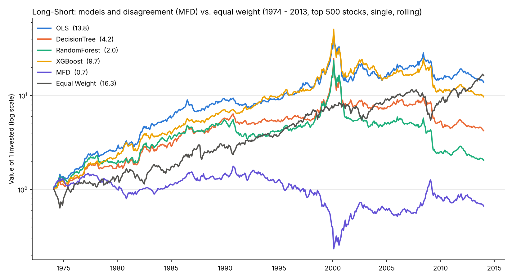 | 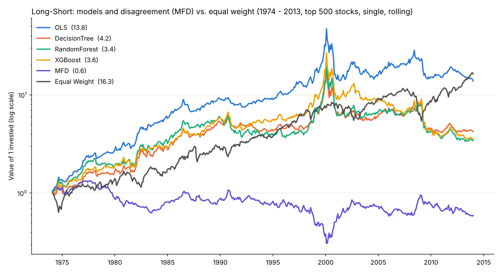 |

**Long Top 10 % gegen Equal Weight**

| 02.11. | 09.11. |
| --- | --- |
| 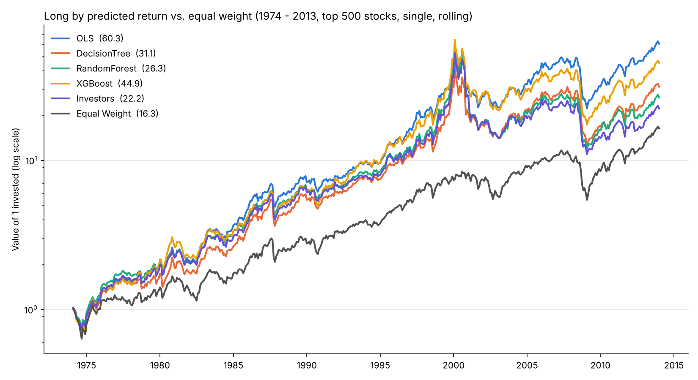 | 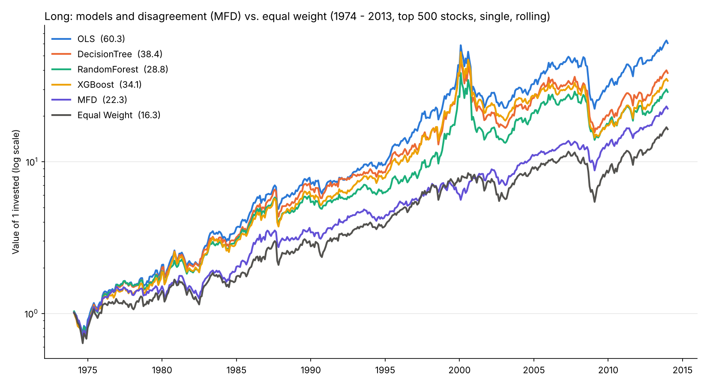 |

**Zeitverlauf, gleitender 10-Jahres-Mittelwert**

| 02.11. | 09.11. |
| --- | --- |
| 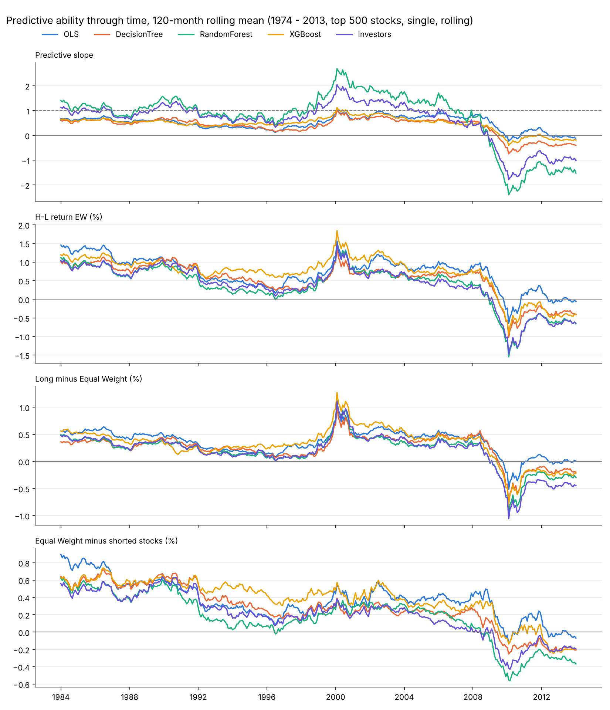 | 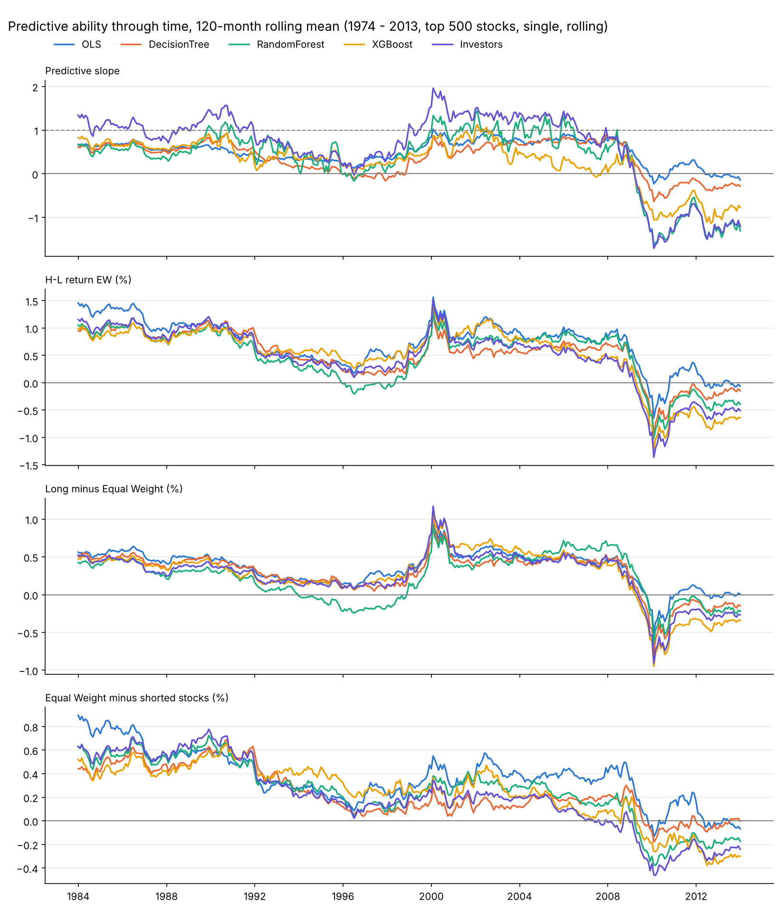 |

**Disagreement: Strategien**

| 02.11. | 09.11. |
| --- | --- |
| 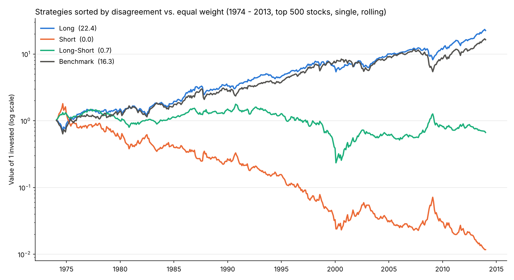 | 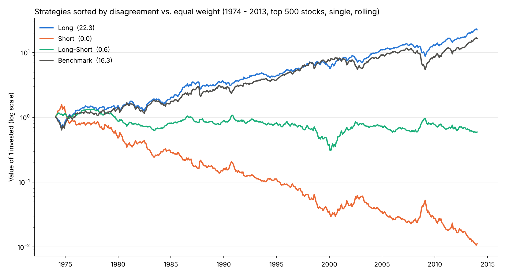 |

## 2. Stacked: 02.11. gegen 09.11.

**Prognosegüte und Dezile (H−L in % pro Monat)**

| | Std Prognose (%) 02.11. | Std Prognose (%) 09.11. | Steigung (t) 02.11. | Steigung (t) 09.11. | IC (t) 02.11. | IC (t) 09.11. | H−L EW (t) 02.11. | H−L EW (t) 09.11. | H−L VW (t) 02.11. | H−L VW (t) 09.11. |
| --- | ---: | ---: | ---: | ---: | ---: | ---: | ---: | ---: | ---: | ---: |
| OLS | 0.46 | 0.47 | 0.35 (2.30) | 0.38 (2.43) | 0.021 (3.30) | 0.024 (3.47) | 0.54 (2.08) | 0.59 (2.24) | 0.55 (1.94) | 0.67 (2.31) |
| DecisionTree | 1.02 | 0.46 | 0.11 (1.66) | 0.43 (1.81) | 0.011 (2.02) | −0.002 (−0.36) | 0.21 (0.97) | −0.00 (−0.03) | 0.04 (0.17) | −0.06 (−0.33) |
| RandomForest | 0.45 | 0.37 | 0.56 (3.24) | 0.63 (1.63) | 0.021 (3.81) | 0.017 (2.79) | 0.80 (3.12) | 0.68 (2.62) | 0.78 (2.95) | 0.70 (2.60) |
| XGBoost | 0.96 | 0.33 | 0.20 (2.73) | 0.30 (0.72) | 0.021 (3.80) | 0.017 (2.68) | 0.58 (2.45) | 0.62 (2.40) | 0.54 (2.31) | 0.50 (1.89) |
| Investors | 0.31 | 0.31 | 0.73 (2.54) | 0.74 (2.40) | 0.018 (2.96) | 0.021 (3.39) | 0.59 (2.33) | 0.64 (2.62) | 0.50 (1.88) | 0.57 (2.26) |
| MFD | – | – | −0.01 (−0.06) | 0.38 (1.24) | – | – | 0.13 (0.42) | −0.00 (−0.00) | 0.01 (0.03) | −0.15 (−0.52) |

**Strategien (Rendite p. a. in %, Sharpe; Long-/Short-Seite in % pro Monat)**

| | Long: Rendite / Sharpe 02.11. | Long: Rendite / Sharpe 09.11. | Short: Rendite 02.11. | Short: Rendite 09.11. | Long-Short: Rendite / Sharpe 02.11. | Long-Short: Rendite / Sharpe 09.11. | Long-Short Max DD (%) 02.11. | Long-Short Max DD (%) 09.11. | Long-Seite (t) 02.11. | Long-Seite (t) 09.11. | Short-Seite (t) 02.11. | Short-Seite (t) 09.11. |
| --- | ---: | ---: | ---: | ---: | ---: | ---: | ---: | ---: | ---: | ---: | ---: | ---: |
| OLS | 9.90 / 0.58 | 10.49 / 0.61 | −6.81 | −6.87 | 4.97 / 0.36 | 5.55 / 0.38 | −75 | −71 | 0.25 (1.63) | 0.30 (1.89) | 0.28 (2.24) | 0.29 (2.29) |
| DecisionTree | 6.92 / 0.43 | 6.23 / 0.42 | −7.75 | −9.51 | 1.98 / 0.21 | −0.56 / 0.01 | −63 | −49 | 0.04 (0.27) | −0.05 (−0.57) | 0.21 (1.85) | 0.07 (0.52) |
| RandomForest | 11.99 / 0.61 | 10.20 / 0.58 | −6.80 | −6.53 | 8.23 / 0.51 | 6.45 / 0.42 | −67 | −49 | 0.46 (2.82) | 0.28 (1.81) | 0.34 (2.17) | 0.39 (2.38) |
| XGBoost | 10.05 / 0.53 | 10.73 / 0.60 | −7.48 | −8.08 | 5.74 / 0.41 | 4.92 / 0.34 | −60 | −64 | 0.32 (1.99) | 0.32 (1.98) | 0.26 (1.76) | 0.22 (1.53) |
| Investors | 9.94 / 0.53 | 9.88 / 0.55 | −7.30 | −6.56 | 5.31 / 0.36 | 6.19 / 0.41 | −69 | −44 | 0.31 (1.86) | 0.27 (1.64) | 0.27 (1.85) | 0.36 (2.56) |
| MFD | 7.52 / 0.57 | 7.49 / 0.56 | −10.11 | −11.23 | −0.71 / 0.07 | −2.26 / 0.01 | −84 | −92 | −0.00 (−0.01) | −0.00 (−0.00) | 0.13 (0.61) | 0.01 (0.07) |

Equal Weight: 02.11. 7.23 % / 0.51, 09.11. 7.23 % / 0.51

**Long-Short gegen Equal Weight**

| 02.11. | 09.11. |
| --- | --- |
| 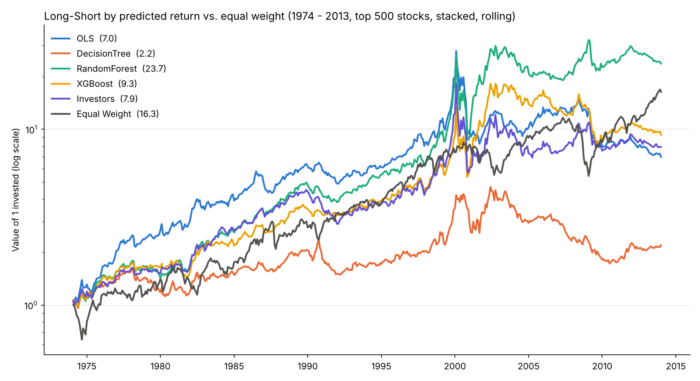 | 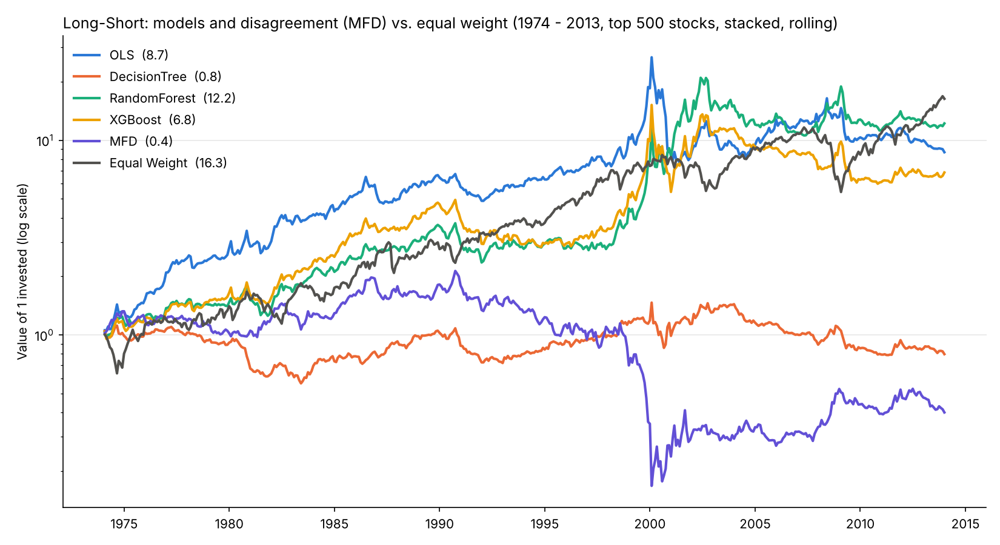 |

**Long Top 10 % gegen Equal Weight**

| 02.11. | 09.11. |
| --- | --- |
| 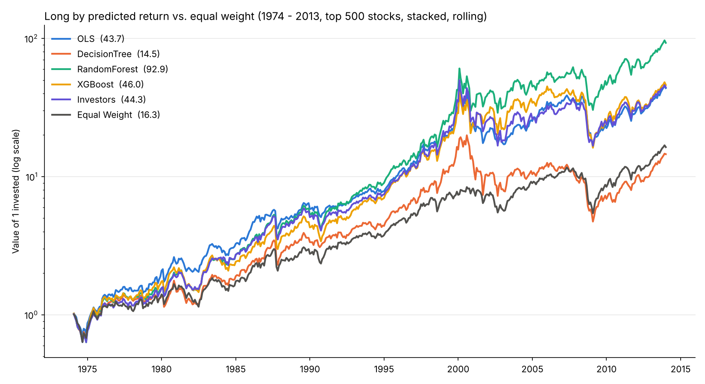 | 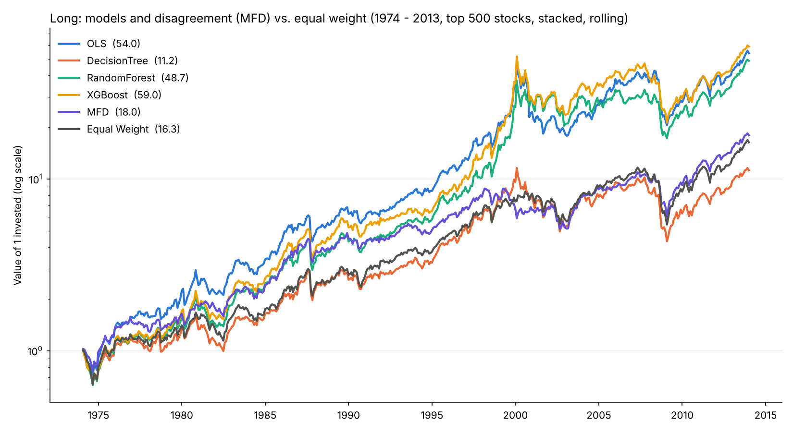 |

**Zeitverlauf, gleitender 10-Jahres-Mittelwert**

| 02.11. | 09.11. |
| --- | --- |
| 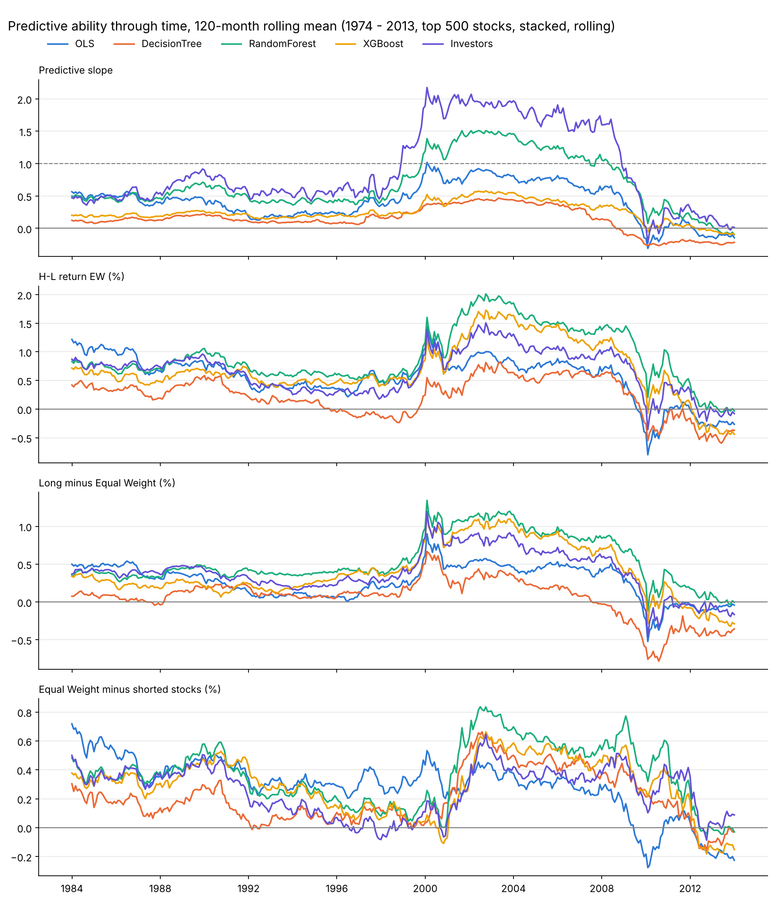 | 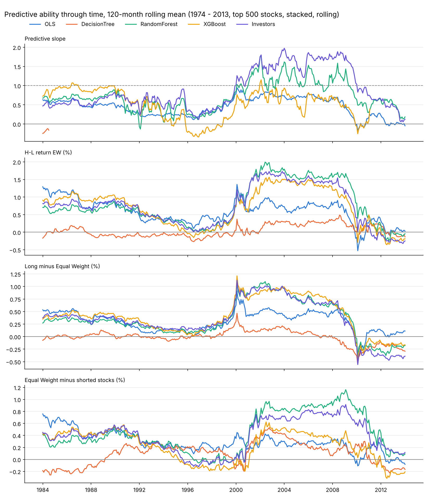 |

**Disagreement: Strategien**

| 02.11. | 09.11. |
| --- | --- |
| 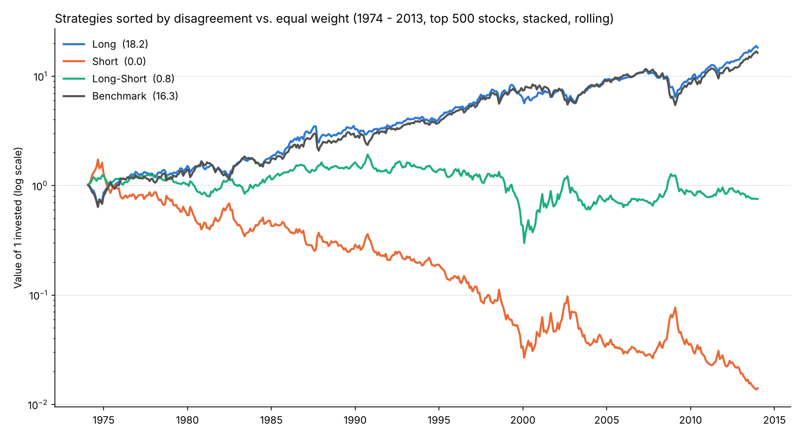 | 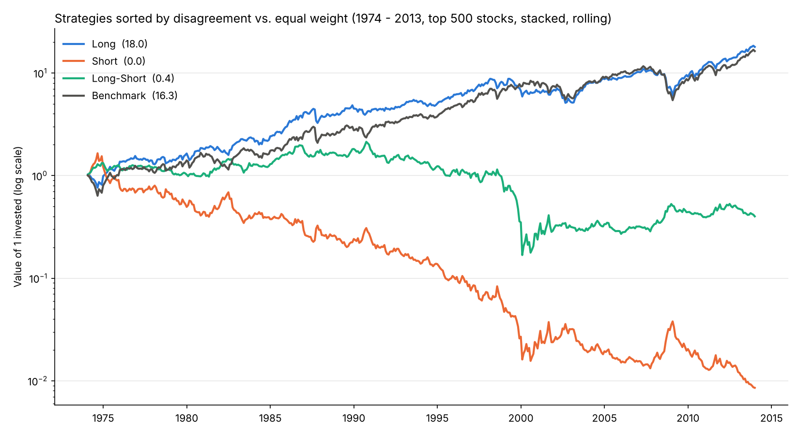 |

## 3. Single gegen Stacked (Stand 09.11.)

**Prognosegüte und Dezile (H−L in % pro Monat)**

| | Std Prognose (%) single | Std Prognose (%) stacked | Steigung (t) single | Steigung (t) stacked | IC (t) single | IC (t) stacked | H−L EW (t) single | H−L EW (t) stacked | H−L VW (t) single | H−L VW (t) stacked |
| --- | ---: | ---: | ---: | ---: | ---: | ---: | ---: | ---: | ---: | ---: |
| OLS | 0.41 | 0.47 | 0.40 (2.26) | 0.38 (2.43) | 0.025 (3.66) | 0.024 (3.47) | 0.70 (2.58) | 0.59 (2.24) | 0.84 (3.04) | 0.67 (2.31) |
| DecisionTree | 0.32 | 0.46 | 0.29 (1.26) | 0.43 (1.81) | 0.015 (2.44) | −0.002 (−0.36) | 0.45 (1.69) | −0.00 (−0.03) | 0.41 (1.44) | −0.06 (−0.33) |
| RandomForest | 0.18 | 0.37 | 0.16 (0.29) | 0.63 (1.63) | 0.016 (2.21) | 0.017 (2.79) | 0.43 (1.45) | 0.68 (2.62) | 0.47 (1.51) | 0.70 (2.60) |
| XGBoost | 0.29 | 0.33 | 0.22 (0.59) | 0.30 (0.72) | 0.017 (2.65) | 0.017 (2.68) | 0.42 (1.56) | 0.62 (2.40) | 0.47 (1.74) | 0.50 (1.89) |
| Investors | 0.16 | 0.31 | 0.48 (1.08) | 0.74 (2.40) | 0.013 (1.89) | 0.021 (3.39) | 0.42 (1.45) | 0.64 (2.62) | 0.39 (1.25) | 0.57 (2.26) |
| MFD | – | – | 0.72 (0.49) | 0.38 (1.24) | – | – | −0.02 (−0.10) | −0.00 (−0.00) | 0.08 (0.33) | −0.15 (−0.52) |

**Strategien (Rendite p. a. in %, Sharpe; Long-/Short-Seite in % pro Monat)**

| | Long: Rendite / Sharpe single | Long: Rendite / Sharpe stacked | Short: Rendite single | Short: Rendite stacked | Long-Short: Rendite / Sharpe single | Long-Short: Rendite / Sharpe stacked | Long-Short Max DD (%) single | Long-Short Max DD (%) stacked | Long-Seite (t) single | Long-Seite (t) stacked | Short-Seite (t) single | Short-Seite (t) stacked |
| --- | ---: | ---: | ---: | ---: | ---: | ---: | ---: | ---: | ---: | ---: | ---: | ---: |
| OLS | 10.79 / 0.62 | 10.49 / 0.61 | −5.96 | −6.87 | 6.79 / 0.44 | 5.55 / 0.38 | −71 | −71 | 0.32 (2.02) | 0.30 (1.89) | 0.37 (2.81) | 0.29 (2.29) |
| DecisionTree | 9.55 / 0.54 | 6.23 / 0.42 | −8.01 | −9.51 | 3.66 / 0.28 | −0.56 / 0.01 | −79 | −49 | 0.25 (1.37) | −0.05 (−0.57) | 0.20 (1.61) | 0.07 (0.52) |
| RandomForest | 8.76 / 0.52 | 10.20 / 0.58 | −7.50 | −6.53 | 3.11 / 0.25 | 6.45 / 0.42 | −84 | −49 | 0.18 (0.92) | 0.28 (1.81) | 0.25 (1.84) | 0.39 (2.38) |
| XGBoost | 9.22 / 0.53 | 10.73 / 0.60 | −8.23 | −8.08 | 3.22 / 0.26 | 4.92 / 0.34 | −87 | −64 | 0.22 (1.21) | 0.32 (1.98) | 0.20 (1.47) | 0.22 (1.53) |
| Investors | 9.25 / 0.53 | 9.88 / 0.55 | −8.05 | −6.56 | 3.05 / 0.25 | 6.19 / 0.41 | −89 | −44 | 0.22 (1.15) | 0.27 (1.64) | 0.20 (1.51) | 0.36 (2.56) |
| MFD | 8.08 / 0.63 | 7.49 / 0.56 | −10.64 | −11.23 | −1.30 / −0.02 | −2.26 / 0.01 | −77 | −92 | 0.03 (0.26) | −0.00 (−0.00) | −0.05 (−0.45) | 0.01 (0.07) |

Equal Weight: single 7.23 % / 0.51, stacked 7.23 % / 0.51

**H−L-Rendite mit 95-%-Intervall**

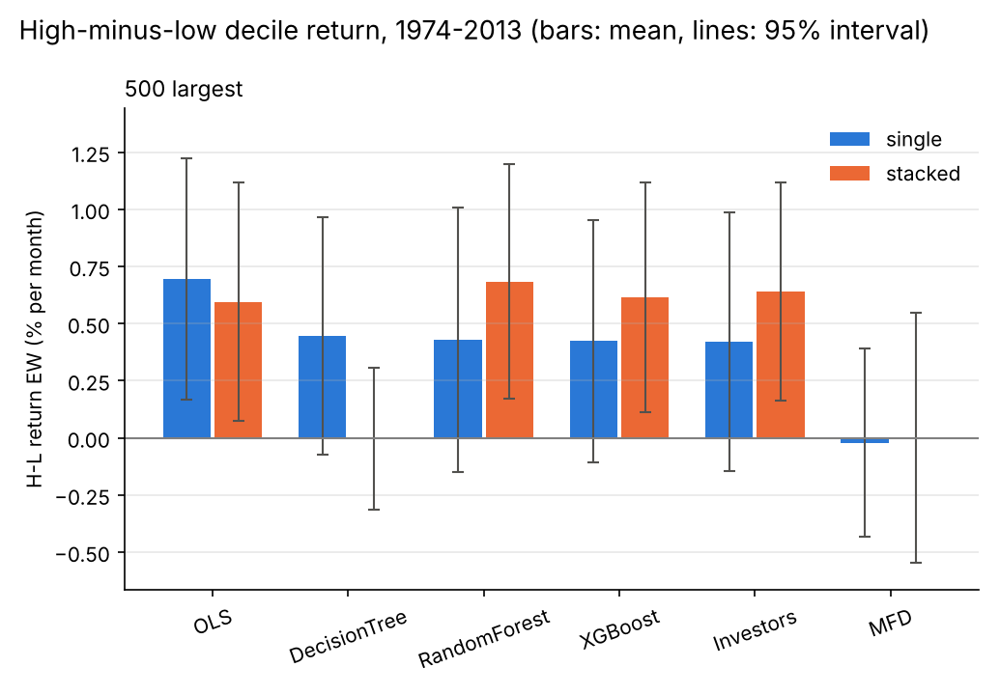

**Long-Short: Wertentwicklung**

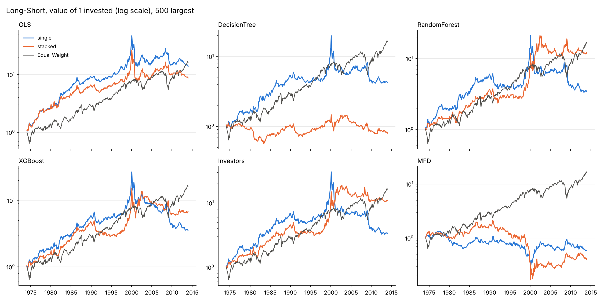

**H−L-Rendite, gleitender 10-Jahres-Mittelwert**

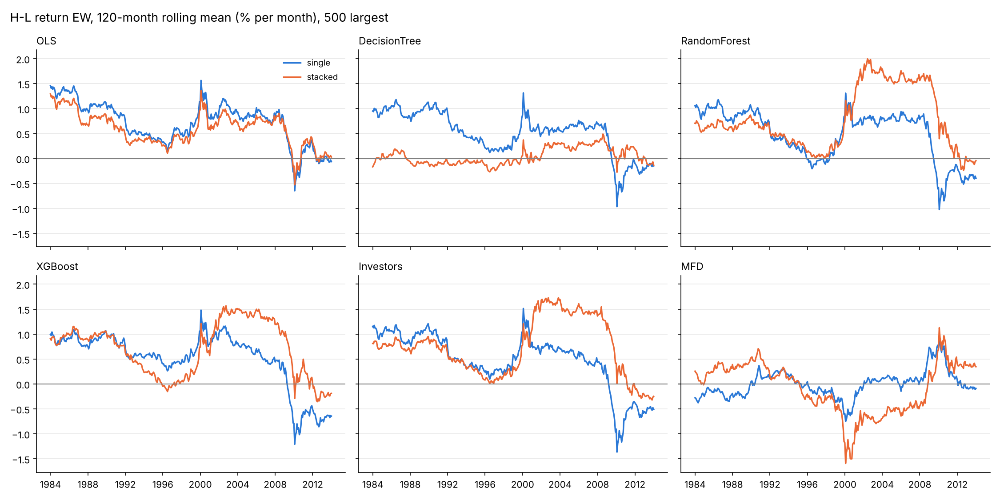

**Long-Short gegen Equal Weight**

| single | stacked |
| --- | --- |
|  |  |

**Long Top 10 % gegen Equal Weight**

| single | stacked |
| --- | --- |
|  |  |

**Zeitverlauf, gleitender 10-Jahres-Mittelwert**

| single | stacked |
| --- | --- |
|  |  |

**Disagreement: Strategien**

| single | stacked |
| --- | --- |
|  |  |
